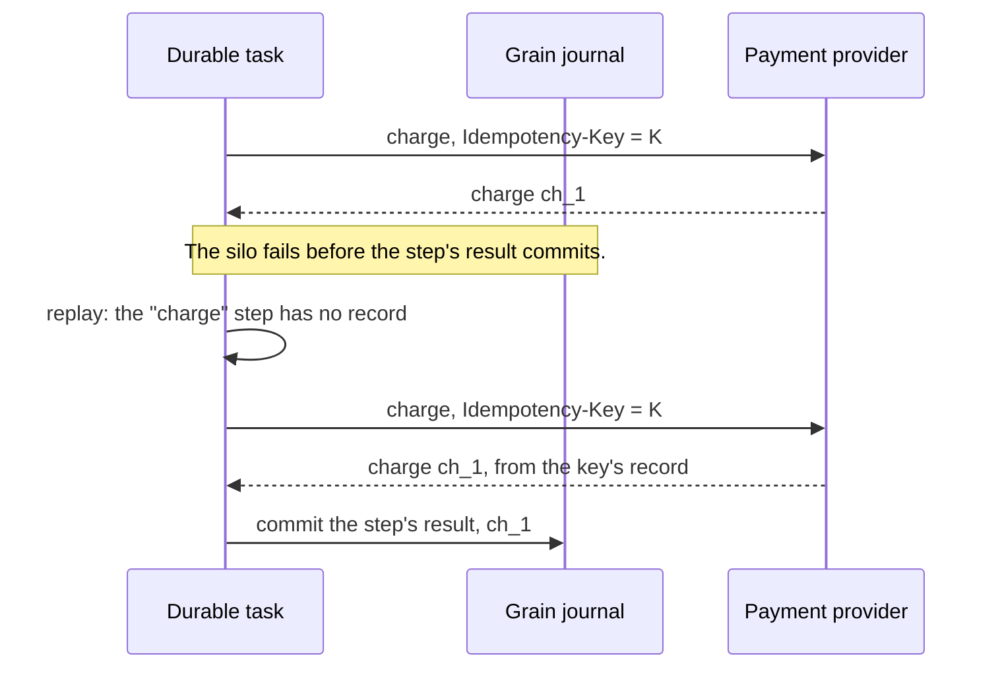

# Idempotency in durable tasks

A durable task survives crashes by running its body again and returning recorded results.
Work which Orleans records commits exactly once. Work at the boundary with another
system can run more than once, and that system deduplicates it with a key which the task
derives from its own identity. This page describes both sides of that boundary. For
replay itself, see [Replay and determinism](durable-tasks.md#replay-and-determinism).

## Effects which commit exactly once

The grain's journal commits task state, the grain's journaled state, and its inbox and
outbox in one write. Each of the following commits atomically with its record, so a
replay finds the record and doesn't apply the effect again:

| Work | Commits with |
| --- | --- |
| A `DurableTask.RunInline` effect's state changes | The effect's record, in the task's next durable write. |
| A local step's final synchronous code | The step's result. |
| The body's synchronous tail | The task's result. |
| A call to another grain, a delay, a signal send, a detached start, `Post` | The execution's record of the operation, in one journal write with the outgoing message. |
| A durable grain's ordinary method which calls `Post` | The grain's state changes, in its next `WriteStateAsync`. |

Messages between grains carry identities derived from the sender, the receiver, the
task, and the subject, so a redelivered or replayed invocation, result, cancellation, or
signal reaches the record which it already created. A task ID deduplicates starts: a
start with the same request under an existing task ID reattaches to that task, and a
start with a different request fails with `DurableTaskConflictException`.

Reads are recorded too. A step's result, an effect's result, a signal's value, and the
logical time `DurableTask.Current.UtcNow` are the same in every replay, so the decisions
which the body makes from them are the same.

## Effects which run at least once

A step which calls another system records its result after the call returns. When the
run ends between the call and the journal write which commits the result, for example
because the silo fails, the next run runs the step again, and the other system receives
the call twice:

The same applies to:

- `DurableTask.Run` delegates and local steps which await external work.
- External awaits in the body's synchronous tail, which run again when the task's result
  didn't commit.
- Ordinary grain calls from a step, which can time out after the callee applied them.
- An external system's reads, which can return another value when a step runs again.

The external system applies such a call once when it recognizes the repetition: by an
idempotency key, by a natural key which an upsert matches, or by a record of the
operations which it already applied.

## Derive idempotency keys from the task

The grain's identity and `DurableTask.Current.Id` name the execution in every replay,
every retry, and every activation, so a key derived from them is the same for every
attempt of one operation and different for every other operation:

:::code source="../snippets/compiled/Grains/DurableTaskIntegrationSnippets.cs" id="durable_tasks_idempotency_key" language="csharp":::

- Include the grain's identity. Task IDs are unique per grain: workflows on two grains can
  both be named `checkout`, and a callee stores each caller's task under that caller's
  scope. See [Task identity and references](durable-tasks-identity.md).
- Add the operation's name when the execution sends more than one request, and keep it
  stable across deployments, like a `WithId` name.
- Compute the key in the body, from values which are the same in every replay, and pass
  it into the step. A key which `Guid.NewGuid` produces outside a recorded effect differs
  in every replay; see [ORLEANS0101](../diagnostics/orleans0101.md).
- Reuse the key for every attempt of the same request, including retries inside the step
  and retries in later steps, and use a new key for a different request, such as a
  different amount.

A task started from outside Orleans gets the same guarantee from its root ID. Derive the
root ID from the business operation, such as `place-order-{orderId}`, so a client which
retries after a timeout reaches the same task instead of starting a second one.

## Deduplicate on the receiving side

How a receiver recognizes a repeated request depends on the receiver:

- **A durable task on another grain** deduplicates by its task ID: the caller's record
  of the call names it, so the callee's task runs once. No key is needed.
- **An ordinary grain method** records the operation IDs which it applied with the state
  which they changed, in the same journal write, and returns the recorded outcome for a
  repeated ID, as the ledger below does. Bound the record, for example by removing
  entries older than the longest retry window, so it doesn't grow without limit.
- **A database** applies a write keyed by the operation ID, such as an upsert with a
  unique constraint on the ID, or records the ID in the transaction which applies the
  change. See [Write to a database](durable-tasks-integrations.md#write-to-a-database).
- **An external API** which accepts an idempotency key, such as a payment provider,
  returns the first request's response for every repeated key within its retention
  window.

The ledger credits each operation once, however often a caller retries it:

:::code source="../snippets/compiled/Grains/DurableTaskIntegrationSnippets.cs" id="durable_tasks_deduplicating_receiver" language="csharp":::

An API without idempotency keys needs a lookup before the change: a step which queries
for the operation's result by a reference which the task supplied, such as an order
number in the request, and skips the change when it finds one.

## What each guarantee covers

| Guarantee | Scope |
| --- | --- |
| Exactly once | Journaled state changes in effects, steps' final code, and tails; operation records; grain-to-grain messages; task starts under one ID while the grain retains the task. |
| Same value in every replay | Recorded results, signal values, logical time, cancellation state and reason. |
| At least once | External calls in steps and tails; ordinary grain calls; logs outside a replay-safe logger. |
| Deduplicated by the receiver | Whatever the receiver keys: durable tasks by task ID, external systems by the key which the task supplies. |

A task ID deduplicates starts only while the grain retains the task. After the task's
tree is deleted, a start with the same ID runs the request again; size
`ResultRetentionPeriod` to cover the period in which callers retry. See
[Retention and deletion](durable-tasks-operations.md#retention-and-deletion).
