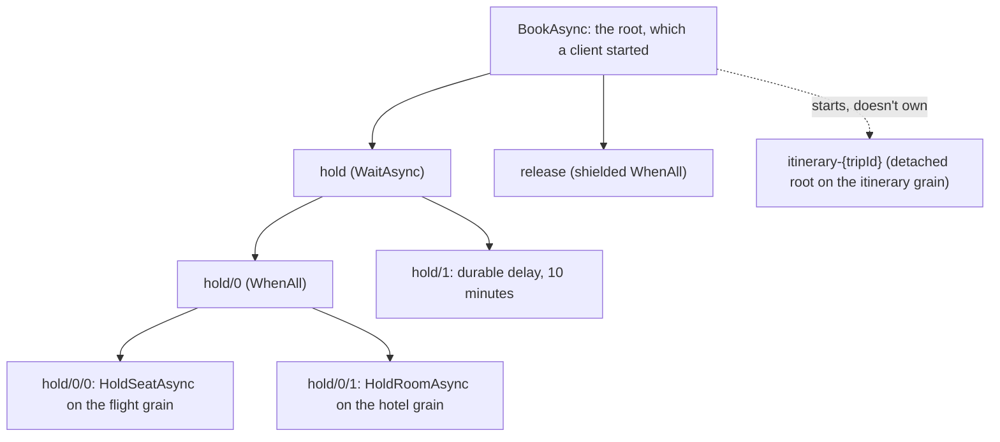
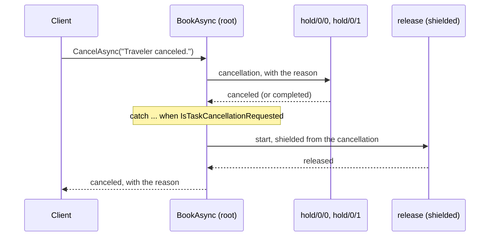

# Structured concurrency in durable tasks

Durable tasks follow *structured concurrency*: every task which a workflow starts has an
owner, the owner outlives the work it owns, and the owner's outcome accounts for that
work. A workflow's concurrent work therefore forms a tree whose shape matches the code's
block structure, and the runtime persists that tree in the grain's journal. This page
describes the tree, the lifetimes and cancellation which flow through it, and the
operations which shape it. [Durable tasks](durable-tasks.md) describes the programming
model, and [Task identity and references](durable-tasks-identity.md) describes the IDs
which name each node.

## Tasks form a tree

A task which a client, an ordinary grain method, or another grain's detached start
invokes is a *root*. Each operation which its body runs becomes a child beneath it, and
children of children nest further:

The following trip booking produces this tree. It holds a seat and a room concurrently,
bounds the holds with a timeout, releases both when the trip is canceled or times out,
and starts the itinerary as an independent task:

:::code source="../snippets/compiled/Grains/DurableTaskConcurrencySnippets.cs" id="durable_tasks_trip_grain" language="csharp":::

Each kind of node has an owner and a lifetime:

| Started with | Owner | Lifetime |
| --- | --- | --- |
| `await call`, `call.ScheduleAsync()`, `call.Post()`, a combinator | The running execution | Ends with its own outcome, and no later than the deletion of its root's tree. |
| `.Shielded()` | The running execution | As attached. Durable cancellation of the owner skips it. |
| `.Detached()` | None: a new root on its target | Its own. Its starter can complete, fail, be canceled, or be deleted while it runs. |

A root's grain deletes the whole tree once the root is terminal and its result is
delivered or retained long enough; see
[Lifecycle and retention](durable-tasks.md#lifecycle-and-retention). Deleting the tree
cancels any child which is still running, so no attached child outlives its root.

## Owners wait for the work they own

A combinator returns only once its inputs have settled, according to its contract:

- `DurableTask.WhenAll` waits for every input, including inputs which a cancellation
  reaches, and then reports the first failure in input order.
- `DurableTask.WhenAllCompleted` waits for every input and reports each outcome without
  throwing.
- `DurableTask.Race` takes the first input to complete, requests cancellation of the
  others with the reason `Another task won the race.`, and waits until each is terminal.
- `WaitAsync(TimeSpan)` and `WaitUntilAsync(DateTimeOffset)` race the work with a
  durable delay. When the delay wins, they request cancellation of the work and wait for
  its outcome, then throw <xref:System.TimeoutException> when it ended canceled.

After `Race` or a timeout returns, no input is still running, so the code which follows
observes a settled world: compensation sees every outcome, and nothing writes to the
grain afterward on behalf of a loser.

`DurableTask.WhenAny` and `ScheduleAll` are the exceptions: they return while other
inputs run. Those inputs remain children of the execution, and the execution observes
them later through their handles, or the runtime cancels them when it deletes the tree.
Prefer `Race` when the other inputs' results aren't needed.

## Cancellation flows down the tree

A durable cancellation request commits on the task and propagates to its descendants:

- Children which haven't started, and children which the canceled task starts later,
  end canceled without running.
- Running children observe the request through
  <xref:Orleans.DurableTasks.DurableTaskContext.CancellationToken?displayProperty=nameWithType>,
  and calls to other grains carry it to their callees, which cancel their own trees.
- The body decides the task's outcome. Awaiting a canceled child throws
  `OperationCanceledException`, and the task ends canceled when the exception escapes
  the body.
- The first request's reason is durable, and
  <xref:Orleans.DurableTasks.DurableTaskContext.TaskCancellationReason?displayProperty=nameWithType>
  returns it in the task, its descendants, and every replay.

A handler which compensates for cancellation filters by
`DurableTask.Current.IsTaskCancellationRequested`, so it runs for task cancellation and not
for the cancellation of an attempt; see
[Task cancellation and attempt cancellation](#task-cancellation-and-attempt-cancellation)
and [ORLEANS0112](../diagnostics/orleans0112.md).

### Shield the work which must finish

`.Shielded()` starts a child which durable cancellation of its owner skips. The owner
still awaits it, its failure still propagates, and deleting the tree or aborting the
task still stops it. Compensation is the typical shielded work: in the trip booking, the
`release` combinator shields both of its inputs, so the holds are released after the trip
was canceled. A shielded combinator shields each input which it starts.

Shielding means the same for every awaited durable operation, whether it runs as a child or
as part of the owner: a shielded signal wait, `TryWaitAsync`, delay, `GetDurableTask`
subscription, `Race`, `WhenAny`, or `WaitAsync` completes after the owner's cancellation,
and only the cancellation of the attempt ends it. A workflow which waits for a payment
shields the wait, so a payment which arrives after a cancellation still reaches it:

:::code source="../snippets/compiled/Grains/DurableTaskConcurrencySnippets.cs" id="durable_tasks_shielded_wait" language="csharp":::

## Task cancellation and attempt cancellation

Durable tasks distinguish two kinds of cancellation:

| | Task cancellation | Attempt cancellation |
| --- | --- | --- |
| What it stops | The task: its outcome becomes canceled once the cancellation escapes its body | The current in-memory run of the body, its *attempt* |
| Caused by | `CancelAsync`, an owner's cancellation, `Race`, or a timeout | The grain activation stopping, an [abort](durable-tasks-operations.md), or the deletion of the task's tree |
| Recorded | Yes: the request, its reason, and the cleanup which the body runs | No: the attempt's later durable operations and journaled state changes throw |
| What follows | The body runs its compensation, which commits | A stopping activation's task replays in a new attempt; an aborted or deleted task already has its outcome |
| `IsTaskCancellationRequested` | `true` | Unchanged |
| `CancellationToken` | Canceled | Canceled |
| `AttemptCancellationToken` | Unchanged | Canceled |
| Exception which durable operations throw | `OperationCanceledException` from the canceled work | <xref:Orleans.DurableTasks.DurableTaskAttemptCanceledException>, with its `Reason` |

Once an attempt is canceled, every durable operation of its code throws
`DurableTaskAttemptCanceledException`: `DurableTask.Once`, starting or awaiting children,
including shielded and detached ones, `Post`, `ScheduleAsync`, signal sends and waits,
delays, subscriptions, and combinators. Changes to the grain's journaled state throw it
too, before they change memory: durable values and collections,
`IDurableTaskCompletionSource<T>`, `IPersistentState<T>`, and journal writes. The
exception derives from `OperationCanceledException`, so the attempt's code unwinds like
any canceled .NET code, and nothing which it does on the way out commits. A stopping
activation's task replays from its records in the next activation, which runs any
compensation again.

The canonical pattern passes `CancellationToken` to the calls which the body makes, runs
durable cleanup in a `catch` filtered on `IsTaskCancellationRequested`, passes
`AttemptCancellationToken` to the calls which that cleanup makes, and releases in-process
resources, such as semaphores and disposables, in `finally` blocks and `using`
statements, which run for both kinds of cancellation:

:::code source="../snippets/compiled/Grains/DurableTaskConcurrencySnippets.cs" id="durable_tasks_attempt_cancellation" language="csharp":::

Journaled state changes pass through the state's API, which the attempt's cancellation
stops. A change made in place to a mutable object which a durable value holds bypasses
that API, so store immutable values, such as records, and assign a new value to change
it. [ORLEANS0117](../diagnostics/orleans0117.md) reports cleanup which passes the
already-canceled `CancellationToken`.

## Detach the work which outlives its starter

`.Detached()` starts a grain call as a new root on its target. The starter records that it
started the task, so a replay doesn't start it again, and it can await the task's result.
The detached task's lifetime is its own:

- The starter can complete before the detached task does.
- Cancellation, abort, and deletion of the starter's tree don't reach it; cancel or abort
  it through its own ID.
- Its grain retains its result for `ResultRetentionPeriod`, and other parties address it
  by its root ID.

Use a detached task for follow-up work, such as the trip's itinerary, and for work which
other parties track by name. Name it with `WithId` from a business identity, so retries
and other parties reach the same task.

## Compared with Task and fire-and-forget

| | `Task` in a grain | Fire-and-forget `Task` | Attached durable task | Detached durable task |
| --- | --- | --- | --- | --- |
| Owner | The awaiting method, while the activation lives | None | The running execution | None: it is a root |
| Survives deactivation and silo failure | No | No | Yes: it resumes from its records | Yes |
| Cancellation | A `CancellationToken` which the code passes | None | Durable, flows to descendants, carries a reason; a stopped attempt replays | Its own |
| Failures | Observed by the awaiter | Lost, or reported as unobserved | Recorded and rethrown to the owner in every replay | Recorded, and returned to subscribers |
| Identity | None | None | A child ID in the owner's tree | A root ID on its grain |

A durable task is never fire-and-forget: an attached child has an owner which observes
it or whose deletion cancels it, and a detached task is a root which its grain retains
and others can address. Each start commits in the starter's journal before the work
runs, so a crash between the decision to start work and its start loses neither.

## Choose an operation

| To | Use |
| --- | --- |
| Run work and continue with its result | `await call.WithId(name)` |
| Run work concurrently and continue once each input settles | `DurableTask.WhenAll(...).WithId(name)` or `WhenAllCompleted` |
| Take the first result and stop the rest | `DurableTask.Race(...).WithId(name)` |
| Bound work with a deadline | `call.WaitAsync(timeout)` or `WaitUntilAsync(dueTime)` |
| Start work now and observe it later in the same workflow | `ScheduleAsync`, `Post`, or `ScheduleAll` |
| Finish compensation after cancellation | `.Shielded()` |
| Start work which outlives the workflow | `.Detached().WithId(name)` |

[Durable task recipes](durable-tasks-recipes.md) shows each of these in a complete
workflow.
