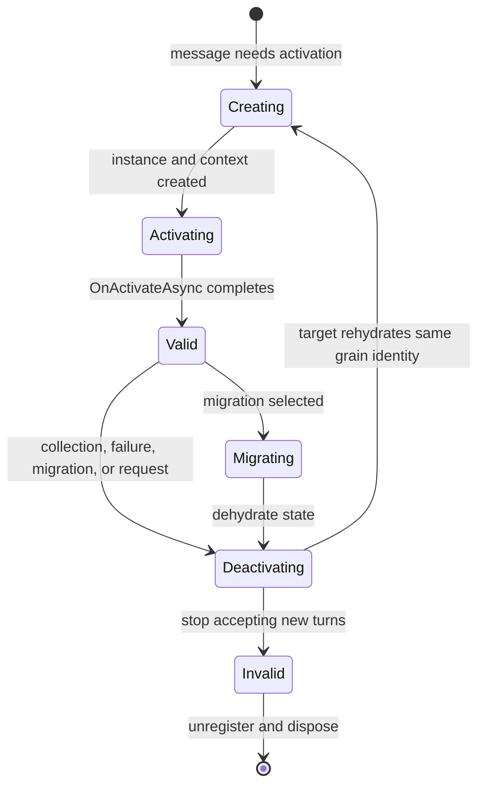
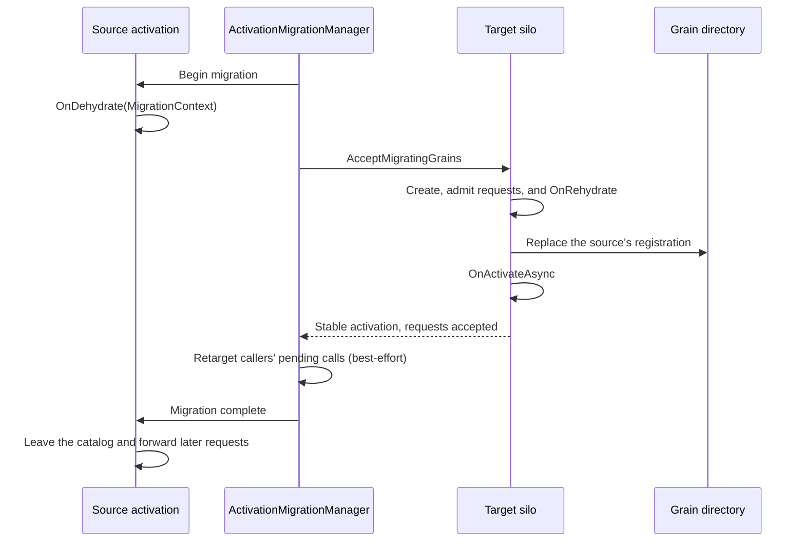

# Activation lifecycle and migration

A grain identity can outlive every process in the cluster. An activation is the temporary, in-memory realization of that identity on one silo. `ActivationData` is the runtime state machine which owns the grain instance, request queues, scheduler, directory registration, lifecycle, and deactivation reason.

## Creation and activation

When routing cannot find a valid activation, the target silo's `Catalog.GetOrCreateActivation` creates or obtains an `ActivationData`. Creation has several distinct steps:

1. Resolve the grain type, implementation, shared type metadata, storage facet, and activation configurators.
1. Create the grain context, per-activation `WorkItemGroup`, and grain instance.
1. Register the local activation and, when required by the grain directory policy, register its address.
1. Notify `IActivationLifecycleObserver.OnCreateActivation`.
1. Run grain lifecycle start and <xref:Orleans.IGrainBase.OnActivateAsync*> on the activation scheduler.
1. Mark the activation valid and release queued requests for turn scheduling.

Activation is asynchronous. Requests which arrive while it is in progress remain queued. If activation fails, the runtime rejects or reroutes requests and tears down the incomplete activation rather than exposing a partially initialized instance.

Source: [`Catalog`](https://github.com/dotnet/orleans/blob/main/src/Orleans.Runtime/Catalog/Catalog.cs) and [`ActivationData`](https://github.com/dotnet/orleans/blob/main/src/Orleans.Runtime/Catalog/ActivationData.cs).

## Working set and collection

`ActivationWorkingSet` tracks activations which recently performed work. `ActivationCollector` schedules collection tickets in time buckets and scans stale buckets. The important invariant is that an activation selected for collection must still be idle when collection begins. New work can cancel or reschedule its ticket.

Collection is not persistence. It releases an idle activation. Durable grain state survives only through a configured storage provider and grain code which writes that state. Operational collection settings belong in [activation collection configuration](../host/configuration-guide/activation-collection.md).

The implementation and its edge cases are covered by [`ActivationCollector`](https://github.com/dotnet/orleans/blob/main/src/Orleans.Runtime/Catalog/ActivationCollector.cs) and [`ActivationCollectorTests`](https://github.com/dotnet/orleans/blob/main/test/Orleans.Runtime.Internal.Tests/ActivationsLifeCycleTests/ActivationCollectorTests.cs).

## Deactivation

Deactivation first prevents new application turns from starting, then drains or rejects pending work according to the reason. It runs <xref:Orleans.IGrainBase.OnDeactivateAsync*> and lifecycle stop on the activation scheduler. Finally, the runtime unregisters the directory address, removes the local activation, disposes resources, and publishes deactivation events.

A deactivation reason distinguishes normal collection, application-requested deactivation, silo shutdown, failure, and migration. Grain code should treat deactivation as best-effort cleanup. Process termination can bypass it, so correctness must not depend on `OnDeactivateAsync` always running.

## Activation migration

Migration moves an activation while preserving its grain identity. `ActivationMigrationManager` starts migration by creating a `MigrationContext`, asking registered migration participants to dehydrate state, and deactivating with the `Migrating` reason. The target creates the activation, rehydrates participants, runs activation, and waits until the activation reaches a stable state.

The migration package also carries the requests which are queued for the source activation. The catalog delivers them through the activation's ordinary request admission, with per-request overload checks and FIFO queueing. A new activation receives them before rehydration and directory registration. An existing activation receives them before the catalog disposes the unused migration context. Requests already queued at the destination retain their place. Once the target accepts the migration, the source retargets their callers' pending calls to the target on a best-effort basis, so the calls survive the source silo's departure. The package serializes its request list using the same message framing as silo connections, preserving received requests' serialized bodies. The target decodes each body when it invokes the request and drops requests whose remaining lifetime has elapsed before admission. A source sends queued requests only to silos whose manifest lists version 1 or later of `IActivationMigrationManagerSystemTarget`. The source activation remains in the catalog until the migration completes, so requests which reach the source silo for the grain reach it. A caller which cancels its call before the call is retargeted signals the cancellation to the target as well, once the call is retargeted. When the migration fails or its outcome is unknown, the source rejects the requests which it carried, so their callers can retry them. It forwards the requests which arrived meanwhile.

The serializer claims a migration's context and request bodies under the migration's completion lock and releases them when serialization finishes, including on failure. Completion releases a payload which serialization has not claimed; a later writer then discards the completed migration. Once serialization owns the payload, completion proceeds independently while the serializer keeps its buffers valid. The source retains routing headers for failure reporting. Transport retries reuse the serialized RPC body. On the destination, embedded messages share the receive buffer and retain their own body slices until invocation. Migration context keeps its existing wire format.

Requests enter the migration in one handoff after dehydration, and the package retains that fixed request set. Later arrivals remain in the source activation's queue. Once the source leaves the catalog, it completes the original handoff's disposition before handling its remaining queue through ordinary forwarding or rejection.

Each embedded message preserves the request's remaining time-to-live at serialization. Local expiry tracking resumes when the destination decodes its headers, and expired requests are dropped individually. Time spent in transport, including retries, makes expiry accounting best effort. The caller's response timeout continues independently; a delayed migration can deliver a request after its caller has timed out.

The catalog transfers requests through ordinary activation admission and releases requests and contexts which remain unadmitted when validation or creation fails. Creating an activation commits it to scheduling rehydration and calling `Activate`, including when subsequent admission work fails. During rehydration, the new activation reads its previous registration and adds cache updates to its queued messages. Responses carry these updates; one-way callers' routes converge on their next send through normal forwarding and cache repair. An existing activation receives requests through ordinary admission and uses normal cache repair. Each activation owns every request submitted to it and handles activation failure through its normal rejection and teardown paths. Canceling an unsent source migration releases its dehydration context while retaining its requests for ordinary forwarding.

Before batching, the source retains local request bodies as owned serialized bytes and bounds each request's current headers, including cache updates from earlier migrations. Arbitrary request-context values use the configured maximum header size as a conservative bound, so sizing leaves those values untouched. Requests which do not fit with their migration state are forwarded individually using the retained body bytes.

Migration state is not the same as persisted grain state. <xref:Orleans.Runtime.IGrainMigrationParticipant> is intended for runtime or application components whose in-memory state must accompany a live move. Participants write versionable data to the migration context and must tolerate rehydration on another silo.

Source: [`ActivationMigrationManager`](https://github.com/dotnet/orleans/blob/main/src/Orleans.Runtime/Catalog/ActivationMigrationManager.cs) and [`ActivationDataMigrationTests`](https://github.com/dotnet/orleans/blob/main/test/Orleans.Runtime.Internal.Tests/ActivationsLifeCycleTests/ActivationDataMigrationTests.cs).

## What initiates movement

Migration is a mechanism, not a policy. Policies choose candidates:

- explicit migration APIs can request a move;
- the experimental activation rebalancer moves random activations to reduce resource imbalance;
- the experimental activation repartitioner observes communication edges and moves activations to improve locality.

Both cluster-wide policies are opt-in. See [placement and activation balancing](load-balancing.md) for their protocols and experimental warning identifiers.

## Extension invariants

Components participating in activation creation or migration should preserve these rules:

- never expose a grain instance before activation completes;
- execute grain lifecycle callbacks in the activation scheduling context;
- do not accept new turns after deactivation begins;
- unregister stale addresses even when cleanup fails;
- keep migration payloads backward-compatible across rolling upgrades; and
- assume source or target failure can interrupt migration.
