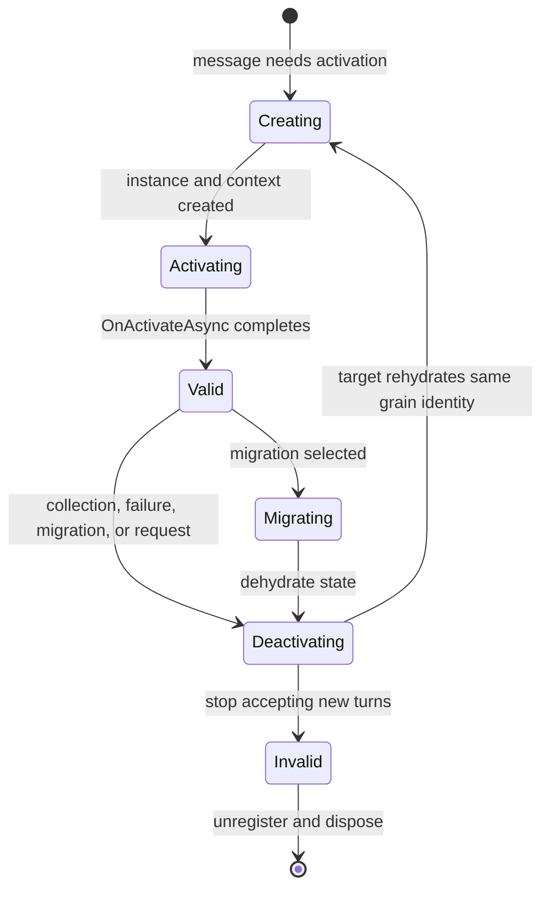
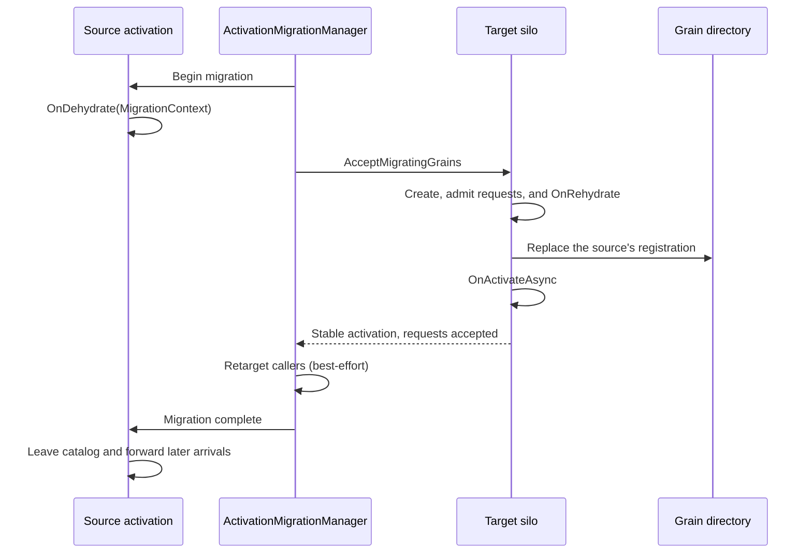

# Activation lifecycle and migration

A grain identity can outlive every process in the cluster. An activation is the temporary, in-memory realization of that identity on one silo. `ActivationData` is the runtime state machine which owns the grain instance, request queues, scheduler, directory registration, lifecycle, and deactivation reason.

## Creation and activation

When routing cannot find a valid activation, the target silo's `Catalog.GetOrCreateActivation` creates or obtains an `ActivationData`. Creation has several distinct steps:

1. Resolve the grain type, implementation, shared type metadata, storage facet, and activation configurators.
1. Create the grain context, per-activation `WorkItemGroup`, and grain instance.
1. Register the local activation and, when required by the grain directory policy, register its address.
1. Notify `IActivationLifecycleObserver.OnCreateActivation`.
1. Run grain lifecycle start and <xref:Orleans.IGrainBase.OnActivateAsync*> on the activation scheduler.
1. Mark the activation valid and release queued requests for turn scheduling.

Activation is asynchronous. Requests which arrive while it is in progress remain queued. If activation fails, the runtime rejects or reroutes requests and tears down the incomplete activation rather than exposing a partially initialized instance.

Source: [`Catalog`](https://github.com/dotnet/orleans/blob/main/src/Orleans.Runtime/Catalog/Catalog.cs) and [`ActivationData`](https://github.com/dotnet/orleans/blob/main/src/Orleans.Runtime/Catalog/ActivationData.cs).

## Working set and collection

`ActivationWorkingSet` tracks activations which recently performed work. `ActivationCollector` schedules collection tickets in time buckets and scans stale buckets. The important invariant is that an activation selected for collection must still be idle when collection begins. New work can cancel or reschedule its ticket.

Collection is not persistence. It releases an idle activation. Durable grain state survives only through a configured storage provider and grain code which writes that state. Operational collection settings belong in [activation collection configuration](../host/configuration-guide/activation-collection.md).

The implementation and its edge cases are covered by [`ActivationCollector`](https://github.com/dotnet/orleans/blob/main/src/Orleans.Runtime/Catalog/ActivationCollector.cs) and [`ActivationCollectorTests`](https://github.com/dotnet/orleans/blob/main/test/Orleans.Runtime.Internal.Tests/ActivationsLifeCycleTests/ActivationCollectorTests.cs).

## Deactivation

Deactivation first prevents new application turns from starting, then drains or rejects pending work according to the reason. It runs <xref:Orleans.IGrainBase.OnDeactivateAsync*> and lifecycle stop on the activation scheduler. Finally, the runtime unregisters the directory address, removes the local activation, disposes resources, and publishes deactivation events.

A deactivation reason distinguishes normal collection, application-requested deactivation, silo shutdown, failure, and migration. Grain code should treat deactivation as best-effort cleanup. Process termination can bypass it, so correctness must not depend on `OnDeactivateAsync` always running.

## Activation migration

Migration moves an activation while preserving its grain identity. `ActivationMigrationManager` starts migration by creating a `MigrationContext`, asking registered migration participants to dehydrate state, and deactivating with the `Migrating` reason. The target creates the activation, rehydrates participants, runs activation, and waits until the activation reaches a stable state.

Migratable activations retiring with the `ShuttingDown` reason also migrate when they completed activation and still have queued requests after their running calls and lifecycle callbacks finish. After dehydration, the source transfers one fixed request set to its migration. Later arrivals remain in the source activation's queue. The source stays in the catalog through migration and disposal, then synchronously leaves the catalog, completes the original handoff's disposition, and forwards or rejects its remaining queue before signaling deactivation completion. This ordering lets shutdown await deactivations already underway and prevents forwarded requests from returning to the retiring activation. Stuck activations retain their early-abandonment path.

The destination catalog admits carried requests through ordinary `IGrainContext.ReceiveMessage`, preserving FIFO order, overload checks, cancellation, and failure handling. A new activation receives them before rehydration and directory registration; creation commits the catalog to scheduling rehydration and `Activate`, including when admission throws. An existing activation receives the requests and the unused context is disposed. Each context owns every submitted request, including when submission throws. During rehydration, a new activation reads its previous registration and adds cache updates to queued requests. Responses carry these updates; one-way callers converge through normal forwarding and cache repair on their next send.

The source prepares ordinary connection-framed requests once into managed byte arrays. These frames bound the package size together with its context and list framing, then supply the package's single serialization. Each frame carries the remaining time-to-live sampled during preparation. Destination decoding produces ordinary eager message bodies, and admission drops expired requests individually. When a group exceeds the message budget, or cancellation prevents sending it, the source restores prepared bodies and request-context values from those frames for ordinary forwarding. Preparation or restoration failure rejects affected requests. The migration context retains its pooled storage and ordinary consuming serialization.

`AcceptMigratingGrains` retains its original RPC identity and request-free package fields. The source carries requests only when the destination's manifest advertises version 1 or later of `IActivationMigrationManagerSystemTarget`; older destinations receive request-free packages with ordinary forwarding. Each migration consumes one forward, and requests which have exhausted the forward limit stay with the source for rejection.

Acceptance transfers carried requests to the destination. The source then retargets pending callbacks on calling silos, preserving their original deadlines and increasing forward counts monotonically. Registered calls which were already canceled signal cancellation to their new target. Retargeting remains best-effort, and a caller which still tracks the retiring silo can fail when that silo departs. Failed or unknown acceptance rejects carried requests without replay; a request can still execute after a lost acknowledgement. Unsent work follows ordinary forwarding.

<xref:Orleans.Configuration.SiloMessagingOptions.SystemResponseTimeout> bounds the acceptance invocation, including outgoing filters, using the messaging clock. <xref:Orleans.Configuration.GrainCollectionOptions.DeactivationTimeout> cancels a queued migration or completes an accepted migration's wait for retargeting. A sent migration waits for its acceptance outcome. A writer already in progress completes using the fixed request frames; completed migrations reject delayed writers. Operators should include both acceptance and retargeting in their [shutdown budget](../host/configuration-guide/shutting-down-orleans.md#queued-requests-during-shutdown).

Migration state is not the same as persisted grain state. <xref:Orleans.Runtime.IGrainMigrationParticipant> is intended for runtime or application components whose in-memory state must accompany a live move. Participants write versionable data to the migration context and must tolerate rehydration on another silo.

Source: [`ActivationMigrationManager`](https://github.com/dotnet/orleans/blob/main/src/Orleans.Runtime/Catalog/ActivationMigrationManager.cs) and [`ActivationDataMigrationTests`](https://github.com/dotnet/orleans/blob/main/test/Orleans.Runtime.Internal.Tests/ActivationsLifeCycleTests/ActivationDataMigrationTests.cs).

## What initiates movement

Migration is a mechanism, not a policy. Policies choose candidates:

- explicit migration APIs can request a move;
- the experimental activation rebalancer moves random activations to reduce resource imbalance;
- the experimental activation repartitioner observes communication edges and moves activations to improve locality.

Both cluster-wide policies are opt-in. See [placement and activation balancing](load-balancing.md) for their protocols and experimental warning identifiers.

## Extension invariants

Components participating in activation creation or migration should preserve these rules:

- never expose a grain instance before activation completes;
- execute grain lifecycle callbacks in the activation scheduling context;
- do not accept new turns after deactivation begins;
- unregister stale addresses even when cleanup fails;
- keep migration payloads backward-compatible across rolling upgrades; and
- assume source or target failure can interrupt migration.
