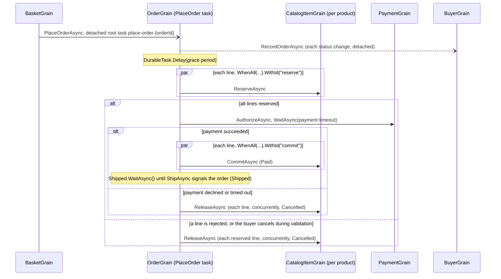

# Durable order processing playground

The [order processing playground](../OrderProcessing/README.md) rebuilt with Orleans Durable Tasks. It has the same
domain, catalog, HTTP endpoints, browser UI, and observable outcomes; each order's workflow is one durable task on its
order grain instead of a set of message handlers.

```bash
dotnet run --project playground/DurableOrderProcessing
```

Open the printed URL to browse the catalog, fill a basket, check out, and watch orders progress.
The Orleans dashboard is at `/dashboard`.

## Flow



`OrderGrain.PlaceOrderAsync` reads top to bottom as the flow above. Every arrow is a durable call: a grain method which
returns `DurableTask` or `DurableTask<T>`. The workflow awaits each call under a stable child ID from `WithId`, and a
named `DurableTask.WhenAll` gives its inputs IDs beneath its own, such as `reserve/0` and `reserve/1`. The order's state
is its history, an `IDurableLog<OrderDetails>` named `history` whose entries are full snapshots of the order and its
stock lines. The workflow keeps the current snapshot in a local variable and computes each transition as a pure function
of the request, recorded results, and `DurableTask.Current.UtcNow`, such as `order = order.MarkPaid()`. It then appends
the snapshot in a recorded effect, `DurableTask.Once(() => _history.Append(order))`: the effect appends once per
position within the workflow, and the entry and the effect's record commit together with the workflow's next journal
write, without a write of their own. A replay returns the recorded sequence without appending again, so the history
holds each version once, in order. Each projection update follows its append and addresses the snapshot's buyer. A paid
order waits for its `Shipped` signal, then appends the `Shipped` snapshot and completes. `GetAsync`, `CancelAsync`, and
`ShipAsync` read the latest snapshot.

When the buyer cancels, the next durable operation before payment authorization throws `OperationCanceledException`, so
a cancellation which arrives as validation completes is observed too. The workflow catches it, then runs its
compensation inline: a shielded `WhenAll`, `.Shielded()`, releases each line concurrently, and the workflow then
appends the `Cancelled` snapshot, which carries `DurableTask.Current.CancellationReason`. Rejected stock, declined
payments, and payment timeouts run the same compensation; a rejected line keeps its `Rejected` status in the cancelled
snapshot.

## Observe an order

`IOrderGrain.WatchAsync` streams the order's committed history from its submission: it reads the log with
`ReadAsync` in the committed mode, yields each snapshot once it is durable, and ends after the `Shipped` or `Cancelled`
snapshot. It's an `IAsyncEnumerable<OrderDetails>` grain method, whose enumeration calls interleave with the order's
other calls, so a watcher doesn't delay the workflow, cancellation, or shipment.

`GET /api/orders/{orderId}/events` serves the stream as server-sent events, one `data:` line per snapshot. When the order
deactivates, the endpoint watches the next activation and skips the snapshots which it has delivered, so a client
receives each version once, in order. The browser UI's order history uses `EventSource` on this endpoint; the catalog,
basket, and order list poll. To watch an order from a shell:

```bash
curl -N http://localhost:5000/api/orders/{orderId}/events
```

## Endpoints

The API matches OrderProcessing's, and adds the order's event stream. Cancel and ship call ordinary order grain methods.
Cancel requests durable cancellation of the PlaceOrder task with the reason `Cancelled by the buyer.`; the workflow
observes it, compensates, and appends the `Cancelled` snapshot. Ship sends the task its `Shipped` signal with
`TrySignalAsync`. Further endpoints observe the order and expose the durable task runtime:

- `GET /api/orders/{orderId}/events` streams the order's snapshots as server-sent events, as
  [Observe an order](#observe-an-order) describes.
- `GET /api/orders/{orderId}/workflow` polls the order's PlaceOrder task. The task is pending until the order is
  cancelled or ships, and the order then retains its result for `DurableTaskOptions.ResultRetentionPeriod`.
- `GET /api/orders/{orderId}/tasks`, `/api/buyers/{buyerId}/tasks`, and `/api/catalog/{productId}/tasks` list the
  tasks a grain retains, such as the buyer's detached projection updates. The UI's order history links the selected order to its task list.
- `POST /api/orders/{orderId}/deactivate` deactivates an order, so its next activation replays the pending workflow.

## Compare with OrderProcessing

| Step | OrderProcessing (Messaging) | DurableOrderProcessing (Durable Tasks) |
| --- | --- | --- |
| Checkout | The basket stages `SubmitOrder` in its outbox and clears itself in one journal write. | The basket clears itself and posts `PlaceOrderAsync` as a detached task, `.Detached().WithId(PlaceOrderTaskId(orderId)).Post()`, under root ID `place-order-{orderId}`. `Post` stages the invocation in the basket's outbox, so it commits with the cleared basket in one journal write, and the order retains the workflow and its result. The checkout request ID is the order ID, and the basket remembers its checkouts for 7 days, so a retried checkout within that period returns the same order, even after later checkouts. |
| Grace period | The order sends itself `GracePeriodElapsed` with `Envelope.DeliverAt`; the handler ignores it unless the order is still `Submitted`. | `await DurableTask.Delay(gracePeriod).WithId("grace-period")`. The runtime sends the same kind of scheduled self-message. |
| Cancellation | `CancelAsync` cancels a `Submitted` or `AwaitingValidation` order; late stock confirmations release their reservations. | `CancelAsync` is an ordinary grain method which, for a `Submitted` or `AwaitingValidation` order, requests durable cancellation of the PlaceOrder task with the buyer's reason through the grain's `IDurableTaskManager`. During the grace period, the cancellation ends the delay at once. During validation, `WhenAll` waits for every reservation to settle, then throws `OperationCanceledException`, so the workflow compensates knowing that no reservation is still running. |
| Reservation fan-out | One `ReserveStock` message per line; `StockResult` replies arrive in any order and the handler tracks each line. | `await DurableTask.WhenAll(lines.Select(...ReserveAsync...)).WithId("reserve")` schedules one call per line concurrently, as children `reserve/0`, `reserve/1`, and so on, and returns each line's result in line order. |
| Payment | `AuthorizePayment` and a `PaymentResult` reply, correlated by message ID. | `await payment.AuthorizeAsync(total, card).WaitAsync(paymentTimeout).WithId("authorize-payment")` runs the call as `authorize-payment/0` and a durable delay as `authorize-payment/1`. When the delay elapses first, the payment grain observes a cancellation request, and an authorization which ends canceled throws `TimeoutException`, so the workflow cancels the order with the reason `Payment authorization timed out.` |
| Shipment | `ShipAsync` moves a `Paid` order to `Shipped`. | `ShipAsync` sends the PlaceOrder task its `Shipped` signal with `TrySignalAsync`; the paid workflow awaits `Shipped.WaitAsync()` and appends the `Shipped` snapshot. The task records the first shipment, so a second one returns `Conflict`, which the endpoint reports as `409`. |
| Compensation | The transition which cancels the order stages `ReleaseStock` for each confirmed line. | Inline and shielded, so the compensation runs to completion after the cancellation which ended the workflow: `WhenAll(...ReleaseAsync...).WithId("release").Shielded()` releases the lines concurrently, then the `Cancelled` snapshot marks each line which held a reservation as released. `ReleaseAsync` returns whether it released stock, so releasing a line whose reservation never ran is a no-op. |
| Projection | `StatusChanged` messages carry a version; the buyer keeps the highest. | The workflow posts one `RecordOrderAsync` call per version as a detached task, `.Detached().Post()`, whose root ID derives from the order grain and the workflow's ID, such as `order/{orderId}/place-order-{orderId}:$child-4`. The update commits with the workflow's next journal write and runs independently of the workflow, which continues without waiting for the buyer. The buyer keeps the highest version and retains the detached task. |
| Idempotency | Message IDs derived from the order ID, such as `orders/{orderId}/stock/{productId}`; each inbox processes a message ID once. | Task IDs derived from the order ID, such as `place-order-{orderId}/reserve/0` and `place-order-{orderId}/authorize-payment/0`; `(grain, task ID)` identifies one execution, and a reused ID with different arguments fails while the task exists. |
| Recovery | The inbox and outbox resume pending messages; each handler runs from the state it finds. | The next activation replays pending tasks from the start; completed children and recorded effects return their recorded results, so the workflow resumes where it stopped and the history holds each version once. Durable Jobs wakes the order when the delay is due or a completion arrives. |
| Observability | Order state and the dashboard. | The order's history as a server-sent event stream, the dashboard, and per-grain task lists with each task's status, timestamps, due time, remote target, and result. |
| Non-blank lines of code | Grains 414, contracts 112, host 49. | Grains 365, contracts 126, host 125, including the event stream and diagnostics endpoints. |

Both samples produce the same outcomes for a successful order, a cancellation during the grace period, a rejected line,
and a declined card, including statuses, versions, descriptions, and stock levels. DurableOrderProcessing also bounds
payment authorization: for a card ending in `0003`, the simulated gateway doesn't respond, so the authorization times out
after `Ordering:PaymentTimeout` and the order is cancelled with the reason `Payment authorization timed out.`

## Configuration

`Ordering:GracePeriod` in `appsettings.json` sets the delay before stock validation, and `Ordering:PaymentTimeout` bounds
payment authorization. A changed setting applies to new orders; a replayed delay keeps the due time it recorded.
Journals and Durable Jobs use volatile in-memory storage, and journaled state uses the JSON journal format with the
source-generated `DurableOrderProcessingJsonContext`, which includes the history's `OrderDetails` snapshots; durable task
arguments and results use the Orleans serializer.
