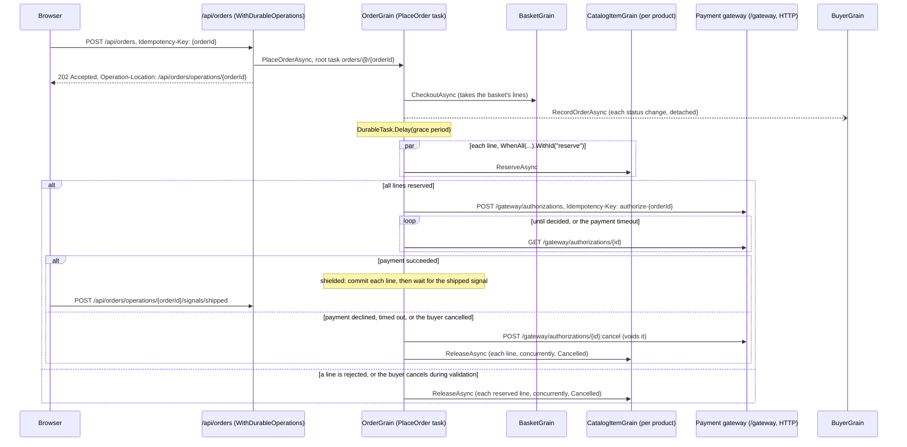

# Durable order processing playground

The [order processing playground](../OrderProcessing/README.md) rebuilt with Orleans Durable Tasks, and served over
HTTP with `Microsoft.Orleans.DurableTasks.Http`. Each order's workflow is one durable task on its order grain, which
the browser starts, observes, cancels, and ships as a durable HTTP operation. Idempotency flows end to end: from the
browser's checkout, through the order's workflow, to the simulated external payment gateway.

```bash
dotnet run --project playground/DurableOrderProcessing
```

Open `http://localhost:5000` to browse the catalog, fill a basket, check out, and watch orders progress. The Orleans
dashboard is at `/dashboard`, and `DurableOrderProcessing.http` walks through the API.

## Flow



`OrderGrain.PlaceOrderAsync` reads top to bottom as the flow above. Every arrow between grains is a durable call: a
grain method which returns `DurableTask` or `DurableTask<T>`. The workflow awaits each call under a stable child ID from
`WithId`, and a named `WhenAll` gives its inputs IDs beneath its own, such as `reserve/0` and `reserve/1`.
The order's state is its history, an `IDurableLog<OrderDetails>` named `history` whose entries are full snapshots of the
order and its stock lines. The workflow keeps the current snapshot in a local variable and computes each transition as a
pure function of the request, recorded results, and `DurableTask.Current.UtcNow`, such as `order = order.MarkPaid()`. It
then appends the snapshot in a recorded effect, `DurableTask.RunInline(() => _history.Append(order))`: the effect appends once
per position within the workflow, and the entry and the effect's record commit together with the workflow's next
journal write. A replay returns the recorded sequence without appending again, so the history holds each version once,
in order.

The workflow's first step takes the basket's lines with `basket.CheckoutAsync(orderId).WithId("checkout")`: the basket
clears itself and returns its lines, which commit with the call's result. The runtime runs the call once for the
order's task, so a replayed or retried workflow reads the same lines. An empty basket fails the workflow, and its
operation reports the error `Rejected: The basket is empty.`

Until the order is paid, cancelling its operation cancels the workflow. The next durable operation throws
`OperationCanceledException`, so a cancellation which arrives during validation or payment is observed too. The workflow
voids the payment authorization at the gateway once the workflow has requested one, releases each line concurrently in a shielded `WhenAll`, and then
appends the `Cancelled` snapshot, which carries `DurableTask.Current.TaskCancellationReason`. Reservations which completed
return normally after a cancellation, so the workflow records whether a cancellation arrived before it authorizes the
payment, with `DurableTask.RunInline`, and a cancelled order doesn't reach the gateway. Rejected stock, declined payments,
payment timeouts, and payments which fail run the same compensation. A paid order shields the commit of its lines and
the wait for its `shipped` signal, `await Shipped.WaitAsync().Shielded()`, so it ships whether or not a cancellation
arrives after payment.

Each catalog grain retains reservation outcomes by order ID, independently of task retention. Repeating a reservation
returns its recorded outcome, including after release or commit, and a different quantity for that order conflicts.
Committing or releasing removes the active reservation once, so repeated workflows preserve the product's stock totals.

## Idempotency end to end

Each layer names its requests, so retries at every layer reach the work which the first attempt started.

| Layer | Identity | Retried by |
| --- | --- | --- |
| Browser to API | A checkout's `Idempotency-Key`, which the browser generates per checkout and persists until the server acknowledges it. The key is the order's ID. | The helper, after a network failure; the buyer, by clicking again; the page, after a refresh. |
| API to the order | The operation key `orders/@/{orderId}`: the scope, the anonymous caller's scope, and the order's ID. It is the workflow's root task ID on the order grain. | Any request with the same key, which reaches the same workflow. A request which reuses the key with another body receives `422`. |
| Workflow to grains | Child task IDs, such as `checkout`, `reserve/0`, and `release/1`, beneath the root. | Replays after a deactivation or failure, which read recorded results. |
| Workflow to gateway | The authorization's `Idempotency-Key`, `authorize-{orderId}`, which names the order, so a workflow which didn't learn its authorization's location, such as after a lost response, reaches it again to void it. Other unsafe requests, such as the void, carry a key which `IDurableHttpClient` derives from the service, the order grain, the step's task ID, and the workflow's run. | The payment client's resilience handler, which follows the key handler, and the step itself after a failure. |
| Signals | The shipment's ID, which the browser persists per ship intent. | A repeated signal with an equal value, which succeeds; another value returns `409`. |

`POST /api/orders` requires its `Idempotency-Key` to be a lowercase UUID, which becomes the order's ID, so every request
for an order names the same operation. The Nexus service `orders.v1` shares the `orders` scope, and its
`Nexus-Request-Id` is the order's ID, so an order which a Temporal workflow places through Nexus is the same operation
at `/api/orders/operations/{orderId}`.

The guides describe each layer in depth:
[deriving root IDs from business identity](../../docs/site/src/content/docs/grains/durable-tasks-identity.md#derive-references-from-business-identity),
[deriving idempotency keys from the task](../../docs/site/src/content/docs/grains/durable-tasks-idempotency.md#derive-idempotency-keys-from-the-task),
[calling a payment API with an idempotency key](../../docs/site/src/content/docs/grains/durable-tasks-integrations.md#call-a-payment-api-with-an-idempotency-key),
and [choosing where to retry](../../docs/site/src/content/docs/grains/durable-tasks-integrations.md#choose-where-to-retry).

### The payment gateway

`PaymentGateway` is a simulated external service, which the order workflow calls over HTTP through the keyed
`IDurableHttpClient` named `payments`. It honors `Idempotency-Key` as Stripe does: it records each key with its request,
answers a retry with the first response marked `Idempotent-Replayed: true`, rejects a key reused with another body with
`422 Unprocessable Content`, and requires a key. An authorization completes asynchronously: the gateway answers
`202 Accepted` with an `Operation-Location` status monitor, which the workflow polls after the gateway's `Retry-After`,
and `POST {monitor}:cancel` voids it. `GET /gateway/authorizations` lists each authorization with the number of requests
which reached it, which the page shows. [Call an HTTP service and wait for a long-running operation](../../docs/site/src/content/docs/grains/durable-tasks-integrations.md#call-an-http-service-and-wait-for-a-long-running-operation)
describes the pattern.

| Card ending | Gateway behavior |
| --- | --- |
| `0002` | Declines the payment; the order is cancelled with `The card was declined.` |
| `0003` | Never decides; the order's payment times out after `Ordering:PaymentTimeout`, and the workflow voids the authorization. |
| `0004` | Drops the connection instead of its first response for a key; the resilience handler retries with the same key, and the ledger shows one authorization from two requests. |
| `0005` | Is unavailable, answering `503 Service Unavailable`; once the resilience handler's retries fail, the order is cancelled with `Payment authorization failed.` |
| Any other | Approves the payment after half a second. |

### The browser helper

`wwwroot/js/durable-operations.js` is a dependency-free ES module, which the page imports. It persists intents and
running operations in `sessionStorage`, so they survive refreshes of the tab:

| Member | Behavior |
| --- | --- |
| `new DurableOperations({ storage, prefix, retryDelays, wait })` | Creates the helper. `retryDelays` are the delays before each retry of a request which fails with a network error; `wait` is the seconds which a long poll asks the server to wait. |
| `start(intent, build, { headers, wait })` | Starts an intent's operation. It reuses the intent's persisted key and request, or builds the request from a new key, persists it, and sends it with `Idempotency-Key`, retrying network failures. Once the server answers, it forgets the intent, and watches a running operation by its `Operation-Location`. Returns `{ key, location, operation, result, data }`. |
| `resume()` | Sends the starts which the server hasn't acknowledged again, with their keys, such as after a refresh during a start. |
| `observe(location, { onStatus, signal })` | Observes an operation's server-sent events until it is terminal, long-polling with `Prefer: wait` where events are unavailable, and stops watching it. |
| `get(location, { wait })`, `cancel(location, reason)`, `signal(location, name, value)` | Read, cancel, and signal an operation. |
| `key(intent)`, `forget(intent)` | Get or create, and forget, an intent's persisted key, such as a shipment's ID. |
| `pending()`, `watching()` | List unacknowledged starts and running operations. |

### See it

- **Double click:** fill a basket and click Checkout twice. Both requests carry the checkout's key, and the Orders and
  Payment gateway panels show one order and one authorization.
- **Lost response:** check *Lose the checkout's first response* and check out. The server places the order, then resets
  the connection with the `Simulate-Lost-Response` header. The helper retries with the same key and receives the same
  order.
- **Refresh mid-checkout:** refresh while a checkout is pending or running. The Operations panel lists the pending start,
  which the page sends again with its key, and the running orders, which the page observes again.
- **Network retry to the gateway:** check out with a card ending in `0004`. The Payment gateway panel shows one
  authorization from two requests.
- **Double ship:** click Ship twice. Both signals carry the shipment's ID, and the order ships once.

`test/DurableOrderProcessing.Tests` asserts these outcomes against the playground's API: concurrent and retried
checkouts with one key place one order and authorize one payment, a payment request whose response is lost authorizes
once, the gateway deduplicates by key, cancellation during payment voids the authorization and releases the stock, a
paid order ships after a cancellation request, a payment which the gateway fails cancels the order, an order which
deactivates during its grace period and after payment appends each snapshot once and authorizes once, and a Nexus
request and a checkout with one ID reach one order.

## Observe an order

The order's operation reports its status: `GET /api/orders/operations/{orderId}` returns the status monitor, and
long-polls with `Prefer: wait=N`; `GET /api/orders/operations/{orderId}/events` streams the status as server-sent
events until the order ships or is cancelled, which completes the operation with the order's `OrderResult`.

The order's history reports each version: `IOrderGrain.WatchAsync` streams the order's committed history from its
submission. It reads the log with `ReadAsync` in the committed mode, yields each snapshot once it is durable, and ends
after the `Shipped` or `Cancelled` snapshot. `GET /api/orders/{orderId}/events` serves the stream as server-sent events,
one `data:` line per snapshot. When the order deactivates, the endpoint watches the next activation and skips the
snapshots which it has delivered, so a client receives each version once, in order. The page's order history uses
`EventSource` on this endpoint; the catalog, basket, order list, and gateway ledger poll.

```bash
curl -N http://localhost:5000/api/orders/{orderId}/events
```

## Endpoints

- `GET /api/catalog`, `GET /api/buyers/{buyerId}/basket`, `PUT /api/buyers/{buyerId}/basket/{productId}`, and
  `GET /api/buyers/{buyerId}/orders` serve the catalog, the basket, and the buyer's orders.
- `POST /api/orders` checks out the buyer's basket as the order which its `Idempotency-Key` names, and returns
  `202 Accepted` with the order's operation. An `Operation-Callback` header registers a webhook, which the silo delivers
  to `/api/webhooks/orders` with durable retries once the order completes.
- `GET /api/orders/operations/{orderId}`, `GET .../events`, `POST .../{orderId}:cancel`, and
  `POST .../signals/shipped` serve the order's operation, which `WithDurableOperations("orders")` maps.
- `GET /api/orders/{orderId}` and `GET /api/orders/{orderId}/events` serve the order's latest snapshot and its history.
- `POST /api/orders/{orderId}/deactivate` deactivates an order, so its next activation replays the pending workflow.
- `POST /nexus/orders.v1/place-order` places an order through the Nexus protocol.
- `/gateway/authorizations` is the simulated payment gateway.

## Compare with OrderProcessing

| Step | OrderProcessing (Messaging) | DurableOrderProcessing (Durable Tasks) |
| --- | --- | --- |
| Checkout | The basket stages `SubmitOrder` in its outbox and clears itself in one journal write. | `POST /api/orders` starts `PlaceOrderAsync` as the operation which the checkout's `Idempotency-Key` names, and the workflow's first step takes the basket's lines. A retried checkout reaches the same order. |
| Grace period | The order sends itself `GracePeriodElapsed` with `Envelope.DeliverAt`; the handler ignores it unless the order is still `Submitted`. | `await DurableTask.Delay(gracePeriod).WithId("grace-period")`. The runtime sends the same kind of scheduled self-message. |
| Cancellation | `CancelAsync` cancels a `Submitted` or `AwaitingValidation` order; late stock confirmations release their reservations. | `POST /api/orders/operations/{orderId}:cancel` requests durable cancellation of the workflow with the buyer's reason until the order is paid. During validation, `WhenAll` waits for every reservation to settle, then throws `OperationCanceledException`, so the workflow compensates knowing that no reservation is still running. |
| Reservation fan-out | One `ReserveStock` message per line; `StockResult` replies arrive in any order and the handler tracks each line. | `await lines.Select(...ReserveAsync...).WhenAll().WithId("reserve")` schedules one call per line concurrently, as children `reserve/0`, `reserve/1`, and so on, and returns each line's result in line order. |
| Payment | `AuthorizePayment` and a `PaymentResult` reply, correlated by message ID. | The workflow starts an authorization at the gateway over HTTP with `IDurableHttpClient.StartOperationAsync`, keyed by its order, and polls it with `WaitForOperationAsync(...).WaitAsync(paymentTimeout).WithId("await-payment")`. A timeout or a cancellation voids the authorization. |
| Shipment | `ShipAsync` moves a `Paid` order to `Shipped`. | `POST /api/orders/operations/{orderId}/signals/shipped` delivers the `shipped` signal, which the paid workflow awaits with a shielded wait. The task records the first shipment, so a repeated one succeeds and another one returns `409`. |
| Compensation | The transition which cancels the order stages `ReleaseStock` for each confirmed line. | Inline and shielded, so the compensation runs to completion after the cancellation which ended the workflow: the authorization is voided, then `lines.Select(...ReleaseAsync...).WhenAll().WithId("release").Shielded()` releases the lines concurrently. |
| Projection | `StatusChanged` messages carry a version; the buyer keeps the highest. | The workflow posts one `RecordOrderAsync` call per version as a detached task, `.Detached().Post()`, whose root ID derives from the order grain and the workflow's ID. The update commits with the workflow's next journal write and runs independently of the workflow. The buyer keeps the highest version. |
| Idempotency | Message IDs derived from the order ID, such as `orders/{orderId}/stock/{productId}`; each inbox processes a message ID once. | The checkout's `Idempotency-Key` names the order and its workflow, task IDs beneath it name each step, and the gateway's `Idempotency-Key` names the order's authorization, as [Idempotency end to end](#idempotency-end-to-end) describes. |
| Recovery | The inbox and outbox resume pending messages; each handler runs from the state it finds. | The next activation replays pending tasks from the start; completed children and recorded effects return their recorded results, so the workflow resumes where it stopped and the history holds each version once. Durable Jobs wakes the order when the delay is due or a completion arrives. |
| Observability | Order state and the dashboard. | The order's operation, with long polling and server-sent events, its history as a server-sent event stream, and the dashboard. |
| Non-blank lines of code | Grains 414, contracts 112, host 49. | Grains 315, contracts 133, host 229, including the HTTP API, the Nexus service, and the diagnostics endpoints; the simulated gateway adds 139. |

## Configuration

`Ordering:GracePeriod` in `appsettings.json` sets the delay before stock validation, `Ordering:PaymentTimeout` bounds
payment authorization, and `Ordering:PaymentPollInterval` spaces polls of an authorization which advertises no
`Retry-After`. `Payments:BaseAddress` locates the gateway, which this application serves. A changed setting applies to new
orders; a replayed delay keeps the due time it recorded. Journals and Durable Jobs use volatile in-memory storage, and
journaled state uses the JSON journal format with the source-generated `DurableOrderProcessingJsonContext`; durable task
arguments and results use the Orleans serializer.
