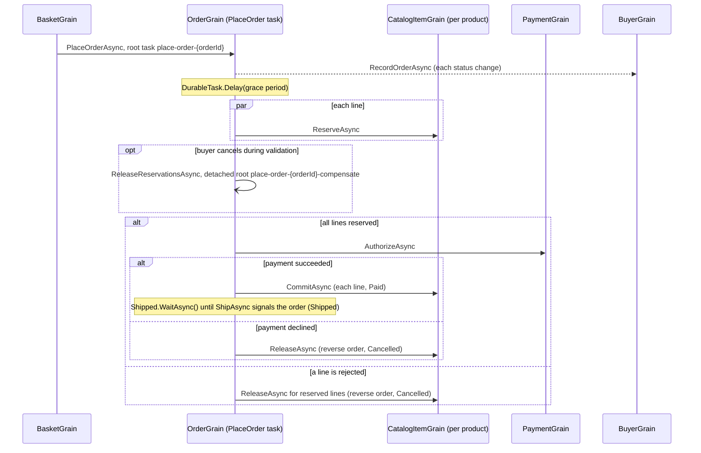

# Durable order processing playground

The [order processing playground](../OrderProcessing/README.md) rebuilt with Orleans Durable Tasks. It has the same
domain, catalog, HTTP endpoints, browser UI, and observable outcomes; each order's workflow is one durable task on its
order grain instead of a set of message handlers.

```bash
dotnet run --project playground/DurableOrderProcessing
```

Open the printed URL to browse the catalog, fill a basket, check out, and watch orders progress.
The Orleans dashboard is at `/dashboard`.

## Flow



`OrderGrain.PlaceOrderAsync` reads top to bottom as the flow above. Every arrow is a durable call: an awaited grain
method which returns `DurableTask` or `DurableTask<T>`, given a stable child ID with `WithId`. Each state transition is
also a durable task method, such as `await MarkPaid().WithId("pay")`, so its journaled state change commits with its
recorded result. A paid order waits for its `Shipped` signal, then records the `Shipped` transition and completes.

## Endpoints

The API matches OrderProcessing's. Cancel and ship call ordinary order grain methods, which return once their decision
commits: cancel records the buyer's decision and cancels the PlaceOrder task, and ship sends the task its `Shipped`
signal. Diagnostics endpoints expose the durable task runtime:

- `GET /api/orders/{orderId}/workflow` polls the order's PlaceOrder task. The task is pending until the order is
  cancelled or ships. The order keeps it until the basket which scheduled it accepts the result, then returns `404`.
- `GET /api/orders/{orderId}/tasks`, `/api/buyers/{buyerId}/basket/tasks`, and `/api/catalog/{productId}/tasks` list
  the tasks a grain retains. The UI links each order ID to its task list.
- `POST /api/orders/{orderId}/deactivate` deactivates an order, so its next activation replays the pending workflow.

## Compare with OrderProcessing

| Step | OrderProcessing (Messaging) | DurableOrderProcessing (Durable Tasks) |
| --- | --- | --- |
| Checkout | The basket stages `SubmitOrder` in its outbox and clears itself in one journal write. | The basket clears itself and schedules `PlaceOrderAsync` under root ID `place-order-{orderId}`. A durable grain stages the invocation in its outbox, so both commit in one journal write. |
| Grace period | The order sends itself `GracePeriodElapsed` with `Envelope.DeliverAt`; the handler ignores it unless the order is still `Submitted`. | `await DurableTask.Delay(gracePeriod).WithId("grace-period")`. The runtime sends the same kind of scheduled self-message. |
| Cancellation | `CancelAsync` cancels a `Submitted` or `AwaitingValidation` order; late stock confirmations release their reservations. | `CancelAsync` is an ordinary grain method which cancels a `Submitted` or `AwaitingValidation` order. It records the decision in the order's state, then cancels the PlaceOrder task through the grain's `IDurableTaskManager`. The workflow observes the cancellation: during the grace period it cancels the delay, which ends the workflow; during validation the workflow awaits every reservation's outcome, then compensates. |
| Reservation fan-out | One `ReserveStock` message per line; `StockResult` replies arrive in any order and the handler tracks each line. | One reservation call per line, scheduled concurrently with `WithId($"reserve-{productId}")`; the workflow awaits every outcome in line order. |
| Payment | `AuthorizePayment` and a `PaymentResult` reply, correlated by message ID. | `await payment.AuthorizeAsync(total, card).WithId("authorize-payment")`. |
| Shipment | `ShipAsync` moves a `Paid` order to `Shipped`. | `ShipAsync` sends the PlaceOrder task its `Shipped` signal through the grain's `IDurableTaskManager`; the paid workflow awaits `Shipped.WaitAsync()` and records the transition. The task records the first shipment, so a second one conflicts and returns `409`. |
| Compensation | The transition which cancels the order stages `ReleaseStock` for each confirmed line. | `ReleaseAsync` for each reserved line in reverse order, then the `cancel` transition. When the buyer cancels during validation, the workflow's further steps are canceled, so it detaches `ReleaseReservationsAsync` on its own order under root ID `place-order-{orderId}-compensate`; cancellation doesn't reach the detached task, which releases the reserved lines in reverse order and marks them released. |
| Projection | `StatusChanged` messages carry a version; the buyer keeps the highest. | `RecordOrderAsync` durable calls, one per version; the buyer keeps the highest because the workflow and the cancel method record independently. Cancel detaches its call with `DetachAsync($"order-{orderId:N}-v{version}")`, which commits with the decision in one journal write; the buyer retains the detached task, so the order retains no task for the command. |
| Idempotency | Message IDs derived from the order ID, such as `orders/{orderId}/stock/{productId}`; each inbox processes a message ID once. | Task IDs derived from the order ID, such as `place-order-{orderId}/reserve-{productId}` and `place-order-{orderId}/authorize-payment`; `(grain, task ID)` identifies one execution, and a reused ID with different arguments fails while the task exists. |
| Recovery | The inbox and outbox resume pending messages; each handler runs from the state it finds. | The next activation replays pending tasks from the start; completed children return their recorded results, so the workflow resumes where it stopped. Durable Jobs wakes the order when the delay is due or a completion arrives. |
| Observability | Order state and the dashboard. | Order state, the dashboard, and per-grain task lists with each task's status, timestamps, due time, remote target, and result. |
| Non-blank lines of code | Grains 403, contracts 112, host 49. | Grains 421, contracts 89, host 90, including the diagnostics endpoints. |

Both samples produce the same outcomes for a successful order, a cancellation during the grace period, a rejected line,
and a declined card, including statuses, versions, descriptions, and stock levels.

## Configuration

`Ordering:GracePeriod` in `appsettings.json` sets the delay before stock validation. A changed setting applies to new
orders; a replayed delay keeps the due time it recorded. Journals and Durable Jobs use volatile in-memory storage, and
journaled state uses the JSON journal format with the source-generated `DurableOrderProcessingJsonContext`; durable task
arguments and results use the Orleans serializer.
