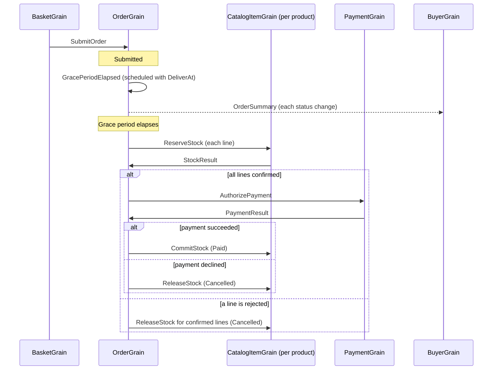

# Order processing playground

An order-processing workflow built with Orleans Messaging and Journaling.
It follows the ordering flow of [dotnet/eShop](https://github.com/dotnet/eShop) in a single
web application which hosts the silo, a minimal API, and a browser UI.

```bash
dotnet run --project playground/OrderProcessing
```

Open the printed URL to browse the catalog, fill a basket, check out, and watch orders progress.
The Orleans dashboard is at `/dashboard`.

## Flow



| eShop | This playground |
| --- | --- |
| Basket.API, checkout integration event | `BasketGrain` stages `SubmitOrder` in its outbox and clears the basket in one journal write |
| Ordering.API, `Order` aggregate and integration event log | `OrderGrain` journals the order and stages every outgoing message with each transition |
| `GracePeriodManagerService` polling the database | A `GracePeriodElapsed` message each order sends to itself with a `DeliverAt` time |
| Catalog.API stock validation | One `CatalogItemGrain` per product reserves, commits, and releases stock |
| PaymentProcessor | `PaymentGrain` authorizes the order total; cards ending in `0002` are declined |
| Order status notifications | `BuyerGrain` projects status messages into the buyer's order list |

Buyers can cancel orders until their stock is confirmed, and ship paid orders.

## Delivery and idempotency

- Messages are delivered at least once and processed once per message ID. Message IDs derive from
  the order ID, such as `orders/{orderId}/stock/{productId}`, and replies use the request ID's
  `result` child.
- The checkout request ID is the order ID. The basket remembers its checkouts for 7 days, so a
  retried checkout within that period returns the same order.
- Status messages carry a version, and the buyer projection keeps the highest one because delivery
  order is unspecified.
- The submit handler sends the order a `GracePeriodElapsed` message due at the end of the grace
  period. The order's inbox accepts it in the same journal write that records the order, and its
  handler advances only a `Submitted` order, so a cancelled order ignores it.
- A stock confirmation which arrives after cancellation releases its reservation.

## Configuration

`Ordering:GracePeriod` in `appsettings.json` sets the delay before stock validation. Journals and
the Durable Jobs that wake messaging use volatile in-memory storage, and journaled state uses the
JSON journal format with the source-generated `OrderProcessingJsonContext`.
