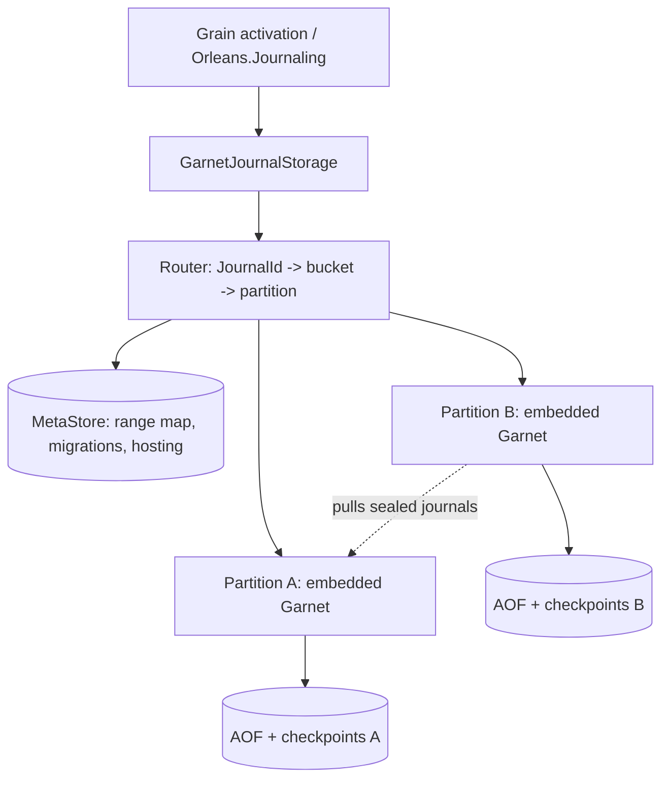

# Range-partitioned journal storage on embedded Garnet

Status: phases 0, 1, and 2 implemented; phase 3 specified; phases 3–5 designed. This document records the design, its decisions (marked **Decided** or **Undecided**), and the evidence behind them.

The system stores `Orleans.Journaling` journals in embedded [Garnet](https://github.com/microsoft/garnet) instances, one per *partition*, and moves ownership of key ranges between partitions online using the range migration scheme designed for Roux (`roux/docs/design/range-migration.md` and `roux/specs/range-migration`). Each journal is linearizable, and every write is durable before it is acknowledged.

## Phases

| Phase | Scope | Status |
| --- | --- | --- |
| 0 | Embedded Garnet, transaction procedures, AOF commit-wait, crash recovery, fencing question | Done: [durability](#durability), [fencing](#fencing) |
| 1 | `Orleans.Journaling.Garnet` with one partition per cluster | Done: provider suites pass; [measurements](#measurements) |
| 2 | Many partitions, buckets, MetaStore, routing with view versions; static range map | Done: [MetaStore](#metastore), [routing](#routing), [hosting](#partition-hosting-phase-2); routing, MetaStore CAS, and three-silo, four-partition cluster tests |
| 3 | Handover, lazy migration, consolidation, tombstones, GC; specification first | [Specified](#specification): simulation, mutants, and TLC safety and liveness; [bucket checks](#journal-procedures) and tombstones implemented |
| 4 | Partition hosting and failover on shared durable storage, with fencing | Designed |
| 5 | Balancer, splits and merges, locality placement, key filters, benchmarks | Designed |

## Architecture

The range layer maps journals to buckets and buckets to partitions, and moves buckets between partitions. The partition hosting layer runs each partition on some silo and fails partitions over. The range layer sees a partition as a linearizable, durable store that is sometimes unavailable.



| Term | Meaning |
| --- | --- |
| Bucket | `XxHash64(WTF-8(JournalId)) & (B - 1)`, where the bucket count `B` is a power of two fixed when a partition is initialized (4096 by default). The unit of ownership and migration. |
| Range | A contiguous run of buckets owned by one partition. |
| Partition | One Garnet instance with its own AOF and checkpoints, identified by a `PartitionId` that is never reused. |
| Range map, view `V` | The versioned mapping from ranges to partitions, with in-progress migrations and hosting assignments, at version `V`. Stored in the MetaStore. |

A silo hosts the partitions the range map assigns to it, each an embedded Garnet server with its own data directory and endpoint, and routes every journal operation to the partition which owns the journal's bucket. The range map is static in phase 2: ranges move between partitions from phase 3.

## Partition data layout

| Key | Type | Contents |
| --- | --- | --- |
| `oj:j:{b}:{id}` | list | Journal data: one element per append. `ReplaceAsync` replaces the list with one element. |
| `oj:m:{b}:{id}` | hash | `$etag`, `$content-etag`, `$append-length`, `$format`, `$schema-version`, `$recent-etags`, and caller properties; or a tombstone: `$deleted`, `$etag`, and `$recent-etags`. |
| `oj:i:{b}` | set | Encoded ids of the bucket's live journals, updated in the same transaction as every create and delete. |
| `oj:b:{map}:{b}` | hash | Bucket state: `state` (`open` or `sealed`; absent key means absent), `version`, `source`, `done`. `{map}` is the range map's identity (D23). |
| `oj:partition` | hash | `identity` (`{map}/{partition}/{bucket count}`), claimed only if absent before the partition opens any bucket; `map-id`, `partition-id`, `bucket-count`, and `schema-version`, the claimed identity's parts; `initialized`, written once the partition has opened its initial buckets. |

`{b}` is the bucket in decimal; `{id}` is the journal id encoded as generalized UTF-8 (WTF-8), which is injective over .NET strings including unpaired surrogates, so the catalog decodes ids from the index without metadata reads.

## Journal procedures

Each journal operation is one Garnet `CustomTransactionProcedure`, registered before the server starts. Arguments begin with the bucket, metadata, data, and index keys and the encoded id. Each procedure:

1. Takes a **shared** lock on `oj:b:{b}` and exclusive locks on the journal's keys (and the index, for operations that create or delete). Bucket transitions take the **exclusive** lock on `oj:b:{b}`.
2. Returns `WrongPartition(state, version)` unless the bucket is `open`. This is Roux's in-band seal: an operation and a seal of its bucket are serialized by the bucket lock, so an operation either commits before the seal, and is part of the sealed state, or observes the seal and fails. No write is acknowledged after the seal (the Delos erratum ordering).
3. Returns `NeedPull(source)` if the bucket's migration is not `done` and the partition holds neither the journal nor its tombstone.
4. Applies the conditional operation with the same semantics as the Redis provider: content-ETag checks for data writes, metadata-ETag checks for metadata updates.

The catalog's `OJINDEX` procedure takes shared locks on the bucket and its index, applies the same bucket checks (returning `NeedPull` for any bucket whose migration is not `done`), and returns the index as one snapshot.

Garnet logs a procedure invocation to the AOF as its input, after `Main` returns, and replays it by running the procedure again. Three rules follow, each enforced in `GarnetJournalProcedures.cs`:

- **Determinism.** Procedures are pure functions of their arguments and the store. Clients generate every ETag.
- **Validate before writing.** `Main` applies writes as it issues them and an exception does not roll them back, so procedures complete every check before their first write, and issue only writes that cannot fail.
- **Stable procedure ids.** Ids are assigned in registration order and persisted in the AOF, so `GarnetJournalProtocol.Names` is append-only and registration verifies each id.

**Conditional writes.** Every mutation is conditional on a state identity that never recurs: a data write on the content ETag the storage instance last observed, or on the absence it observed, named by the tombstone's ETag (or no record); a metadata update on the metadata ETag. An unconditional metadata update is conditioned on the ETag the instance reads, and reads again while other writers' updates intervene. An instance that has not observed the journal reads its metadata before its first write. Two activations that both observe a missing journal therefore cannot both create it: one write succeeds and the other fails with `InconsistentStateException`. (The Redis provider instead appends unconditionally when it holds no ETag.)

**Idempotent retries.** The client sends the ETag each mutation writes, and each journal, including its tombstone, records the ETags of its last eight mutations in `$recent-etags`. A mutation that finds its own ETag there has already committed, so it reports success instead of applying again; a no-op metadata update records its ETag without changing the metadata ETag. Otherwise the mutation's condition decides, and because every condition names a state that never recurs, a retry whose ETag has left the history cannot apply again, even after a later creation and deletion. A retry therefore applies at most once, and reports the committed outcome while fewer than eight later mutations have committed. Beyond that, a retry whose condition no longer holds throws `GarnetJournalAmbiguousConflictException`, an `InconsistentStateException`: other writers changed the journal either way. The client retries connection failures, timeouts, and transactions that did not run (lock timeouts) with identical arguments until `OperationTimeout`, which also bounds each attempt's wait for a reply. Payloads are copied before they are sent, because a cancelled or timed-out call can leave the command queued in the client after the operation returns.

## Durability

Each partition runs with `EnableAOF`, `CommitFrequencyMs = 0`, and `WaitForCommit`. Evidence, from Garnet 2.2.0 (`microsoft/garnet@0d58590`):

- `RespCommand.HandleAofCommitMode` marks a session to wait for the AOF whenever it parses a command that is not AOF-independent; custom transaction procedures are not. `RespServerSession.Send` then awaits `StoreWrapper.WaitForCommitAsync` before writing the response.
- `TransactionManager.RunTransactionProcInternal` runs `Main`, logs the invocation (`EnqueueStoredProc`), and only then commits and releases locks. Any later operation on the same keys waits for the lock, and its reply waits for a commit that includes the earlier entry. Reads therefore never observe a write that a crash could lose, and read-only procedures (shared locks only) write nothing to the AOF.
- Partitions use Tsavorite's `RandomAccess` device, which opens files with `FileOptions.WriteThrough` and unbuffered I/O on every platform (decision D14), so a completed AOF flush is on stable storage.
- Recovery replays the AOF after the latest checkpoint, re-running logged procedures; the procedures must be registered before `GarnetServer.Start`, which recovers.
- The partition takes a checkpoint whenever its AOF exceeds `CheckpointAofSize` (256 MiB by default; Garnet's `AofSizeLimit`), compacting the hybrid log first (`LogCompactionType.Lookup`), which truncates the AOF and bounds recovery time.

`GarnetJournalDurabilityTests` verifies this end to end: a child process hosts a partition while eight writers append sequence numbers, the test kills the process at a random point (half of the cycles after a `SAVE` checkpoint), restarts it from the same directory, and checks that every journal holds a gap-free sequence including every acknowledged append. It runs four kill cycles in CI on every supported framework.

## Fencing

**Question:** does Garnet's Azure page blob device fence a zombie writer?

**Answer: not as Garnet configures it.** Tsavorite's `AzureStorageDevice` supports fencing when constructed with `underLease: true`: `BlobManager` maintains a 45-second lease on a `commit-lease` blob, and every page upload is conditioned on the page blob's ETag (`PageBlobRequestConditions.IfMatch`). But Garnet's `--use-azure-storage` path, `AzureStorageNamedDeviceFactory`, constructs devices with `underLease: false`, so it neither takes the lease nor conditions writes.

Phase 4 therefore requires a Garnet change. **Undecided:** either expose `underLease` through the device factory and prove that it covers every write (including creation of new segment blobs and checkpoint metadata, which the ETag condition alone does not), or add epoch fencing in the device so that every page write and AOF commit is conditional on the writer's hosting epoch from the MetaStore. Either way, the failover test must show that the old host's writes fail once the new host has recovered.

## Measurements

Phase 1, one embedded partition, 128-byte appends, Release build, .NET 10, Windows on a shared Azure VM (Intel Xeon Platinum 8370C, Azure managed disk; not local NVMe), client and partition in one process over loopback TCP, `RandomAccess` device. Two runs, which varied with load from other tenants of the VM:

| Concurrent writers | p50 | p99 | p99.9 | Throughput |
| --- | --- | --- | --- | --- |
| 1 | 0.87–0.93 ms | 3.6–4.3 ms | 17.6–25.7 ms | 924–956 appends/s |
| 16 | 4.9–5.6 ms | 9.8–18.1 ms | 20.6–47.0 ms | 2,816–3,371 appends/s |
| 64 | 3.7–4.9 ms | 12.9–56.0 ms | 19.2–100.9 ms | 8,633–14,692 appends/s |

With Tsavorite's default Windows device (unbuffered, without write-through), one run measured p50 0.65 ms and p99 2.76 ms for one writer and 10,272 appends/s for 64 writers. Concurrent commits share AOF flushes, so throughput grows with concurrency. `GarnetJournalLatencyTests` (category `Performance`, excluded from CI) reproduces these numbers. Migration, consolidation, failover, and storage-cost measurements follow the phases that introduce them; the NVMe and Azure page blob measurements need dedicated hardware.

## Decisions

| # | Decision | Status | Rationale |
| --- | --- | --- | --- |
| D1 | Store journal data as a **list**, one element per append. | Decided | Garnet stores strings in its hybrid log and `APPEND` rewrites the whole value (read-copy-update), so with the 128 MiB compaction threshold the Redis provider uses, each append could copy megabytes. A list append is O(1); a read returns one segment per append, which `IJournalStorageConsumer` accepts. |
| D2 | Use C# transaction procedures, not Lua. | Decided | Procedures lock their key set, log as one AOF record, and replay deterministically; Lua would need `--lua-transaction-mode` and per-call script parsing. |
| D3 | Clients generate ETags and retry ambiguous outcomes with identical arguments; journals retain their last eight mutation ETags. | Decided | Required for deterministic replay (D2) and for applying each mutation at most once across lost replies, including retries at another partition after a migration. Keeping several ETags, rather than only the current one, recognizes a retry after later mutations, including a deletion. |
| D4 | Delete writes a tombstone carrying the deletion's recent ETags. | Decided | Makes retries around deletes idempotent, and is required during migration so that a later read does not fall back to the source and resurrect the journal. |
| D5 | A tombstone is dropped only once its bucket's migration is `done` and no attempt of a mutation on its journal can still execute: no client awaits a retry, and every attempt whose reply was lost, including attempts still queued in a client, has expired. An absent marker (a pulled journal the source did not hold) is dropped once the bucket is `done`. | Decided (phase 3 specification) | Before `done`, a missing record makes reads fall back to the source and resurrect the journal (`mutantDeleteWithoutTombstone`). A tombstone also names the absence it represents (D16) and holds the recent ETags of the journal's last mutations (D3). Once it is dropped, the journal's absence is the unnamed one a creation observed before the journal existed, so a delayed attempt of that creation would recreate the deleted journal, even after the client received its outcome through a retry (`mutantCollectWithAttempt`, `collectWithAttemptResurrectsTest`). A new conditional write by a client which observed the unnamed absence before the journal existed does apply after collection; the journal is absent at that point, so the write is linearizable (`staleAbsenceAfterCollectionTest`). Absent markers name the unnamed absence, which is what the source held, and hold no ETags. The retention bound is D41. |
| D6 | Operations require only `state == open`; the bucket's `version` is returned with `WrongPartition` so the client refreshes its view. | Decided | Refines the brief's `version == expectedVersion`. At most one partition holds a bucket open (Roux's `singleOpen`), so an open bucket is the unique acceptor regardless of the client's view; the view version is a staleness hint, not a safety condition. See D17. |
| D7 | A new partition claims its identity (map, partition id, bucket count) in `oj:partition` as one field set only if absent, then opens the buckets the map assigns to it, outside any migration, at their assignment version with `done = 1`, then marks the descriptor `initialized`. | Decided | Storage that records another identity is rejected before any bucket is opened, so a data directory serves only the partition it was created for, even after an interrupted initialization, and of concurrent initializations with different identities (including different bucket counts) exactly one succeeds. Claiming the identity's parts separately could leave a mixed identity that no initialization matches. Opening is idempotent, so an interrupted initialization resumes on the next start. |
| D8 | Lock the bucket key shared and the bucket index exclusively for operations that may create or delete. | Decided | The shared bucket lock implements the in-band seal; the index lock serializes creates and deletes per bucket for microseconds, while locks are held only in memory (AOF waits happen after release). |
| D9 | Reach partitions over RESP (StackExchange.Redis), including the in-process partition over loopback. | Decided for phases 1–2 | Garnet's in-process sessions (`EmbeddedRespServer`) are internal to its benchmarks. Productizing them is a Garnet change, worth doing in phase 5 for locality placement. |
| D10 | Depend on `Microsoft.Garnet` 2.2.0 and target net10.0 only. | Decided | Garnet requires Microsoft.Extensions 10.x, which the repository uses on net10.0. |
| D11 | **Reopen rule:** a partition opens a bucket only if it holds no copy of it (the bucket is absent, or sealed and reclaimed with its deletion finished). **Coordinator rule:** the coordinator commits a view moving bucket `b` to partition `p` only once the previous move of `b` has reached `Opened`, and only if no read path reaches `p`'s copy of `b`: `p` never held `b`, or a migration of `b` after `p`'s last tenure has reached `Done`. | Decided (phase 3 specification) | Per-journal keys carry no position, so a partition that reopened a bucket while still holding its sealed copy would serve that stale copy instead of pulling (Roux compares log positions instead). The reopen rule is a safety rule. The coordinator rule is a safety rule too: a destination opens after its open was authorized, in a separate request, so a later move committed before that open would let a delayed open at the superseded view leave two partitions open (`delayedOpenUncoordinatedTest`); the rule commits no later move until the destination has opened (D45). It is also a liveness rule: a move back to a partition whose copy is still on the chain, or an open at a superseded view, leaves a migration that can never complete (`returnToChainedCopyStallsTest`). The balancer additionally moves a bucket only after its inbound migration is `Done`, so chains form only from failure-driven moves. |
| D12 | Zombie-host fencing mechanism. | Undecided | See [Fencing](#fencing). |
| D13 | Garnet replication is not used. | Decided | It is asynchronous and cannot satisfy synchronous durability. Availability comes from failover onto shared durable storage (phase 4). |
| D14 | Local partitions use the `RandomAccess` device (write-through, unbuffered). | Decided | Tsavorite's default devices are unbuffered but not write-through (Windows) or depend on the native backend (Linux), which survives process loss but not necessarily power loss. Write-through makes an acknowledged write durable on the device on every platform. |
| D15 | The catalog reads each bucket index whole (`SMEMBERS`, in the `OJINDEX` procedure at the bucket's owner). | Decided | Garnet's `SSCAN` cursor is a position in the set's enumeration, so a delete between pages skips members. One snapshot per bucket includes every journal that exists for the whole listing. |
| D16 | Every mutation is conditional on a state identity that never recurs: a content ETag, a metadata ETag, or an absence named by its tombstone's ETag. | Decided | Duplicate activations which both observe a missing journal cannot both create it, and a retry whose ETag has left the history cannot apply again: a creation cannot resurrect a deleted journal, and an unconditional metadata update cannot overwrite a later one. |
| D17 | Requests do not carry the client's view version. A `WrongPartition` reply carries the version of the bucket's last transition; the client refreshes its view when that version is newer than its own and retries at once, and otherwise backs off and retries. | Decided | Refines the brief, which sends the client's version with each request. By D6 the partition's decision does not depend on the client's view, so the client's version would be unused; the reported version tells the client which view to wait for. A reported version no newer than the client's view means the owner has not opened the bucket yet (or the endpoint now belongs to another partition), which is transient. |
| D18 | Hosts publish each partition's endpoint in the range map (`PartitionHosting.Endpoint`), by CAS, after the partition has opened its buckets. | Decided | Endpoints change when a host restarts with a free port or a partition fails over, and the MetaStore is already the authority for hosting. Clients route to a partition only once it serves its buckets. A stale endpoint is safe: whatever listens there rejects buckets it does not hold open, including partitions of other maps (D23). |
| D19 | `PartitionId` is a string of 1–64 characters from `[A-Za-z0-9._-]`, starting with a letter or digit. `StorageLocation` is a path relative to the host's data directory. | Decided | Ids name files, keys, and the bucket `source` field (where `-` means none); relative locations keep the map independent of host file systems. Phase 4 interprets `StorageLocation` for shared storage. |
| D20 | The Azure Blob MetaStore lives in the provider package. | Decided | `Microsoft.Garnet` already depends on `Azure.Storage.Blobs`, so a separate package would add no isolation. |
| D21 | A Garnet MetaStore in a dedicated instance with commit-wait. | Undecided | Optional in the brief; the in-memory and Azure Blob stores cover phase 2. Worth adding if a deployment needs a MetaStore without Azure. |
| D22 | `HostId`, if not configured, is generated on a silo's first start and stored in its `DataDirectory`; silos without a directory host nothing. | Decided for phase 2 | The static map assigns partitions to hosts by id, so the id must be stable across restarts. The silo name is not (Orleans generates a random one by default), while the directory persists exactly as long as the partitions it holds. Phase 4 assigns hosts through the coordinator, keyed by live silos. |
| D23 | Each range map has an identity, fixed when it is created, which is part of every bucket key and of the partition descriptor. | Decided | A stale endpoint may reach a partition of another cluster on the same machine. That partition holds no bucket under this map's identity, so it rejects the operation as `WrongPartition(absent, 0)` and the router backs off and refreshes. Only the bucket key needs the identity, since every procedure checks the bucket before touching journal keys. |
| D24 | A MetaStore write whose outcome cannot be determined throws, and the caller reads the map to continue. | Decided | The Azure SDK retries requests, so a conditional upload can fail its condition because its own first attempt was applied. Each document carries a unique write id: if the blob holds the next version, the store knows whether that version is this write's; if a later version has superseded it, the outcome is unknown. Reporting `Written = false` there could make a caller apply a change twice. |
| D41 | How a partition knows that no attempt of a mutation can still execute, which bounds tombstones (D5). | Undecided | The bound covers attempts, not client outcomes: a client can receive an operation's outcome through a retry while an earlier attempt stays queued in its connection (`GarnetJournalStorage` copies payloads for this reason), and that attempt can reach the partition later. Clients stop retrying after `OperationTimeout`, but a queued attempt can be sent after that. Options: requests carry their deadline and a partition refuses attempts past it, then drops tombstones once every deadline it accepted has passed; the refusal must not be part of the logged procedure, which replays deterministically (D2). Or retain tombstones for a period longer than any attempt's lifetime, including time queued in the client, by the partition's clock with a skew allowance. |
| D42 | **Migration inventory and reclamation rule:** a migration's inventory is every journal whose newest record on the bucket's source chain is live or a tombstone. The consolidator enumerates both the live index (`oj:i:{b}`) and an index of retained tombstones in every source on the chain up to the first `done` bucket, and the destination sets `done` only once it holds a record of every journal in the inventory. A sealed copy of a bucket is reclaimed once a migration of the bucket after the copy's tenure has reached `Done`, which takes it off every migration chain. Holding every journal in the destination is not enough. When a migration reaches `Done`, the coordinator records `Complete` for it and for every earlier migration on its chain, and each of their sources deletes the bucket's journals and index in batches fenced by D47, and keeps its bucket key sealed. A partition reopens the bucket only once the deletion has finished (D11). | Decided (phase 3 specification) | Deletion removes a journal from the live index, but its tombstone names the absence that pending and queued creations are conditioned on and holds their ETags. Completing against the live index alone leaves the destination with neither, and a retried creation applies again (`mutantInventoryLiveOnly`, `inventoryLiveOnlyResurrectsTest`). Journals the chain never held need no marker: after `done`, they read as absent at the destination. Reads walk the chain newest first and stop at a `done` bucket, so copies behind it are unreachable; reclaiming earlier loses data (`mutantReclaimBeforeDone`). The sealed bucket key makes a later request there fail with `WrongPartition`, so reclaimed data reads as an error, never as absent. Chained sources whose own migration never reached `Done` (they were sealed first) are reclaimed by the later migration's `Done`. The model computes reachability from bucket states alone, as the coordinator observes them (`reclaimWaitsForDoneTest`, `returnWaitsForDoneTest`). |
| D43 | **Install fencing:** a pull reads the journal from the source chain and installs it in the destination in separate requests. The install carries the destination bucket's opening version, observed with the `NeedPull` reply or by the consolidator, and applies only if the bucket is still open at that version, its migration is not `done`, and it holds no record of the journal. | Decided (phase 3 specification) | A destination that reopens a bucket starts empty, so an install conditional only on absence would accept a pull delayed from an earlier opening and hide every write since (`mutantUnfencedInstall`, `unfencedInstallHidesWriteTest`). Within one opening, the sources on the chain are sealed and are not reclaimed before the destination is `done`, so the fetched copy is still current. |
| D44 | **Retry history:** each journal keeps the ETags of its last eight mutations (D3), evicted by count, and every mutation is conditioned on a state identity that never recurs (D16). A retry that finds its ETag reports success; a retry whose ETag has left the history fails its condition, and the client reports the outcome as unknown (`GarnetJournalAmbiguousConflictException`). | Decided (phase 3 specification) | The specification models a history of `RECENT` entries and an `ambiguous` outcome, which may have committed or not. A retry therefore applies at most once (`exactlyOnce`), even after its id leaves the history and the journal is deleted (`retryCreateAfterDeleteTest`), and reports the committed outcome while fewer than `RECENT` later mutations of its journal have committed (`retryOutcome`). Matching an absence without its identity lets a retried creation recreate a deleted journal (`mutantRetryAnyAbsence`). |
| D45 | **Open fencing:** a destination opens a bucket in a request separate from the observation of the source's seal (the migration's `Sealed` phase), and `OJBUCKET open` applies only if its view is later than the version of the partition's last transition of the bucket (its opening or its seal; reclamation keeps the version). Opens may be duplicated and delayed. | Decided (phase 3 specification) | With the coordinator rule (D11), no later move of the bucket commits before the destination opens, so an authorized open is never superseded before it applies; and a delayed duplicate arrives after the destination has opened at that view or a later one, so the version fence rejects it, including after the destination sealed and reclaimed the bucket (`mutantUnfencedOpen`, `unfencedOpenTest`). |
| D46 | **Completion fencing:** the consolidator enumerates the inventory (D42) and sends it to the destination with the bucket's opening version, observed with the enumeration; the destination sets `done` only if the bucket is still open at that version, not `done`, and holds a record of every journal in the inventory, and rejects the request otherwise. | Decided (phase 3 specification) | Enumeration and completion are separate requests, and a completion can be delayed. Within one opening the inventory is stable, because the sources are sealed and are not reclaimed before the destination is `done`. A completion delivered after the destination reopened the bucket would check a stale inventory against the new, empty opening and hide every write since (`mutantUnfencedDone`, `unfencedDoneHidesWriteTest`; fenced: `delayedDoneFencedTest`). |
| D47 | **Reclamation fencing:** the coordinator authorizes a source to reclaim its copy of a bucket (D42) with the version at which the source sealed it; every deletion batch runs in one transaction that checks the bucket is still sealed at that version, and the first batch marks the bucket reclaimed. Duplicate and delayed requests are expected. | Decided (phase 3 specification) | Reclamation is authorized by observing the migration chain and runs later, in many batches. After a source reclaims its copy, the bucket can return to it, gain writes, and be sealed again for a later move; a delayed duplicate checked only for the sealed state would delete records the next destination has not pulled (`mutantUnfencedReclaim`, `unfencedReclaimLosesWriteTest`; fenced: `delayedReclaimFencedTest`). The seal version changes with every tenure, so it fences out every earlier authorization. |

## Range layer (phases 2–3)

### MetaStore

The MetaStore is pluggable and holds the range map. Every change, including migration phase and hosting changes, is a compare-and-swap from `V` to `V + 1`, so a crashed or duplicated coordinator is safe. The types live in `Orleans.Journaling.Ranges` and reference neither Garnet nor Orleans.

```csharp
public interface IRangeMetaStore
{
    ValueTask<RangeMapSnapshot?> ReadAsync(CancellationToken cancellationToken);
    ValueTask<RangeMapWriteResult> TryWriteAsync(RangeMap next, long expectedVersion, CancellationToken cancellationToken);
}

public sealed record RangeMapSnapshot(long Version, RangeMap Map);
public readonly record struct RangeMapWriteResult(bool Written, RangeMapSnapshot? Current);
public sealed record RangeMap(
    string Id,
    int BucketCount,
    ImmutableArray<RangeAssignment> Ranges,
    ImmutableArray<Migration> Migrations,
    ImmutableSortedDictionary<PartitionId, PartitionHosting> Partitions);
public sealed record RangeAssignment(int FirstBucket, int LastBucket, PartitionId Owner, long AssignedAtVersion = 0);
public sealed record Migration(int FirstBucket, int LastBucket, PartitionId Source, PartitionId Destination, long StartedAtVersion, MigrationPhase Phase);
public enum MigrationPhase { Committed, Sealed, Opened, Done, Complete }
public sealed record PartitionHosting(string Host, long Epoch, string StorageLocation, string? Endpoint = null);
public readonly record struct PartitionId(string Value);
```

Refinements of the brief's sketch, and why:

- **No map is version 0.** `ReadAsync` returns `null` for an empty store, and the first map is written with `expectedVersion = 0` as version 1, so every silo can race to write the initial map and exactly one succeeds.
- **`RangeMap.Id`** is the map's identity (D23), generated by `RangeMap.CreateUniform` or `RangeMap.CreateId`. Like the bucket count, it never changes.
- **`RangeMapWriteResult`** names the CAS outcome. `Current` is the written map on success and the map that prevented the write on failure, so a writer retries from it without another read.
- **`RangeAssignment.AssignedAtVersion`** is the version at which the owner opens the range's buckets: 0 for ranges assigned when the map was created, otherwise the version which committed the migration into the owner. A partition reports it in `WrongPartition`, which lets clients decide between refreshing and backing off (D17).
- **`PartitionHosting.Host` is a string** (`HostId`; D22), and **`Endpoint`** is the `host:port` the hosting silo publishes once the partition serves (D18).
- **`ImmutableSortedDictionary`** gives the map a deterministic order, so equal maps serialize to equal documents. `RangeMap` compares its collections by value.
- **`RangeMap.Validate`** checks the structural invariants: a power-of-two bucket count; ordered, contiguous ranges covering every bucket and owned by known partitions; disjoint migrations between distinct known partitions whose buckets the map already assigns to the destination (the commit step of the handover); and complete hosting records. Stores validate every write, and routers validate every view they read. Invariants across versions, the fixed identity and bucket count, are enforced by the router, which rejects a view that changes them.

Implementations:

- `InMemoryRangeMetaStore`, for tests and single-process development.
- `AzureBlobRangeMetaStore`: one JSON document (format version, map version, write id, map) in a blob. A write reads the document, compares versions, and uploads conditionally on the ETag it read (`If-None-Match: *` for the first map). If the upload fails its condition, the store reads the blob again: at the next version, the write succeeded exactly if the blob holds this write's document; at a later version, the outcome is unknown (D24).
- A dedicated Garnet MetaStore is optional (D21).

### Routing

`GarnetJournalRouter` holds the cached view and a connection per published endpoint. An operation computes its journal's bucket, finds the owner in the view, and runs its procedure there:

- **`WrongPartition(state, version)`**: if `version` is newer than the view, the router refreshes from the MetaStore and retries at once; otherwise the owner has not yet opened the bucket, and the router backs off and retries (D17).
- **Unavailability** (no published endpoint, connection failures, timeouts, transactions that did not run): back off from 10 ms to 1 s, refresh the view in case the endpoint changed, and retry.
- Every retry reuses the operation's arguments, so idempotent retries (D3) make a retry at another partition safe. An attempt that may have committed without a reply (a connection failure, a lost reply, or the deadline passing) marks the operation's outcome ambiguous, so a later conflict surfaces as `GarnetJournalAmbiguousConflictException`; `WrongPartition` replies, transactions that did not run, and attempts never sent are definite non-applications and leave it unmarked. `OperationTimeout` bounds every wait (connecting, the command, MetaStore refreshes, and backoff); when it passes, the operation fails with `TimeoutException`. An operation that stops waiting for a shared refresh does not cancel it for others. Grains see `InconsistentStateException` only for genuine conflicts.

Views are applied in version order: a refresh that returns an older or equal version is ignored. Concurrent refreshes share one MetaStore read. When a view changes an endpoint, the router stops using the old connection at once and closes it after `OperationTimeout`, once operations in flight on it have finished. Once disposal begins, the router opens no connections, and operations fail with `ObjectDisposedException` at their next attempt. Safety does not depend on the view: only a partition that holds a bucket open accepts operations on it, and at most one partition does.

The catalog reads every bucket's index at its owner with `OJINDEX`, 32 buckets at a time. While a bucket's migration is not `done` its source may hold more journals, so `OJINDEX` returns `NeedPull` and the catalog fails rather than return a partial listing; phase 3 lists the union.

### Partition hosting (phase 2)

On start, each silo reads the range map, writing `InitialRangeMap` (or a one-partition map hosted by itself, if it has a `DataDirectory`) if the store is empty, and waits if neither applies. It then starts an embedded Garnet server for each partition the map assigns to its `HostId`, in `DataDirectory/StorageLocation`, on consecutive ports from `ListenEndPoint` (free ports by default). The silo initializes its partitions through the loopback address when `ListenEndPoint` is a wildcard address, and publishes the machine's host name. Each new partition opens its initial buckets (D7) and records its descriptor; a restarted partition checks its descriptor (map identity, partition id, bucket count) against the map. Once its partitions serve, the silo publishes their endpoints by CAS (D18). Silos with no partitions route only.

In phase 2 the map's ranges and hosting assignments never change; only endpoints do. Phase 3 opens and seals buckets through migrations, and phase 4 moves partitions between hosts with a new epoch.
### Handover and migration

Moving buckets `[f, l]` from partition A to B at view `V`: commit `V` (assign to B, add `Migration(..., Committed)`); A seals each bucket (`OJBUCKET seal V`); B opens each bucket (`open V source=A done=0`) only after A's seal is recorded. B returns `NeedPull` for a journal it does not hold; the client reads the journal from A (stable, since A's bucket is sealed), installs it in B with a conditional install (only if B holds neither the journal nor its tombstone), and retries. A consolidator scans A's `oj:i:{b}` and installs each journal; when every journal is present in B, B sets `done` in a transaction that rechecks the condition. After `Done`, the coordinator records `Complete`, and A deletes the bucket's journals and index but keeps `oj:b:{b}` sealed, so later reads in A return `WrongPartition`: reclaimed data reads as an error, never as absent.

The procedures already implement the seal, the `WrongPartition` and `NeedPull` checks, and tombstones. Phase 3 adds the install procedure, fenced by the destination's opening version (D43), the consolidator, which enumerates retained tombstones as well as the live index (D42), completion, fenced by the destination's opening version (D46), and GC, whose deletion batches are fenced by the source's seal version (D47), and lands with the specification below. Reclamation records itself in the bucket key (sealed and reclaimed), and `OJBUCKET open`, which today opens only absent buckets, also opens reclaimed ones (D11), fenced by the bucket's version (D45).

### Specification

[`specs/garnet-range-migration`](../../specs/garnet-range-migration/README.md) specifies handover, lazy migration, consolidation, tombstones, idempotent retries, and reclamation in Quint, adapted from Roux's `specs/range-migration`. Partitions are the actors; hosting is abstract. Clients send conditional writes to any partition (requests carry no view version, D17), duplicate activations write with stale ETags, and any reply can be lost and retried at another partition. A view change moves one or more buckets to one partition, which covers moves, splits, and merges, following the coordinator rule (D11), so migrations chain through partitions off the chain. Opens, pulls, completions, reclamations, and attempts whose reply was lost are separate requests that may be delayed and duplicated, and clients may hold old observations of a journal.

- **Safety** (`singleOpen`, `durability`, `exactlyOnce`, `retryOutcome`): at most one partition accepts writes for a bucket; reads through the bucket's current opener return every committed write, deleted and never-written journals read as absent, and no read path reaches reclaimed data; each operation applies at most once, success and conflict outcomes are exact, and a retry reports an unknown outcome for a committed operation only after its ETag has left the journal's bounded history (D44).
- **Liveness** (`migrationsComplete`): under weak fairness of sealing, opening, pulling, completion, and reclamation, every migration completes and its sources are reclaimed. With views changed freely, safety and liveness both fail.
- **Mutants**, each of which violates safety: open before seal, unfenced open, write after seal, unconditional install, unfenced install, delete without tombstone, reclaim before `done`, unfenced reclamation, mark `done` early, unfenced completion, complete against live journals only, collect a tombstone with an attempt outstanding, retry without idempotence, and retry matching any absence.

The specification's README records what was checked. Traces exported with `quint run --mbt --out-itf` drive the .NET conformance harness against the real procedures and an in-memory MetaStore. The [workflow](../../.github/workflows/garnet-specs.yml) runs the directed scenarios, simulation, and mutants on every change to the specification, and TLC weekly.

## Differences from Roux

| Roux | Here | Why the guarantee holds |
| --- | --- | --- |
| A node-wide log; a range's cut is the position of its in-band `Offloading` record. | Per-journal keys; a bucket's cut is its sealed state in the source partition. | The seal is serialized with every operation on the bucket by the bucket lock (step 1 above), which gives the same ordering as an in-band log record: every acknowledged write precedes the seal. Without positions, D11 replaces Roux's position-based reopen. |
| Membership log with dense versions. | MetaStore with CAS from `V` to `V + 1`. | Both provide a totally ordered sequence of views; nodes apply views in order. |
| Snapshot records with continuations, written conditionally on coverage. | Whole journals installed conditionally on absence. | A journal's state in B is either absent (pull from the source) or authoritative (written or installed in B), so "install only if absent" is the coverage comparison. |
| VirtualLog segments with reconfiguration for forced seals. | Garnet AOF; an unreachable source is failed over at the hosting layer, recovered at a higher epoch, and then sealed. | Recovery replays every acknowledged write, and fencing (D12) prevents the old host from acknowledging more. |
| A range that returns to a log still holding it reopens there, with itself as the source; positions separate old and new history. | A partition reopens a bucket only with no copy of it, and the coordinator moves a bucket only to a partition whose copy no read path reaches (D11). | A reopened bucket starts empty and pulls everything from its chain, so it never serves a stale copy. The coordinator rule replaces Roux's ability to resume on its own history, and keeps every migration able to complete. |
| Chains capped at a configurable depth; capped chains consolidate first. | Chains form only from failure-driven moves, and only through partitions off the chain (D11). | Reads walk the chain newest first and stop at the first record or `done` bucket, as in Roux. The model checks safety with unrestricted chains. |
| A source trims a log prefix once every range with entries in it is reclaimable. | A source deletes a bucket's journals once a later migration of the bucket is `Done` (D42). | Per-bucket keys make reclamation per bucket, so one slow migration holds back only its own bucket. The sealed bucket key keeps reclaimed data reading as an error. |
| Key filters include deleted keys, so a reader stops at a deletion. | Tombstones in the destination until `done` and the retry bound pass (D5). | A tombstone stops the chain walk at the destination, so the source's copy never resurrects. |
| Positions make writes idempotent within a log; the specification does not model lost replies. | Clients generate ETags; journals keep their recent ETags, which travel with installs (D3). | A retry, at any partition after any number of migrations, finds its own ETag and reports success instead of applying again (`exactlyOnce`). After eight later mutations its ETag has left the history; its condition names a state that never recurs, so it fails and reports an unknown outcome (D44). |
| Requests are routed by the node's view. | Requests carry no view version (D17). | Only a partition holding the bucket open accepts an operation, and at most one does (`singleOpen`), so the client's view affects routing only. The model lets clients send any operation to any partition. |
