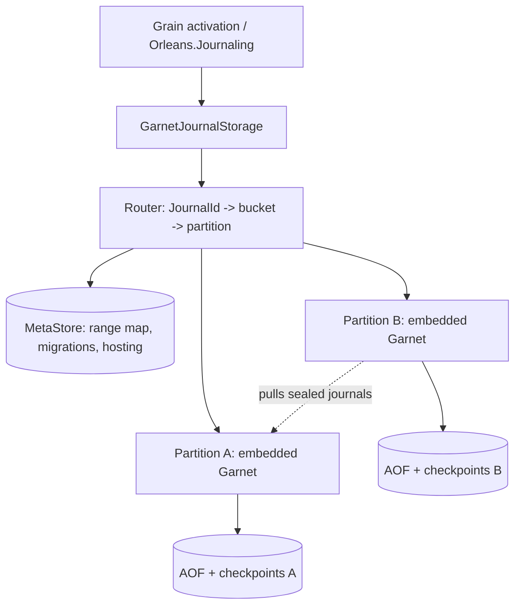

# Range-partitioned journal storage on embedded Garnet

Status: phases 0 and 1 implemented; phases 2–5 designed. This document records the design, its decisions (marked **Decided** or **Undecided**), and the evidence behind them.

The system stores `Orleans.Journaling` journals in embedded [Garnet](https://github.com/microsoft/garnet) instances, one per *partition*, and moves ownership of key ranges between partitions online using the range migration scheme designed for Roux (`roux/docs/design/range-migration.md` and `roux/specs/range-migration`). Each journal is linearizable, and every write is durable before it is acknowledged.

## Phases

| Phase | Scope | Status |
| --- | --- | --- |
| 0 | Embedded Garnet, transaction procedures, AOF commit-wait, crash recovery, fencing question | Done: [durability](#durability), [fencing](#fencing) |
| 1 | `Orleans.Journaling.Garnet` with one partition per cluster | Done: provider suites pass; [measurements](#measurements) |
| 2 | Many partitions, buckets, MetaStore, routing with view versions; static range map | Designed |
| 3 | Handover, lazy migration, consolidation, tombstones, GC; specification first | Designed; [bucket checks](#journal-procedures) and tombstones implemented |
| 4 | Partition hosting and failover on shared durable storage, with fencing | Designed |
| 5 | Balancer, splits and merges, locality placement, key filters, benchmarks | Designed |

## Architecture

The range layer maps journals to buckets and buckets to partitions, and moves buckets between partitions. The partition hosting layer runs each partition on some silo and fails partitions over. The range layer sees a partition as a linearizable, durable store that is sometimes unavailable.



| Term | Meaning |
| --- | --- |
| Bucket | `XxHash64(WTF-8(JournalId)) & (B - 1)`, where the bucket count `B` is a power of two fixed when a partition is initialized (4096 by default). The unit of ownership and migration. |
| Range | A contiguous run of buckets owned by one partition. |
| Partition | One Garnet instance with its own AOF and checkpoints, identified by a `PartitionId` that is never reused. |
| Range map, view `V` | The versioned mapping from ranges to partitions, with in-progress migrations and hosting assignments, at version `V`. Stored in the MetaStore. |

Phase 1 runs one partition which owns every bucket. A silo hosts it in process (`DataDirectory`); other silos connect to it (`ConfigurationOptions`).

## Partition data layout

| Key | Type | Contents |
| --- | --- | --- |
| `oj:j:{b}:{id}` | list | Journal data: one element per append. `ReplaceAsync` replaces the list with one element. |
| `oj:m:{b}:{id}` | hash | `$etag`, `$content-etag`, `$append-length`, `$format`, `$schema-version`, `$recent-etags`, and caller properties; or a tombstone: `$deleted`, `$etag`, and `$recent-etags`. |
| `oj:i:{b}` | set | Encoded ids of the bucket's live journals, updated in the same transaction as every create and delete. |
| `oj:b:{b}` | hash | Bucket state: `state` (`open` or `sealed`; absent key means absent), `version`, `source`, `done`. |
| `oj:partition` | hash | `bucket-count` and `schema-version`, written once every bucket of a new partition is open. |

`{b}` is the bucket in decimal; `{id}` is the journal id encoded as generalized UTF-8 (WTF-8), which is injective over .NET strings including unpaired surrogates, so the catalog decodes ids from the index without metadata reads.

## Journal procedures

Each journal operation is one Garnet `CustomTransactionProcedure`, registered before the server starts. Arguments begin with the bucket, metadata, data, and index keys and the encoded id. Each procedure:

1. Takes a **shared** lock on `oj:b:{b}` and exclusive locks on the journal's keys (and the index, for operations that create or delete). Bucket transitions take the **exclusive** lock on `oj:b:{b}`.
2. Returns `WrongPartition(state, version)` unless the bucket is `open`. This is Roux's in-band seal: an operation and a seal of its bucket are serialized by the bucket lock, so an operation either commits before the seal, and is part of the sealed state, or observes the seal and fails. No write is acknowledged after the seal (the Delos erratum ordering).
3. Returns `NeedPull(source)` if the bucket's migration is not `done` and the partition holds neither the journal nor its tombstone.
4. Applies the conditional operation with the same semantics as the Redis provider: content-ETag checks for data writes, metadata-ETag checks for metadata updates.

Garnet logs a procedure invocation to the AOF as its input, after `Main` returns, and replays it by running the procedure again. Three rules follow, each enforced in `GarnetJournalProcedures.cs`:

- **Determinism.** Procedures are pure functions of their arguments and the store. Clients generate every ETag.
- **Validate before writing.** `Main` applies writes as it issues them and an exception does not roll them back, so procedures complete every check before their first write, and issue only writes that cannot fail.
- **Stable procedure ids.** Ids are assigned in registration order and persisted in the AOF, so `GarnetJournalProtocol.Names` is append-only and registration verifies each id.

**Conditional writes.** Every data write is conditional: on the content ETag the storage instance last observed, or on the journal's absence. An instance that has not observed the journal reads its metadata before its first write. Two activations that both observe a missing journal therefore cannot both create it: one write succeeds and the other fails with `InconsistentStateException`. (The Redis provider instead appends unconditionally when it holds no ETag.)

**Idempotent retries.** The client sends the ETag each mutation writes, and each journal, including its tombstone, records the ETags of its last eight mutations in `$recent-etags`. A mutation that finds its own ETag there has already committed, so it reports success instead of applying again; otherwise its condition decides. A retry therefore applies at most once, and reports the committed outcome while fewer than eight later mutations have committed; beyond that, a retry whose condition no longer holds reports a conflict, which requires another writer and so is a genuine one. The client retries connection failures, timeouts, and transactions that did not run (lock timeouts) with identical arguments until `OperationTimeout`. Payloads are copied before they are sent, because a cancelled or timed-out call can leave the command queued in the client after the operation returns.

## Durability

Each partition runs with `EnableAOF`, `CommitFrequencyMs = 0`, and `WaitForCommit`. Evidence, from Garnet 2.2.0 (`microsoft/garnet@0d58590`):

- `RespCommand.HandleAofCommitMode` marks a session to wait for the AOF whenever it parses a command that is not AOF-independent; custom transaction procedures are not. `RespServerSession.Send` then awaits `StoreWrapper.WaitForCommitAsync` before writing the response.
- `TransactionManager.RunTransactionProcInternal` runs `Main`, logs the invocation (`EnqueueStoredProc`), and only then commits and releases locks. Any later operation on the same keys waits for the lock, and its reply waits for a commit that includes the earlier entry. Reads therefore never observe a write that a crash could lose, and read-only procedures (shared locks only) write nothing to the AOF.
- Partitions use Tsavorite's `RandomAccess` device, which opens files with `FileOptions.WriteThrough` and unbuffered I/O on every platform (decision D14), so a completed AOF flush is on stable storage.
- Recovery replays the AOF after the latest checkpoint, re-running logged procedures; the procedures must be registered before `GarnetServer.Start`, which recovers.
- The partition takes a checkpoint whenever its AOF exceeds `CheckpointAofSize` (256 MiB by default; Garnet's `AofSizeLimit`), compacting the hybrid log first (`LogCompactionType.Lookup`), which truncates the AOF and bounds recovery time.

`GarnetJournalDurabilityTests` verifies this end to end: a child process hosts a partition while eight writers append sequence numbers, the test kills the process at a random point (half of the cycles after a `SAVE` checkpoint), restarts it from the same directory, and checks that every journal holds a gap-free sequence including every acknowledged append. It runs four kill cycles in CI on every supported framework.

## Fencing

**Question:** does Garnet's Azure page blob device fence a zombie writer?

**Answer: not as Garnet configures it.** Tsavorite's `AzureStorageDevice` supports fencing when constructed with `underLease: true`: `BlobManager` maintains a 45-second lease on a `commit-lease` blob, and every page upload is conditioned on the page blob's ETag (`PageBlobRequestConditions.IfMatch`). But Garnet's `--use-azure-storage` path, `AzureStorageNamedDeviceFactory`, constructs devices with `underLease: false`, so it neither takes the lease nor conditions writes.

Phase 4 therefore requires a Garnet change. **Undecided:** either expose `underLease` through the device factory and prove that it covers every write (including creation of new segment blobs and checkpoint metadata, which the ETag condition alone does not), or add epoch fencing in the device so that every page write and AOF commit is conditional on the writer's hosting epoch from the MetaStore. Either way, the failover test must show that the old host's writes fail once the new host has recovered.

## Measurements

Phase 1, one embedded partition, 128-byte appends, Release build, .NET 10, Windows on a shared Azure VM (Intel Xeon Platinum 8370C, Azure managed disk; not local NVMe), client and partition in one process over loopback TCP, `RandomAccess` device. Two runs, which varied with load from other tenants of the VM:

| Concurrent writers | p50 | p99 | p99.9 | Throughput |
| --- | --- | --- | --- | --- |
| 1 | 0.87–0.93 ms | 3.6–4.3 ms | 17.6–25.7 ms | 924–956 appends/s |
| 16 | 4.9–5.6 ms | 9.8–18.1 ms | 20.6–47.0 ms | 2,816–3,371 appends/s |
| 64 | 3.7–4.9 ms | 12.9–56.0 ms | 19.2–100.9 ms | 8,633–14,692 appends/s |

With Tsavorite's default Windows device (unbuffered, without write-through), one run measured p50 0.65 ms and p99 2.76 ms for one writer and 10,272 appends/s for 64 writers. Concurrent commits share AOF flushes, so throughput grows with concurrency. `GarnetJournalLatencyTests` (category `Performance`, excluded from CI) reproduces these numbers. Migration, consolidation, failover, and storage-cost measurements follow the phases that introduce them; the NVMe and Azure page blob measurements need dedicated hardware.

## Decisions

| # | Decision | Status | Rationale |
| --- | --- | --- | --- |
| D1 | Store journal data as a **list**, one element per append. | Decided | Garnet stores strings in its hybrid log and `APPEND` rewrites the whole value (read-copy-update), so with the 128 MiB compaction threshold the Redis provider uses, each append could copy megabytes. A list append is O(1); a read returns one segment per append, which `IJournalStorageConsumer` accepts. |
| D2 | Use C# transaction procedures, not Lua. | Decided | Procedures lock their key set, log as one AOF record, and replay deterministically; Lua would need `--lua-transaction-mode` and per-call script parsing. |
| D3 | Clients generate ETags and retry ambiguous outcomes with identical arguments; journals retain their last eight mutation ETags. | Decided | Required for deterministic replay (D2) and for applying each mutation at most once across lost replies, including retries at another partition after a migration. Keeping several ETags, rather than only the current one, recognizes a retry after later mutations, including a deletion. |
| D4 | Delete writes a tombstone carrying the deletion's recent ETags. | Decided | Makes retries around deletes idempotent, and is required during migration so that a later read does not fall back to the source and resurrect the journal. |
| D5 | Tombstone reclamation. | Undecided | During migration, tombstones may be dropped once their bucket is `done`. Outside migration they serve only retry idempotency; reclaim them after a retention bound longer than `OperationTimeout`, measured in bucket transitions rather than clocks. |
| D6 | Operations require only `state == open`; the bucket's `version` is returned with `WrongPartition` so the client refreshes its view. | Decided | Refines the brief's `version == expectedVersion`. At most one partition holds a bucket open (Roux's `singleOpen`), so an open bucket is the unique acceptor regardless of the client's view; the view version is a staleness hint, not a safety condition. |
| D7 | A new single partition opens every bucket at version 0 with `done = 1`, then writes `oj:partition`. | Decided | Opening is idempotent, so a crash during initialization is repaired by the next start; the descriptor pins the bucket count. |
| D8 | Lock the bucket key shared and the bucket index exclusively for operations that may create or delete. | Decided | The shared bucket lock implements the in-band seal; the index lock serializes creates and deletes per bucket for microseconds, while locks are held only in memory (AOF waits happen after release). |
| D9 | Reach partitions over RESP (StackExchange.Redis), including the in-process partition over loopback. | Decided for phases 1–2 | Garnet's in-process sessions (`EmbeddedRespServer`) are internal to its benchmarks. Productizing them is a Garnet change, worth doing in phase 5 for locality placement. |
| D10 | Depend on `Microsoft.Garnet` 2.2.0, with Microsoft.Extensions 10.x on net8.0 for these projects. | Decided | Garnet requires those versions on both frameworks; `Directory.Packages.props` raises them only for `Orleans.Journaling.Garnet*` projects. |
| D11 | A partition opens a bucket only when it holds no data for it: the bucket is absent, or sealed and reclaimed. The coordinator starts a migration out of a bucket only after the bucket's inbound migration is `Complete`, except during failover. | Undecided (phase 3 specification) | Per-journal keys carry no position, so a partition that reopened a bucket while still holding its sealed copy would serve that stale copy instead of pulling. Roux avoids this with log positions; here the rule prevents it and bounds chains to one source outside failover. |
| D12 | Zombie-host fencing mechanism. | Undecided | See [Fencing](#fencing). |
| D13 | Garnet replication is not used. | Decided | It is asynchronous and cannot satisfy synchronous durability. Availability comes from failover onto shared durable storage (phase 4). |
| D14 | Local partitions use the `RandomAccess` device (write-through, unbuffered). | Decided | Tsavorite's default devices are unbuffered but not write-through (Windows) or depend on the native backend (Linux), which survives process loss but not necessarily power loss. Write-through makes an acknowledged write durable on the device on every platform. |
| D15 | The catalog reads each bucket index with `SMEMBERS`. | Decided | Garnet's `SSCAN` cursor is a position in the set's enumeration, so a delete between pages skips members. One snapshot per bucket includes every journal that exists for the whole listing. |
| D16 | Every data write is conditional, on an observed content ETag or on absence. | Decided | Duplicate activations which both observe a missing journal cannot both create it, and retries cannot apply a write blindly. |

## Range layer (phases 2–3)

### MetaStore

The MetaStore is pluggable and holds the range map. Every change, including migration phase and hosting changes, is a compare-and-swap from `V` to `V + 1`, so a crashed or duplicated coordinator is safe.

```csharp
public interface IRangeMetaStore
{
    ValueTask<RangeMapSnapshot> ReadAsync(CancellationToken cancellationToken);
    ValueTask<(bool Written, RangeMapSnapshot Current)> TryWriteAsync(RangeMap next, long expectedVersion, CancellationToken cancellationToken);
}

public sealed record RangeMapSnapshot(long Version, RangeMap Map);
public sealed record RangeMap(
    int BucketCount,
    ImmutableArray<RangeAssignment> Ranges,
    ImmutableArray<Migration> Migrations,
    ImmutableDictionary<PartitionId, PartitionHosting> Partitions);
public sealed record RangeAssignment(int FirstBucket, int LastBucket, PartitionId Owner, long AssignedAtVersion);
public sealed record Migration(int FirstBucket, int LastBucket, PartitionId Source, PartitionId Destination, long StartedAtVersion, MigrationPhase Phase);
public sealed record PartitionHosting(string Host, long Epoch, string StorageLocation);
```

`RangeAssignment.AssignedAtVersion` is added to the brief's sketch so a client can compare its assignment with the version a partition reports. `PartitionHosting.Host` is a string so the interface carries no Orleans types. Implementations: in-memory (tests), Azure Blob (one document, ETag CAS), and a dedicated Garnet instance with commit-wait.

### Handover and migration

Moving buckets `[f, l]` from partition A to B at view `V`: commit `V` (assign to B, add `Migration(..., Committed)`); A seals each bucket (`OJBUCKET seal V`); B opens each bucket (`open V source=A done=0`) only after A's seal is recorded. B returns `NeedPull` for a journal it does not hold; the client reads the journal from A (stable, since A's bucket is sealed), installs it in B with a conditional install (only if B holds neither the journal nor its tombstone), and retries. A consolidator scans A's `oj:i:{b}` and installs each journal; when every journal is present in B, B sets `done` in a transaction that rechecks the condition. After `Done`, the coordinator records `Complete`, and A deletes the bucket's journals and index but keeps `oj:b:{b}` sealed, so later reads in A return `WrongPartition`: reclaimed data reads as an error, never as absent.

The procedures already implement the seal, the `WrongPartition` and `NeedPull` checks, and tombstones. Phase 3 adds the install procedure, the consolidator, completion, and GC, and lands with the specification below.

### Specification

The Roux specification is copied and adapted before phase 3 code lands: per-bucket seal and open, pulls with conditional installs, tombstones, `done`, GC, chains, and D11; partitions abstracted as available or unavailable with an epoch; concurrent clients, duplicate activations with ETags, ambiguous outcomes with idempotent retries, crashes, and view changes at every phase. Invariants: every read returns every acknowledged write; deleted and never-written journals read as absent; no write is acknowledged in a sealed bucket; at most one partition accepts writes for a bucket; a pull never overwrites a newer write; reclaimed data reads as an error; under fairness every migration completes. Each rule gets a mutant (open before seal, unconditional install, delete without tombstone, GC before `done`, non-idempotent retry). Traces exported with `quint run --out-itf` drive a .NET conformance harness against the real procedures and an in-memory MetaStore.

## Differences from Roux

| Roux | Here | Why the guarantee holds |
| --- | --- | --- |
| A node-wide log; a range's cut is the position of its in-band `Offloading` record. | Per-journal keys; a bucket's cut is its sealed state in the source partition. | The seal is serialized with every operation on the bucket by the bucket lock (step 1 above), which gives the same ordering as an in-band log record: every acknowledged write precedes the seal. Without positions, D11 replaces Roux's position-based reopen. |
| Membership log with dense versions. | MetaStore with CAS from `V` to `V + 1`. | Both provide a totally ordered sequence of views; nodes apply views in order. |
| Snapshot records with continuations, written conditionally on coverage. | Whole journals installed conditionally on absence. | A journal's state in B is either absent (pull from the source) or authoritative (written or installed in B), so "install only if absent" is the coverage comparison. |
| VirtualLog segments with reconfiguration for forced seals. | Garnet AOF; an unreachable source is failed over at the hosting layer, recovered at a higher epoch, and then sealed. | Recovery replays every acknowledged write, and fencing (D12) prevents the old host from acknowledging more. |
