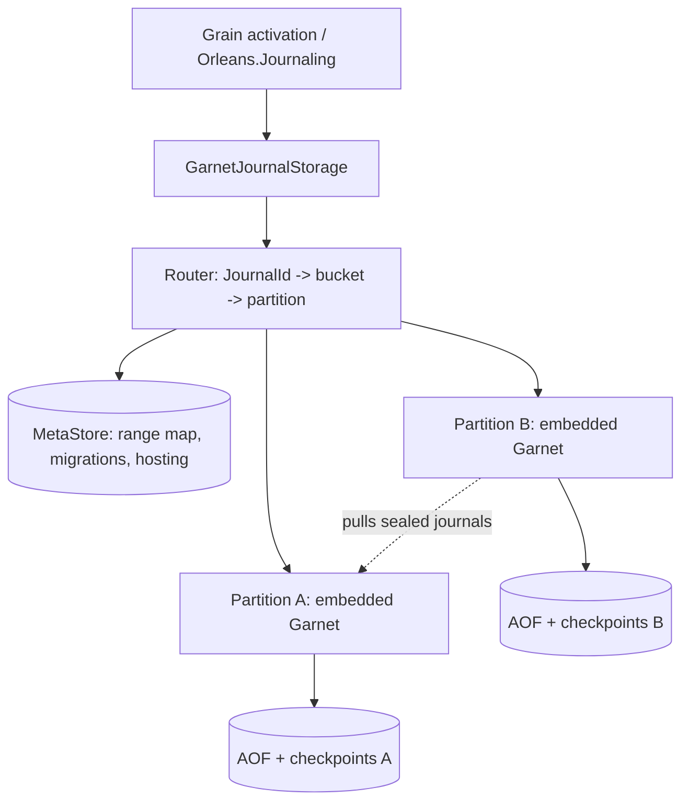
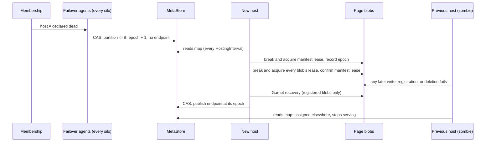

# Range-partitioned journal storage on embedded Garnet

Status: spike complete. Phases 0–5 are implemented; the [final status](#final-status) summarizes what the spike proved and what remains open. This document records the design, its decisions (marked **Decided** or **Undecided**), and the evidence behind them.

The system stores `Orleans.Journaling` journals in embedded [Garnet](https://github.com/microsoft/garnet) instances, one per *partition*, and moves ownership of key ranges between partitions online using the range migration scheme designed for Roux (`roux/docs/design/range-migration.md` and `roux/specs/range-migration`). Each journal is linearizable, and every write is durable before it is acknowledged.

## Phases

| Phase | Scope | Status |
| --- | --- | --- |
| 0 | Embedded Garnet, transaction procedures, AOF commit-wait, crash recovery, fencing question | Done: [durability](#durability), [fencing](#fencing) |
| 1 | `Orleans.Journaling.Garnet` with one partition per cluster | Done: provider suites pass; [measurements](#measurements) |
| 2 | Many partitions, buckets, MetaStore, routing with view versions; static range map | Done: [MetaStore](#metastore), [routing](#routing), [hosting](#partition-hosting-phase-2); routing, MetaStore CAS, and three-silo, four-partition cluster tests |
| 3 | Handover, lazy migration, consolidation, tombstones, GC; specification first | Done: [specification](#specification) (simulation, mutants, TLC safety and liveness), [migration](#handover-and-migration), [conformance replay](#conformance-and-fault-tests) of specification traces, fault tests under continuous migration with process kills, [measurements](#migration-measurements) |
| 4 | Partition hosting and failover on shared durable storage, with fencing | Done: [fencing](#fencing) on Azure page blobs (D12), [hosting and failover](#partition-hosting-and-failover-phase-4), [hosting specification](#hosting-specification) (simulation, mutants, TLC safety), zombie-host, failover-under-load, process-kill, and cluster failover tests, [measurements](#failover-measurements) |
| 5 | Balancer, splits and merges, locality placement, key filters, benchmarks | Done: [key filters](#key-filters) (specified first, with mutants; TLC safety and liveness with exact filters), [load balancing](#load-balancing), [placement balance](#placement-balance), [locality placement](#locality-placement), [benchmarks against the Azure Blob and Redis providers](#provider-comparison), [phase 5 measurements](#phase-5-measurements) |

## Architecture

The range layer maps journals to buckets and buckets to partitions, and moves buckets between partitions. The partition hosting layer runs each partition on some silo and fails partitions over. The range layer sees a partition as a linearizable, durable store that is sometimes unavailable.



| Term | Meaning |
| --- | --- |
| Bucket | `XxHash64(WTF-8(JournalId)) & (B - 1)`, where the bucket count `B` is a power of two fixed when a partition is initialized (4096 by default). The unit of ownership and migration. |
| Range | A contiguous run of buckets owned by one partition. |
| Partition | One Garnet instance with its own AOF and checkpoints, identified by a `PartitionId` that is never reused. |
| Range map, view `V` | The versioned mapping from ranges to partitions, with in-progress migrations and hosting assignments, at version `V`. Stored in the MetaStore. |

A silo hosts the partitions the range map assigns to it, each an embedded Garnet server with its own data directory and endpoint, and routes every journal operation to the partition which owns the journal's bucket. Ranges move between partitions online through migrations recorded in the range map.

## Partition data layout

| Key | Type | Contents |
| --- | --- | --- |
| `oj:j:{b}:{id}` | list | Journal data: one element per append. `ReplaceAsync` replaces the list with one element. |
| `oj:m:{b}:{id}` | hash | `$etag`, `$content-etag`, `$append-length`, `$format`, `$schema-version`, `$recent-etags`, and caller properties; a tombstone: `$deleted`, `$etag` (the deletion's), `$deleted-at`, `$deleted-gen` (the bucket's collection generation at the deletion, D25), and `$recent-etags`; or an absent marker: `$absent`. |
| `oj:i:{b}` | set | Encoded ids of the bucket's live journals, updated in the same transaction as every create and delete. |
| `oj:x:{b}` | set | Encoded ids of the bucket's tombstones and absent markers, updated in the same transaction as every change to them. Consolidation, marker collection, and reclamation find them here. |
| `oj:b:{map}:{b}` | hash | Bucket state: `state` (`open` or `sealed`; absent key means absent), `version`, `source`, `done`, `reclaimed`, and `collected` (the collection generation, D25). `{map}` is the range map's identity (D23). |
| `oj:partition` | hash | `identity` (`{map}/{partition}/{bucket count}`), claimed only if absent before the partition opens any bucket; `map-id`, `partition-id`, `bucket-count`, and `schema-version`, the claimed identity's parts; `initialized`, written once the partition has opened its initial buckets. |

`{b}` is the bucket in decimal; `{id}` is the journal id encoded as generalized UTF-8 (WTF-8), which is injective over .NET strings including unpaired surrogates, so the catalog decodes ids from the index without metadata reads.

## Journal procedures

Each journal operation is one Garnet `CustomTransactionProcedure`, registered before the server starts. Arguments begin with the bucket, metadata, data, and index keys and the encoded id. Each procedure:

1. Takes a **shared** lock on `oj:b:{b}` and an exclusive lock on the journal's metadata key, which also makes Garnet log reads (D32); writes also lock the data key, the index, and the marker set exclusively. Bucket transitions take the **exclusive** lock on `oj:b:{b}`.
2. Returns `WrongPartition(state, version)` unless the bucket is `open`. This is Roux's in-band seal: an operation and a seal of its bucket are serialized by the bucket lock, so an operation either commits before the seal, and is part of the sealed state, or observes the seal and fails. No write is acknowledged after the seal (the Delos erratum ordering).
3. Returns `NeedPull(source, version)` if the bucket's migration is not `done` and the partition holds no record of the journal (the journal, its tombstone, or an absent marker). `version` names the partition's tenure of the bucket, which a pull's install checks.
4. Applies the conditional operation with the same semantics as the Redis provider: content-ETag checks for data writes, metadata-ETag checks for metadata updates.

The catalog's `OJINDEX` procedure takes a shared lock on the bucket and an exclusive lock on its index (D32), applies the same bucket checks (returning `NeedPull` for any bucket whose migration is not `done`), and returns the index as one snapshot.

Migration procedures (`GarnetJournalMigrationProcedures.cs`), each one transaction:

| Procedure | Runs at | Does |
| --- | --- | --- |
| `OJBUCKET` | any | `open`, `seal`, or `reclaim` a bucket under its exclusive lock (D11, D42). An open inherits the source's collection generation (D25). Each reports success if already applied. |
| `OJBUCKETINFO` | any | Reads a bucket's state and its index and marker counts. |
| `OJPULLREAD` | a sealed copy | Reads a journal's record (live, tombstone, absent marker, or none) and the copy's own `done` and `source`, for a pull or consolidation; `WrongPartition` if the copy is not sealed or is reclaimed. |
| `OJLINK` | a sealed copy | Lists every journal the copy holds a record of (index and marker set), with its `done` and `source`. |
| `OJINSTALL` | the destination | Installs a record only if the partition holds the bucket open, not done, at the expected version, and holds no record of the journal (D43). |
| `OJDONE` | the destination | Sets `done` only if the bucket is open at the expected version, under the bucket's exclusive lock, rechecking that every listed journal has a record. A partition reopens a bucket only at a later version, so a delayed request applies to no later tenure (D46). |
| `OJPURGE` | a reclaimed copy | Deletes a batch of journals, tombstones, and markers, only if the copy is still sealed at the version the batch names and reclaimed, so a delayed batch purges no later tenure (D47). |
| `OJDROPMARK` | an open, done bucket | Drops a batch of absent markers, and tombstones deleted before a cutoff, under the bucket's exclusive lock, raising the bucket's collection generation past every dropped tombstone's `$deleted-gen` (D5, D25). |

Garnet logs a procedure invocation to the AOF as its input, after `Main` returns, and replays it by running the procedure again. Three rules follow, each enforced in `GarnetJournalProcedures.cs`:

- **Determinism.** Procedures are pure functions of their arguments and the store. Clients generate every ETag.
- **Validate before writing.** `Main` applies writes as it issues them and an exception does not roll them back, so procedures complete every check before their first write, and issue only writes that cannot fail.
- **Stable procedure ids.** Ids are assigned in registration order and persisted in the AOF, so `GarnetJournalProtocol.Names` is append-only and registration verifies each id.

**Conditional writes.** Every mutation is conditional on a state identity that never recurs: a data write on the content ETag the storage instance last observed, or on the absence it observed, named by the tombstone's ETag (or no record); a metadata update on the metadata ETag. An unconditional metadata update is conditioned on the ETag the instance reads, and reads again while other writers' updates intervene. An instance that has not observed the journal reads its metadata before its first write. Two activations that both observe a missing journal therefore cannot both create it: one write succeeds and the other fails with `InconsistentStateException`. (The Redis provider instead appends unconditionally when it holds no ETag.) A missing journal reads as `[0, absenceETag, generation]`; a write conditioned on the empty absence (no record, or an absent marker) carries that collection generation, and fails if the bucket has since dropped a tombstone stamped at or after it (D25). If no attempt can have committed and the journal is still in the empty absence, the client observes it again and writes with the new generation.

**Idempotent retries.** The client sends the ETag each mutation writes, and each journal, including its tombstone, records the ETags of its last eight mutations in `$recent-etags`. A mutation that finds its own ETag there has already committed, so it reports success instead of applying again; a no-op metadata update records its ETag without changing the metadata ETag. Otherwise the mutation's condition decides, and because every condition names a state that never recurs, a retry whose ETag has left the history cannot apply again, even after a later creation and deletion. A retry therefore applies at most once, and reports the committed outcome while fewer than eight later mutations have committed. Beyond that, a retry whose condition no longer holds throws `GarnetJournalAmbiguousConflictException`, an `InconsistentStateException`: other writers changed the journal either way. The client retries connection failures, timeouts, and transactions that did not run (lock timeouts) with identical arguments until `OperationTimeout`, which also bounds each attempt's wait for a reply. Payloads are copied before they are sent, because a cancelled or timed-out call can leave the command queued in the client after the operation returns.

## Durability

Each partition runs with `EnableAOF`, `CommitFrequencyMs = 0`, and `WaitForCommit`. Evidence, from Garnet 2.2.0 (`microsoft/garnet@0d58590`):

- `RespCommand.HandleAofCommitMode` marks a session to wait for the AOF whenever it parses a command that is not AOF-independent; custom transaction procedures are not. `RespServerSession.Send` then awaits `StoreWrapper.WaitForCommitAsync` before writing the response.
- `TransactionManager.RunTransactionProcInternal` runs `Main`, logs the invocation (`EnqueueStoredProc`), and only then commits and releases locks. Any later operation on the same keys waits for the lock, and its reply waits for a commit that includes the earlier entry. Reads therefore never observe a write that a crash could lose. Garnet logs a procedure only if it takes an exclusive lock (`TxnKeyManager` sets `PerformWrites`), so every journal procedure, including reads, locks the journal's metadata key exclusively, and the catalog's `OJINDEX` locks the bucket index exclusively: their replies wait for an AOF commit, which a fenced partition cannot complete (D32).
- Partitions on local disk use Tsavorite's `RandomAccess` device, which opens files with `FileOptions.WriteThrough` and unbuffered I/O on every platform (decision D14), so a completed AOF flush is on stable storage. Partitions on shared storage use the fenced page blob device (D12), whose writes complete once Azure Storage has committed them.
- Recovery replays the AOF after the latest checkpoint, re-running logged procedures; the procedures must be registered before `GarnetServer.Start`, which recovers.
- The partition takes a checkpoint whenever its AOF exceeds `CheckpointAofSize` (256 MiB by default; Garnet's `AofSizeLimit`), compacting the hybrid log first (`LogCompactionType.Lookup`), which truncates the AOF and bounds recovery time.

`GarnetJournalDurabilityTests` verifies this end to end: a child process hosts a partition while eight writers append sequence numbers, the test kills the process at a random point (half of the cycles after a `SAVE` checkpoint), restarts it from the same directory, and checks that every journal holds a gap-free sequence including every acknowledged append. It runs four kill cycles in CI on every supported framework.

## Fencing

**Question:** does Garnet's Azure page blob device fence a zombie writer?

**Answer: not as Garnet configures it.** Tsavorite's `AzureStorageDevice` supports fencing when constructed with `underLease: true`: `BlobManager` maintains a 45-second lease on a `commit-lease` blob, and every page upload is conditioned on the page blob's ETag (`PageBlobRequestConditions.IfMatch`). But Garnet's `--use-azure-storage` path, `AzureStorageNamedDeviceFactory`, constructs devices with `underLease: false`, so it neither takes the lease nor conditions writes. Even with `underLease: true`, uploads do not carry the lease id, and an ETag condition does not fence: a zombie's write can land after the new host reads the blob and before its first write, acknowledged by the zombie yet absent from the new host's state.

**Mechanism (D12): an Orleans-side device over fenced page blobs, without a Garnet change.** `GarnetServerOptions.DeviceFactoryCreator` supplies every device Garnet uses (hybrid log, AOF, checkpoints, and AOF commit metadata), so `GarnetPartitionBlobDeviceFactoryCreator` puts all of a partition's durable state in page blobs under its `StorageLocation`, held by one hosting tenure at a time (`GarnetPartitionBlobStorage`):

- **Leases.** A tenure holds an infinite lease, with an id of its own, on the partition's manifest blob and on every page blob it writes. Every page upload (`UploadPages`), manifest update, re-creation, and deletion carries the lease id, so the storage service rejects it, atomically, once another tenure has broken the lease.
- **Manifest.** The manifest registers the blobs which hold the partition's state; the device lists and recovers only registered blobs. A tenure creates a blob (`If-None-Match: *`), acquires its lease, and only then registers it, by a lease-conditioned manifest update, before writing to it; it unregisters a blob before deleting it. Only a takeover breaks leases: creation fails rather than break another tenure's lease.
- **Takeover.** A new tenure breaks and acquires the manifest's lease (break period 0), checks that the manifest's epoch is not later than its own and records its epoch, breaks and acquires the lease of every blob under the location, confirms by another lease-conditioned manifest update that it still holds the manifest, and only then lets Garnet recover. An earlier tenure wrote only to blobs it registered while it held the manifest, which existed under its lease before the takeover, so the takeover fences them: every write an earlier tenure completed is visible to recovery, and every later one fails. The confirmation stops a slower, earlier takeover which broke leases after a later one fenced them (found by TLC; `mutantUnconfirmedRecovery`).
- **Acknowledgments.** Garnet replies only after the AOF commit covering the operation completes (`--aof-commit-wait`), and a failed AOF write makes Tsavorite fail every later commit (`TolerateDeviceFailure` is off), so a fenced host acknowledges nothing more. Its connections fail, and clients retry at the new host.
- **Reads.** A zombie which has not written since the takeover still holds its state in memory. Every journal read and catalog procedure therefore takes an exclusive lock, which makes Garnet log it, so its reply waits for an AOF write which a fenced host cannot complete (D32).

The epoch check only keeps a stale host from interrupting a later one; safety rests on the leases. The [hosting specification](#hosting-specification) checks the protocol and a mutant for each rule. `GarnetJournalFencingTests` shows on Azurite that a zombie acknowledges no write which the new host did not recover, including writes in flight during the takeover, that it answers no read once the new host has taken over, and that creation and deletion are fenced. Upstreaming the device to Garnet, as a fencing mode of `AzureStorageNamedDeviceFactory`, is Undecided (D35).

## Measurements

Phase 1, one embedded partition, 128-byte appends, Release build, .NET 10, Windows on a shared Azure VM (Intel Xeon Platinum 8370C, Azure managed disk; not local NVMe), client and partition in one process over loopback TCP, `RandomAccess` device. Two runs, which varied with load from other tenants of the VM:

| Concurrent writers | p50 | p99 | p99.9 | Throughput |
| --- | --- | --- | --- | --- |
| 1 | 0.87–0.93 ms | 3.6–4.3 ms | 17.6–25.7 ms | 924–956 appends/s |
| 16 | 4.9–5.6 ms | 9.8–18.1 ms | 20.6–47.0 ms | 2,816–3,371 appends/s |
| 64 | 3.7–4.9 ms | 12.9–56.0 ms | 19.2–100.9 ms | 8,633–14,692 appends/s |

With Tsavorite's default Windows device (unbuffered, without write-through), one run measured p50 0.65 ms and p99 2.76 ms for one writer and 10,272 appends/s for 64 writers. Concurrent commits share AOF flushes, so throughput grows with concurrency. `GarnetJournalLatencyTests` (category `Performance`, excluded from CI) reproduces these numbers. Phase 5 adds [storage cost](#storage-cost) and a [provider comparison](#provider-comparison); the NVMe and real Azure page blob measurements need dedicated hardware and a storage account.

### Migration measurements

Phase 3, the same VM (Intel Xeon Platinum 8370C, 32 logical processors, 128 GiB, Azure managed disk, Windows), Release build, .NET 10, two embedded partitions in one process over loopback TCP, `RandomAccess` device, 16 buckets. `GarnetJournalMigrationMeasurements` (category `Performance`) reproduces them. Two runs:

| Measurement | Configuration | Result |
| --- | --- | --- |
| Cutover pause | 16 writers appending 128 B to journals in one bucket while it moves; the coordinator in-process | Commit to `Opened`: 67–79 ms; commit to reclaimed source: 140–166 ms. Appends which completed before the commit: p50 3.5–4.2 ms, p99 19–45 ms, max 40–92 ms. Appends which overlapped the move, including those blocked across cutover: p50 3.7–3.8 ms, p99 76–91 ms, max 81–94 ms. |
| Pull overhead on first access | 500 journals of 1 KiB, read one at a time after the destination opened | Before the move p50 0.26–0.27 ms; first access (pull) p50 1.46–1.60 ms, p99 5.8–34 ms; second access p50 0.25–0.27 ms. |
| Consolidation rate | 5,000 journals of 1 KiB in one bucket, 16 concurrent installs | 3,452–4,132 journals/s (3.4–4.0 MiB/s); completion and reclamation of the source 45–50 ms. |

The cutover pause is the time between the seal and the open, plus the writers' backoff (10 ms doubling) while the destination has not opened, so it is dominated by the coordinator's round trips: two MetaStore writes and a bucket transition at each partition. A pull costs a chain read and an install, about five times a read. Consolidation reads each journal from the chain and installs it, in two round trips; batching several journals per round trip, or opening the destination with a key filter (phase 5), would raise its rate.

### Failover measurements

Phase 4, the same VM, Release build, .NET 10, one partition on page blobs in [Azurite](https://github.com/Azure/Azurite) 3.35.0 running on the same VM (its blob service persisting to the managed disk), client and partition in one process over loopback TCP, 128-byte appends. Azurite has no network hop and no replication, so these numbers bound the device's own overhead; real Azure page blobs add the service's write latency to every commit, and need a real storage account to measure. `GarnetJournalFailoverMeasurements` (categories `Performance` and `AzureStorage`) reproduces them. Two runs:

| Measurement | Configuration | Result |
| --- | --- | --- |
| Append latency, 1 writer | 1,000 appends | p50 1.84–1.89 ms, p99 6.4–22.2 ms, p99.9 11.2–86.1 ms; 390–498 appends/s |
| Append latency, 16 writers | 4,800 appends | p50 5.2–6.6 ms, p99 14.8–31.2 ms, p99.9 16.5–46.6 ms; 2,194–2,866 appends/s |
| Append latency, 64 writers | 6,400 appends | p50 6.5–6.9 ms, p99 14.3–24.3 ms, p99.9 24.4–26.3 ms; 8,494–9,651 appends/s |
| Failover, small partition | 216 journals; 16 writers appending throughout | Assignment to serving at the new host (takeover, recovery, initialization, endpoint published): 1.24–1.28 s. Longest append seen by a writer: 1.38 s. |
| Failover, 5 MiB partition | 5,016 journals of 1 KiB; 16 writers | Assignment to serving: 1.39–1.62 s. Longest append: 2.37–2.38 s. |
| Failover in a cluster | 3 silos, 3 partitions on the killed silo, `ProbeTimeout` 1 s, `NumMissedProbesLimit` 2 | Kill to every partition served by another silo: 2.6–7.1 s over three runs, including membership's declaration of death (`GarnetSharedStorageClusterTests`). |

Failover time is membership's failure detection, then the failover agent's next pass and the new host's next hosting pass (`HostingInterval`, 1 s by default), then the takeover (a lease break and acquisition per blob, about 10 blobs here) and Garnet's recovery, which replays the AOF since the last checkpoint and so grows with `CheckpointAofSize`. Writers see the failover as one long append: the router backs off (up to 1 s) while the partition has no endpoint, so the longest append exceeds assignment-to-serving by up to a backoff interval.

### Phase 5 measurements

The same VM (Intel Xeon Platinum 8370C, 32 logical processors, 128 GiB, Azure managed disk, Windows), Release build, .NET 10, one run each with no other load on the VM. Garnet partitions run in the test process and are reached over loopback TCP. [Azurite](https://github.com/Azure/Azurite) 3.35.0 runs natively on the VM (Node.js), persisting to the managed disk, with no network hop and no replication, so Azure numbers bound the client and device overheads rather than predict the service's. Redis 7.4 runs in Docker Desktop (a Linux VM on WSL 2) with its AOF on the VM's virtual disk; a Redis round trip through Docker's port forwarding takes 0.67–0.74 ms p50, against 0.22 ms for a loopback round trip to Garnet. The reports come from the `Performance`-category tests named in each section, which append them to files in the temporary directory. After this layer was rebased onto the lower layers' final protocol (collection generations, fenced opens and installs), the key-filter, cutover, pull, and consolidation measurements were repeated and matched the tables within run-to-run variation (commit to `Opened` 7.5–9.6 ms; first write after a move with filters p50 1.11 ms, without 2.55 ms; 4,173 journals/s consolidated). A repeat of the local-disk append case ran while other processes held the VM at 36–79% CPU and varied threefold between two runs (5,114–16,460 appends/s at 64 writers), so the tables keep the unloaded run.

#### Provider comparison

`GarnetJournalProviderComparison`: 128-byte appends through `IJournalStorage`, one journal per writer, after one warm-up append; 1,000 appends for one writer, 250 per writer for 16, and 100 per writer for 64. Garnet uses one partition, so its numbers are per partition.

| Provider | Durability of an acknowledged append | 1 writer: p50 / p99 / p99.9, throughput | 16 writers | 64 writers |
| --- | --- | --- | --- | --- |
| Garnet, local disk | Flushed with write-through | 0.56 / 2.13 / 3.85 ms, 1,577/s | 1.75 / 5.58 / 24.6 ms, 8,333/s | 2.20 / 3.67 / 3.90 ms, 28,646/s |
| Garnet, page blobs (Azurite) | Committed by the storage service, fenced | 1.99 / 5.63 / 12.0 ms, 460/s | 5.34 / 14.3 / 16.0 ms, 2,800/s | 5.65 / 14.5 / 14.5 ms, 10,098/s |
| Azure Blob provider (Azurite) | Committed by the storage service | 1.78 / 5.96 / 14.3 ms, 509/s | 15.9 / 29.7 / 45.1 ms, 921/s | 65.7 / 103 / 109 ms, 959/s |
| Redis provider, `appendfsync always` (Docker) | `fsync`ed by the Redis process | 2.29 / 4.11 / 5.70 ms, 422/s | 3.85 / 9.04 / 14.3 ms, 3,882/s | 6.25 / 10.8 / 13.4 ms, 9,903/s |
| Redis provider, `appendfsync everysec` (Docker) | Not durable: up to a second of acknowledged writes is lost with the machine | 0.81 / 1.34 / 1.99 ms, 1,193/s | 1.09 / 1.96 / 2.79 ms, 14,011/s | 1.60 / 2.43 / 2.49 ms, 39,065/s |

Garnet's group commit shares AOF flushes and page uploads among concurrent appends (0.050 uploads per append at 64 writers), so its throughput grows with concurrency on both devices. The Azure Blob provider issues at least one append-block per append, and Azurite, a single Node.js process, caps it near 950 appends/s; the real service parallelizes across blobs, so its concurrency curve needs a storage account to measure. Redis with `appendfsync always` is the comparable synchronous configuration, and it trails Garnet on local disk by its container's round trip and the virtual disk's `fsync`; `everysec` is faster because it acknowledges before writes are durable, which the hard requirements exclude. Neither Redis configuration survives the loss of its machine without replication, which is asynchronous.

#### Key filters, cutover, and pulls

`GarnetJournalMigrationMeasurements`: two partitions, 16 buckets.

| Measurement | Configuration | Without key filters | With key filters |
| --- | --- | --- | --- |
| Cutover pause | 5,000 journals of 128 B in the bucket, 16 writers appending to it while it moves, coordinator in-process | Commit to `Opened` 9.5 ms; appends during the move p50 1.54 ms, p99 8.34 ms, max 56.9 ms | Commit to `Opened` 9.8 ms; p50 1.55 ms, p99 8.53 ms, max 27.4 ms |
| First write to a journal created after the move | 500 journals, one at a time; before the move p50 1.07 ms | p50 2.52 ms, p99 4.43 ms (a pull: chain read, absent marker, retry) | p50 1.07 ms, p99 2.80 ms (no pull) |
| First read of a journal the source held | 500 journals of 1 KiB, one at a time | p50 2.05 ms, p99 4.78 ms | p50 2.08 ms, p99 4.41 ms |

Building the filter in the seal's transaction and copying it at the open does not measurably lengthen the cutover at 5,000 journals (the filter is 6 KiB). Filters remove the pull from every first access to a journal the source never held, which is most first accesses to a moved bucket, and leave pulls of held journals unchanged. Without preloaded journals, commit to `Opened` took 10.6 ms. The [migration measurements](#migration-measurements) report 67–79 ms from commit to `Opened`, taken while other work loaded the VM.

#### Consolidation and failover

| Measurement | Configuration | Result |
| --- | --- | --- |
| Pull overhead | 500 journals of 1 KiB read one at a time (`MeasurePullOverhead`) | Before the move p50 0.76 ms; first access p50 2.90 ms, p99 6.21 ms; second access p50 0.69 ms |
| Consolidation rate | 5,000 journals of 1 KiB in one bucket, 16 concurrent installs | 4,151 journals/s (4.1 MiB/s); completion and reclamation of the source 51 ms |
| Failover, small partition | 216 journals, 16 writers, page blobs (`GarnetJournalFailoverMeasurements`) | Assignment to serving 2.39 s; longest append 3.39 s |
| Failover, 5 MiB partition | 5,016 journals of 1 KiB, 16 writers | Assignment to serving 2.52 s; longest append 3.38 s |

Failover took 1.24–1.62 s in phase 4's runs and 2.4–2.5 s in this one, which is run-to-run variation on this shared VM. Cluster failover (membership's detection included) took 2.6–7.1 s in phase 4.

#### Round trips and in-process sessions

`GarnetJournalProviderComparison.GarnetRoundTripCosts`, 2,000 sequential calls each on a partition on local disk: a loopback `PING` p50 0.224 ms; an unlogged procedure (`OJBUCKETINFO`) 0.299 ms; a journal read, which is logged and waits for an AOF commit (D32), 0.667 ms. A loopback round trip is therefore 39% of a single writer's append on local disk (0.56 ms), 11% of one on page blobs (1.99 ms), and less under concurrency, where commits wait for shared flushes. In-process sessions would remove at most that round trip (D40).

#### Storage cost

`GarnetJournalProviderComparison.GarnetPageBlobs` counts the bytes and page uploads the fenced device completes. Per 128-byte append, the AOF record of the procedure invocation (keys, ETags, payload) is about 550 bytes; one writer commits each append alone and rounds it up to two 512-byte pages:

| Writers | Bytes uploaded per append | Page uploads per append |
| --- | --- | --- |
| 1 | 1,027 | 1.00 |
| 16 | 617 | 0.19 |
| 64 | 552 | 0.050 |

A million 128-byte appends therefore write 0.55–1.03 GB to the AOF in 50,000–1,003,000 page uploads. Checkpoints truncate the AOF (at most `CheckpointAofSize`, 256 MiB, per partition), so retained storage is the journals' own data (each append's payload plus list overhead, until compaction replaces it) plus up to one AOF and one checkpoint per partition. Estimated cost per million appends, from those measurements and assumed list prices, which must be checked against the current [page blob pricing](https://azure.microsoft.com/pricing/details/storage/page-blobs/):

- **Premium page blobs** (assumed: P10, 128 GiB, about $18 per month, transactions included): the cost is capacity, one P10 per partition, independent of appends. At a sustained 1,000 appends/s a partition performs 2.6 billion appends a month, about $0.007 per million.
- **Standard page blobs** (assumed: $0.05 per 10,000 write transactions and $0.045 per GB-month): $5.00 per million appends with one writer, $0.95 with 16, and $0.25 with 64, plus storage for the retained data. Group commit is what makes the standard tier affordable: transactions, not bytes, dominate.

The Azure Blob provider issues at least one write transaction per append regardless of concurrency.

## Decisions

| # | Decision | Status | Rationale |
| --- | --- | --- | --- |
| D1 | Store journal data as a **list**, one element per append. | Decided | Garnet stores strings in its hybrid log and `APPEND` rewrites the whole value (read-copy-update), so with the 128 MiB compaction threshold the Redis provider uses, each append could copy megabytes. A list append is O(1); a read returns one segment per append, which `IJournalStorageConsumer` accepts. |
| D2 | Use C# transaction procedures, not Lua. | Decided | Procedures lock their key set, log as one AOF record, and replay deterministically; Lua would need `--lua-transaction-mode` and per-call script parsing. |
| D3 | Clients generate ETags and retry ambiguous outcomes with identical arguments; journals retain their last eight mutation ETags. A retry which finds neither its ETag nor its condition after an attempt with an unknown outcome fails with an ambiguous conflict. | Decided | Required for deterministic replay (D2) and for reporting each mutation's outcome across lost replies, including retries at another partition after a migration. Keeping several ETags, rather than only the current one, recognizes a retry after later mutations, including a deletion. Conditions on states (D16), not the ETag list, make retries apply at most once; the list makes them report success. The fault tests found a retry whose ETag eight later mutations evicted; it is now reported as ambiguous, which the specification models (`outcome = ambiguous`, `RECENT`). |
| D4 | Delete writes a tombstone carrying the deletion's recent ETags. | Decided | Makes retries around deletes idempotent, and is required during migration so that a later read does not fall back to the source and resurrect the journal. |
| D5 | A tombstone is dropped once its bucket's migration is `done` and its retention (`TombstoneRetention`, D25) has passed, whatever retries or attempts are outstanding; dropping it raises the bucket's collection generation (D25). An absent marker (a pulled journal the source did not hold) is dropped once the bucket is `done`. | Decided | Before `done`, a missing record makes reads fall back to the source and resurrect the journal (`mutantDeleteWithoutTombstone`). A tombstone also names the absence it represents (D16) and holds the recent ETags of the journal's last mutations (D3). Once it is dropped, the journal's absence is the empty one a creation observed before the journal existed. The collection generation rejects every retry, and every queued or delayed attempt, of a mutation which observed that absence before the deletion, so collection need not wait for attempts to expire (`collectWithAttemptRejectedTest`; without the generation, `collectWithAttemptResurrectsTest`). A new write by a client which observed the empty absence before the collection is rejected too; when no attempt can have committed, the client observes the absence again and writes, which is linearizable since the journal is absent at that point (`staleAbsenceAfterCollectionTest`). Absent markers name the empty absence and hold no ETags. Hosting silos collect markers every `MarkerCollectionInterval` (`OJDROPMARK`), in a loop of their own, so collection never delays a handover. |
| D6 | Operations require only `state == open`; the bucket's `version` is returned with `WrongPartition` so the client refreshes its view. | Decided | Refines the brief's `version == expectedVersion`. At most one partition holds a bucket open (Roux's `singleOpen`), so an open bucket is the unique acceptor regardless of the client's view; the view version is a staleness hint, not a safety condition. See D17. |
| D7 | A new partition claims its identity (map, partition id, bucket count) in `oj:partition` as one field set only if absent, then opens the buckets the map assigns to it, outside any migration, at their assignment version with `done = 1`, then marks the descriptor `initialized`. | Decided | Storage that records another identity is rejected before any bucket is opened, so a data directory serves only the partition it was created for, even after an interrupted initialization, and of concurrent initializations with different identities (including different bucket counts) exactly one succeeds. Claiming the identity's parts separately could leave a mixed identity that no initialization matches. Opening is idempotent, so an interrupted initialization resumes on the next start. |
| D8 | Lock the bucket key shared and the bucket index exclusively for operations that may create or delete. | Decided | The shared bucket lock implements the in-band seal; the index lock serializes creates and deletes per bucket for microseconds, while locks are held only in memory (AOF waits happen after release). |
| D9 | Reach partitions over RESP (StackExchange.Redis), including the in-process partition over loopback. | Decided | Garnet's in-process sessions (`EmbeddedRespServer`) are internal to its benchmarks. Phase 5 measured what they would save: a loopback round trip costs about a quarter of a logged read, and a smaller share of a durable write, which waits for an AOF flush (see [round trips](#round-trips-and-in-process-sessions)). Productizing them is not worthwhile for durable journaling alone. |
| D10 | Depend on `Microsoft.Garnet` 2.2.0 and target net10.0 only. | Decided | Garnet requires Microsoft.Extensions 10.x, which the repository uses on net10.0. |
| D11 | **Reopen rule:** a partition opens a bucket only if it holds no copy of it: the bucket is absent, or sealed, reclaimed at an earlier version, and purged (its index and marker set empty). It opens at the version which moved the bucket to it. **Coordinator rule:** the coordinator commits a view moving bucket `b` to partition `p` only once the previous move of `b` has reached `Opened` and `b`'s owner holds it open, and only if `p` holds no copy of `b` or has reclaimed it, which the coordinator checks at `p` (`OJBUCKETINFO`). | Decided | Per-journal keys carry no position, so a partition that reopened a bucket while still holding its sealed copy would serve that stale copy instead of pulling (Roux compares log positions instead). The reopen rule is a safety rule. The coordinator rule is a safety rule too: a destination opens after its open was authorized, in a separate request, so a later move committed before that open would let a delayed open at the superseded view leave two partitions open (`delayedOpenUncoordinatedTest`); the rule commits no later move until the destination has opened (D45). It is also a liveness rule: a move back to a partition whose copy is still on the chain, or an open at a superseded view, leaves a migration that can never complete (`returnToChainedCopyStallsTest`). The phase 3 implementation checks reclamation rather than reachability: reachability needs the chain's state, while reclamation is one read at `p`, and a reachable copy is never reclaimed; the specification uses the same rule. Requiring the owner to hold the bucket open (as the specification's `mayMove` does) keeps a move out of a partition which has not yet opened its initial buckets from stalling before its seal. The balancer (D37) moves buckets only while the range map holds no migrations, so it moves a bucket only after its previous migration completed, and chains form only from failure-driven moves. |
| D12 | **Zombie-host fencing:** partitions on shared storage use an Orleans-side Tsavorite device over Azure page blobs, supplied through `GarnetServerOptions.DeviceFactoryCreator`. Every write, manifest update, re-creation, and deletion carries the hosting tenure's lease id; a manifest registers each blob after its creation and lease acquisition, and recovery reads only registered blobs; a takeover breaks and acquires the manifest's lease, records its epoch, breaks and acquires every blob's lease, and confirms the manifest's lease before recovery. | Decided | See [Fencing](#fencing). The storage service applies the lease condition atomically with each write, so no timing assumption is needed: a zombie's write either precedes the takeover's lease break, and recovery reads it, or fails. Registering after acquisition and confirming before recovery close the two windows that per-blob leases alone leave open (a zombie's blob created after the takeover listed blobs, and a slower, earlier takeover); the hosting specification has a mutant for each rule. ETag conditions and time-based leases were the alternatives: ETags do not fence (a write can land between the new host's read and its first write), and time-based leases need bounded clock drift and make failover wait for expiry. |
| D13 | Garnet replication is not used. | Decided | It is asynchronous and cannot satisfy synchronous durability. Availability comes from failover onto shared durable storage (phase 4). |
| D14 | Local partitions use the `RandomAccess` device (write-through, unbuffered). | Decided | Tsavorite's default devices are unbuffered but not write-through (Windows) or depend on the native backend (Linux), which survives process loss but not necessarily power loss. Write-through makes an acknowledged write durable on the device on every platform. |
| D15 | The catalog reads each bucket index whole (`SMEMBERS`, in the `OJINDEX` procedure at the bucket's owner). | Decided | Garnet's `SSCAN` cursor is a position in the set's enumeration, so a delete between pages skips members. One snapshot per bucket includes every journal that exists for the whole listing. |
| D16 | Every mutation is conditional on a state identity that never recurs: a content ETag, a metadata ETag, or an absence named by its tombstone's ETag. | Decided | Duplicate activations which both observe a missing journal cannot both create it, and a retry whose ETag has left the history cannot apply again: a creation cannot resurrect a deleted journal, and an unconditional metadata update cannot overwrite a later one. |
| D17 | Requests do not carry the client's view version. A `WrongPartition` reply carries the version of the bucket's last transition; the client refreshes its view when that version is newer than its own and retries at once, and otherwise backs off and retries. | Decided | Refines the brief, which sends the client's version with each request. By D6 the partition's decision does not depend on the client's view, so the client's version would be unused; the reported version tells the client which view to wait for. A reported version no newer than the client's view means the owner has not opened the bucket yet (or the endpoint now belongs to another partition), which is transient. |
| D18 | Hosts publish each partition's endpoint in the range map (`PartitionHosting.Endpoint`), by CAS, after the partition has opened its buckets. | Decided | Endpoints change when a host restarts with a free port or a partition fails over, and the MetaStore is already the authority for hosting. Clients route to a partition only once it serves its buckets. A stale endpoint is safe: whatever listens there rejects buckets it does not hold open, including partitions of other maps (D23). |
| D19 | `PartitionId` is a string of 1–64 characters from `[A-Za-z0-9._-]`, starting with a letter or digit. `StorageLocation` is a path relative to the host's data directory. | Decided | Ids name files, keys, and the bucket `source` field (where `-` means none); relative locations keep the map independent of host file systems. With shared storage, `StorageLocation` is the partition's blob name prefix in `PartitionBlobContainer`. |
| D20 | The Azure Blob MetaStore lives in the provider package. | Decided | `Microsoft.Garnet` already depends on `Azure.Storage.Blobs`, so a separate package would add no isolation. |
| D21 | A Garnet MetaStore in a dedicated instance with commit-wait. | Undecided | Optional in the brief; the in-memory and Azure Blob stores cover phase 2. Worth adding if a deployment needs a MetaStore without Azure. |
| D22 | `HostId`, if not configured, is the silo's address with shared storage; otherwise it is generated on a silo's first start and stored in its `DataDirectory`; silos with neither host nothing. | Decided | A partition in a local directory must return to the silo which holds the directory, so its host id must be stable across restarts, and the silo name is not (Orleans generates a random one by default). A partition on shared storage may run anywhere, so its host is one run of a silo, which membership can declare dead (D33). |
| D23 | Each range map has an identity, fixed when it is created, which is part of every bucket key and of the partition descriptor. | Decided | A stale endpoint may reach a partition of another cluster on the same machine. That partition holds no bucket under this map's identity, so it rejects the operation as `WrongPartition(absent, 0)` and the router backs off and refreshes. Only the bucket key needs the identity, since every procedure checks the bucket before touching journal keys. |
| D24 | A MetaStore write whose outcome cannot be determined throws, and the caller reads the map to continue. | Decided | The Azure SDK retries requests, so a conditional upload can fail its condition because its own first attempt was applied. Each document carries a unique write id: if the blob holds the next version, the store knows whether that version is this write's; if a later version has superseded it, the outcome is unknown. Reporting `Written = false` there could make a caller apply a change twice. |
| D25 | **Collection generation.** Each bucket copy has a collection generation, assigned by the partitions which hold it: a delete stamps its tombstone with the bucket's current generation (`$deleted-gen`), dropping a tombstone raises the generation past its stamp, and every later opener inherits its source's generation, so generations only grow along the bucket's history. A read of a journal in the empty absence returns the generation, and a create or write conditioned on that absence carries it and is rejected if the bucket's generation has since passed it. Tombstones are retained for `TombstoneRetention` (5 minutes by default) after their deletion first. | Decided | A tombstone holds the ETags that let a retry recognize its commitment and names the absence a retried create is conditioned on (D16); dropping it restores the empty absence, so a retried create could apply again. A mutation which committed before a deletion observed its absence before the deletion committed, so at a generation no later than the deletion's stamp; once the tombstone is dropped, the generation exceeds the stamp and the retry, or any queued or delayed attempt of it, is rejected, however long it was delayed, so collection need not wait for attempts to expire (D41). The comparison uses only partition-assigned generations, which the AOF replays deterministically. The first design compared the client's issue time with the deletion's client time; a creator whose clock ran ahead of the deleter's passed that check, which `mutantClientClock` reproduces and `clientClockSkewAppliesTwiceTest` exhibits (review of #11504). `mutantDropWithoutHorizon` violates `exactlyOnce` too. An unrelated tombstone dropped after a write's observation rejects that write as well; when no attempt can have committed, the client observes the empty absence again and writes, and a retry after a lost reply reports an ambiguous conflict. Both need an observation older than the retention. Retention decides when tombstones are dropped, and so how long retries report their committed outcome; clocks affect nothing else. |
| D26 | Reclamation of sealed copies. | Decided (D42) | Merged into D42, which records the rule and its implementation. |
| D27 | **Coordinator placement:** every silo which hosts partitions runs an agent which drives the migrations into them; any process can commit moves. Every step runs an idempotent partition procedure, then records the phase it observed in the partitions by MetaStore compare-and-swap. | Decided | The destination's host has one driver per migration while it is up, without an election; a host which has not yet observed a change, or any number of duplicates, repeats procedures which report success if already applied, and phases advance only from observed partition state; an unavailable partition leaves unobserved only the migrations which involve it. A grain coordinator would need the grain runtime before storage starts; a MetaStore-elected silo adds a lease to the MetaStore. When the destination's host dies, failover (D33) moves the destination to another silo, whose agent continues. The agent runs handovers (seal and open), completion (consolidation and reclamation), and marker collection (D5) in separate loops, and each bucket records its phases on its own, continuing a handover to its open as soon as its seal is recorded: a bucket is unavailable between seal and open, so a long consolidation or sweep elsewhere never delays it (`Handover_DoesNotWaitForAnotherBucketsConsolidation`, review of #11504). |
| D28 | **Migration records form a chain per bucket.** `RangeMap.Migrations` holds every migration of a bucket until its source is reclaimed, ordered by version: each from the previous one's destination, the latest to the owner. Phases are tracked per bucket. | Decided | A bucket can move again once its migration has `Opened` (D11), before its source is reclaimed, so the map must hold both records to reclaim both sources. Earlier records are removed first, so the remainder always forms a chain. Validation checks the chains. Reads follow at most `GarnetJournalMigrator.MaxChainLength` (64) sources, and the coordinator refuses a move of a bucket with that many migrations still in the map (`ChainTooLong`), so every chain stays traversable; a chain shortens as its migrations complete. |
| D29 | Install fencing of pulls and consolidation. | Decided (D43) | Merged into D43, which records the rule and its implementation. |
| D30 | **Consolidation lists each chain link's index and marker set.** A destination is done once it holds a record of every journal with a record on its chain; journals with no record on the chain read as absent either way. | Decided | Tombstones are not in the index, but carry ETags which retried mutations rely on (D3, D16), so they are consolidated too. The specification's `markDone` requires exactly the journals whose chain walk finds a record. |
| D31 | Conditions on absence name its identity. | Decided (D16, D44) | Merged into D16, which states the rule, and D44, which records how retries use it and the fault that motivated it. |
| D32 | **Reads are fenced through the AOF.** Journal reads, metadata reads, and catalog listings take an exclusive lock, so Garnet logs them and their replies wait for an AOF commit. | Decided | A zombie which has not written since a takeover holds its state in memory and would otherwise answer reads which miss writes the new host acknowledged (`mutantUnfencedRead`). Logging makes every reply depend on a fenced write. The cost is one AOF record and a commit wait per read, shared with concurrent commits; journal reads happen once per activation. The two bucket-level reads of migration (`OJBUCKETINFO`, `OJLINK`) stay unlogged. Every procedure's reply waits for the AOF tail, which includes every state the procedure observed, so they report only durable states, and a fenced host, whose commits fail, reports nothing it wrote after the takeover. The states they report (a seal, an open, `done`, a collection generation, reclamation, a sealed copy's records) never revert once durable, and every decision taken from them, such as recording `Sealed` and then opening the destination, is conditional at the partition that applies it. Partitions on local disk pay the same cost, which keeps one protocol. |
| D33 | **Hosting assignments are MetaStore compare-and-swaps.** `GarnetJournalHostingCoordinator` assigns a partition to a new host at the next epoch and clears its endpoint. With shared storage, every silo runs a failover agent which assigns each partition whose host Orleans membership has declared `Dead`, or does not know at a newer membership version or after a membership table read which started after the host was first found unknown (its entry was cleaned up, or the cluster was redeployed), or which no registered host serves (an unregistered identifier, such as a placeholder, or an active silo address which is not registered), to the active silo registered under its address with the fewest partitions. Every hosting silo registers its host id in its range map's host registry in the shared container (`~hosts/{map id}/`, so providers sharing a container judge eligibility separately) before it serves or becomes active: silos with automatic hosting under their addresses, silos with an explicit `HostId` under that identifier, whose partitions the agents leave in place. Shared storage locations must be disjoint, since a takeover fences every blob under its location; hosts validate them before taking any partition over. | Decided | The new host's takeover fences the previous one (D12), so an assignment never waits for the previous host to stop, and a wrong verdict, a duplicated agent, or a crashed agent costs availability, never safety; the compare-and-swap lets one assignment per epoch win, without an election. Membership is the cluster's authority on liveness and already tolerates partitions. Unregistered hosts which are not silo addresses let an initial map leave partitions for the agents to place. The registry restricts assignments to silos which serve them: in a cluster which mixes automatic hosting with explicit host ids, a silo with an explicit id serves only that id, so an assignment to its address would strand the partition. Explicit host ids in the form of silo addresses are rejected with shared storage. Registrations of silos membership declares dead are dropped by the agents. |
| D34 | **Hosts follow the map.** Each silo reads the range map every `HostingInterval`, and whenever a partition's storage fails: it stops every partition the map assigns elsewhere or at another epoch, or whose storage failed, and starts every partition assigned to it which it does not serve, publishing its endpoint by compare-and-swap at the partition's epoch. | Decided | A host stops serving as soon as it observes a view assigning its partition elsewhere, and fencing covers the time until it does. A storage failure stops the partition at once (Garnet acknowledges nothing after a failed AOF write); if the map still assigns the partition to the host, it takes the storage over again at the same epoch and recovers. |
| D35 | Open questions from phase 4. | Undecided | (a) **Placement balance**: resolved by D38. (b) **Real Azure measurements** need a storage account; the measurements here use Azurite. (c) **Upstreaming** the fenced device to Garnet, as a fencing mode of `AzureStorageNamedDeviceFactory`. (d) **Blobs outside the manifest** (a deletion which did not complete, or a zombie's creation after a takeover) are fenced by every later takeover but never deleted; they need collection. A zombie's creation of a blob which the new host later creates under the same name fails the new host once, until its next takeover replaces the blob. (e) **Partitions on local disk** cannot fail over; a deployment chooses shared storage for availability. |
| D36 | **Key filters.** A seal with filters enabled writes, in its transaction, a bloom filter over the bucket's index and marker set (live journals, tombstones, and absent markers; 10 bits and 7 hashes per id, about 1% false positives, 64 bytes minimum), followed by the copy's own chain filters while its migration is not done, or no filter if those are unknown. The open copies the source's filters into the destination's bucket state (`chain`); `OJDONE` removes them, only at the opening its inventory was enumerated for (D46), and `OJBUCKET reclaim` removes a sealed copy's filter, only at the version which sealed it (D47). A journal procedure answers for a journal the partition holds no record of without `NeedPull` when no chain filter reports it. | Decided | Roux writes a key filter at each seal so readers skip sources which never held a key. Here a bucket's first accesses after a move are mostly journals created since, and each paid a chain read and an absent-marker install. Writing the filter in the seal's transaction makes it cover exactly the sealed state, and a replayed seal writes the same filter. Tombstones are included because a tombstone carries the deletion's identity and history, on which retried creations rely (D16, D44); `mutantFilterOmitsTombstone` applies a retry twice without them. Covering the index and the marker set makes a filter cover exactly the migration inventory (D42). A filtered answer is the empty absence at the bucket's collection generation, which the destination inherits from the same sealed source (D25), so it is what a pull would install. The open already reads the sealed source for its collection generation, so filters add no round trip, and the destination decides locally. Pulls still read every link: the filters only decide whether a pull is needed. |
| D37 | **Load balancing.** Partitions count journal operations per bucket in memory (`OJLOAD`, unlogged). The host of the partition with the lowest id runs a balancer every `BalancingInterval` (30 s): on an idle map (no migrations) whose busiest partition exceeds `BalancingThreshold` (1.25) times the mean and whose load is at least `BalancingMinimumLoad`, it merges cold ranges (below 1% of the mean partition load) into a neighbor's owner, at most 1% of the buckets, then repeatedly moves the run of buckets at an end of one of the busiest partition's ranges to the least loaded partition, choosing the greatest reduction in the pair's maximum load per unit of churn (one plus the bucket's journal count), preferring runs next to the destination's ranges, until the busiest is within half the threshold's margin or `BalancingMaxMoveFraction` (9%) of the buckets has moved. The round commits as one view. | Decided | Slicer's weighted-move algorithm, as Roux adapts it, with operations as the load metric and journals as the churn, since every moved journal is pulled or consolidated. Acting only on an idle map bounds the rate (one round in flight), keeps the D11 coordinator rule trivially satisfied, and makes duplicated balancers harmless: the first commit leaves migrations which stop the others. Moving range ends keeps ranges contiguous; a move of a range's end is a split and a move next to the destination's range a merge, both ordinary handovers. Buckets are fixed, so a bucket hotter than the gap between two partitions is not split (Roux splits buckets logically; here a bucket is the unit of storage). The leader rule reads the map, so it needs no election and survives failovers. |
| D38 | **Placement balance.** With shared storage, silos' failover agents move one partition at a time, every `BalancingInterval`, from the active silo hosting the most partitions to the one hosting the fewest while the counts differ by two or more and every partition is served. Like failover (D33), its move candidates are active silos registered under their addresses. Registered explicit `HostId` hosts satisfy readiness and retain their partitions. A move is a hosting assignment at the next epoch, as in failover. | Decided | Resolves D35(a). The takeover fences the previous host, so a move needs no cooperation, and waiting for every partition to serve moves one at a time; concurrent agents choose the same move from the same view and the epoch's compare-and-swap lets one win. Partition counts, not load, decide, because the range balancer evens partition load. A planned move costs the partition's failover time (about 1.3 s here); a graceful handoff, in which the old host checkpoints and stops before the assignment, would shorten recovery and is a follow-up. |
| D39 | **Locality placement.** `[GarnetJournalPlacement]` activates a grain on the silo hosting its journal's partition (`JournalId.FromGrainId`, the silo's default journal storage provider), falling back to a random compatible silo. | Decided | Orleans' existing placement extension point (`AddPlacementDirector`) and the public `JournalId.FromGrainId` suffice; no Orleans change is needed. Hosts are silo addresses with shared storage; a partition in a local directory is recognized only by the silo hosting it, since generated host ids do not name silos. Placement affects only where operations run. |
| D40 | **Productizing Garnet in-process sessions.** | Decided: not worthwhile for journaling | With locality placement every journal operation reaches a partition in the same process, over loopback. A loopback RESP round trip measured 0.22 ms p50: 39% of a single writer's append on local disk, but 11% of one on page blobs, the configuration availability requires, and less under concurrency, where appends wait for shared flushes. In-process sessions would save at most that round trip while coupling Orleans to Garnet's session internals, which are internal to its benchmarks. Revisit if a lower-latency shared durable device replaces page blobs. |
| D41 | How a partition knows that no attempt of a mutation can still execute, which bounded tombstones (D5). | Decided (D25) | Decided in D25: no such knowledge is needed. Tombstones are retained for `TombstoneRetention`, and dropping one raises the bucket's collection generation, which rejects every retry and every queued or delayed attempt the tombstone could have matched, whatever the clocks or deadlines. |
| D42 | **Migration inventory and reclamation rule:** a migration's inventory is every journal whose newest record on the bucket's source chain is live or a tombstone. The consolidator enumerates the live index (`oj:i:{b}`) and the marker set (`oj:x:{b}`: retained tombstones and absent markers) of every source on the chain up to the first `done` bucket (`OJLINK`, D30), installs what the destination lacks, and the destination sets `done` (`OJDONE`) only once it holds a record of every journal listed, a superset of the inventory. A sealed copy of a bucket is reclaimed once a migration of the bucket after the copy's tenure has reached `Done`, which takes it off every migration chain. Holding every journal in the destination is not enough. When a migration reaches `Done`, the coordinator records `Complete` for it and for every earlier migration on its chain, and each of their sources marks its copy reclaimed (`OJBUCKET reclaim`, at the version which sealed it), then deletes the bucket's journals, tombstones, and absent markers in batches (`OJPURGE`). The migration is removed once its source has purged its copy. | Decided | Deletion removes a journal from the live index, but its tombstone names the absence that pending and queued creations are conditioned on and holds their ETags. Completing against the live index alone leaves the destination with neither, and a retried creation applies again (`mutantInventoryLiveOnly`, `inventoryLiveOnlyResurrectsTest`). Journals the chain never held need no marker: after `done`, they read as absent at the destination. Reads walk the chain newest first and stop at a `done` bucket, so copies behind it are unreachable; reclaiming earlier loses data (`mutantReclaimBeforeDone`). The reclaimed bucket key makes every later read there fail with `WrongPartition`, so reclaimed data reads as an error, never as absent, and purging in batches after marking is unobservable. Reclamation names the sealing version, so a stale request cannot reclaim a later tenure. Chained sources whose own migration never reached `Done` (they were sealed first) are reclaimed by the later migration's `Done`. The model computes reachability from bucket states alone, as the coordinator observes them (`reclaimWaitsForDoneTest`, `returnWaitsForDoneTest`). |
| D43 | **Install fencing:** a pull reads the journal from the source chain and installs it in the destination in separate requests. The install carries the destination bucket's opening version, observed with the `NeedPull` reply or by the consolidator, and applies only if the bucket is still open at that version, its migration is not `done`, and it holds no record of the journal. `OJINSTALL` checks all of this in one transaction, and consolidation installs and marks done (`OJDONE`) at the version it read. | Decided | A destination that reopens a bucket starts empty, so an install conditional only on absence would accept a pull delayed from an earlier opening and hide every write since (`mutantUnfencedInstall`, `unfencedInstallHidesWriteTest`). Within one opening, the sources on the chain are sealed and are not reclaimed before the destination is `done`, so the fetched copy is still current. |
| D44 | **Retry history:** each journal keeps the ETags of its last eight mutations (D3), evicted by count, and every mutation is conditioned on a state identity that never recurs (D16). A retry that finds its ETag reports success; a retry whose ETag has left the history fails its condition, and the client reports the outcome as unknown (`GarnetJournalAmbiguousConflictException`). | Decided | The specification models a history of `RECENT` entries and an `ambiguous` outcome, which may have committed or not. A retry therefore applies at most once (`exactlyOnce`), even after its id leaves the history and the journal is deleted (`retryCreateAfterDeleteTest`), and reports the committed outcome while fewer than `RECENT` later mutations of its journal have committed (`retryOutcome`). Matching an absence without its identity lets a retried creation recreate a deleted journal (`mutantRetryAnyAbsence`). The linearizability checker found the case this rules out: a creation whose reply was lost, retried after eight later mutations ending in a deletion had evicted its ETag, found the journal absent again and applied a second time. Once a tombstone is dropped, the collection generation rejects the retries it could have matched (D25). |
| D45 | **Open fencing:** a destination opens a bucket in a request separate from the observation of the source's seal (the migration's `Sealed` phase), and `OJBUCKET open` applies only if its view is later than the version of the partition's last transition of the bucket (its opening or its seal; reclamation keeps the version). Opens may be duplicated and delayed. The agent authorizes an open from the recorded `Sealed` phase, reading the sealed source's collection generation, which the open carries (D25). | Decided | With the coordinator rule (D11), no later move of the bucket commits before the destination opens, so an authorized open is never superseded before it applies; and a delayed duplicate arrives after the destination has opened at that view or a later one, so the version fence rejects it, including after the destination sealed and reclaimed the bucket (`mutantUnfencedOpen`, `unfencedOpenTest`). |
| D46 | **Completion fencing:** the consolidator enumerates the inventory (D42) and sends it to the destination with the bucket's opening version, observed with the enumeration; the destination sets `done` only if the bucket is still open at that version, not `done`, and holds a record of every journal in the inventory, and rejects the request otherwise. `OJDONE` carries the opening version, takes the bucket's exclusive lock, and sets `done` only if the bucket is open at exactly that version; a partition reopens a bucket only at a later version (D11), so a delayed request applies to no later opening (`DelayedDoneAndPurge_ApplyToNoLaterTenure`). | Decided | Enumeration and completion are separate requests, and a completion can be delayed. Within one opening the inventory is stable, because the sources are sealed and are not reclaimed before the destination is `done`. A completion delivered after the destination reopened the bucket would check a stale inventory against the new, empty opening and hide every write since (`mutantUnfencedDone`, `unfencedDoneHidesWriteTest`; fenced: `delayedDoneFencedTest`). |
| D47 | **Reclamation fencing:** the coordinator authorizes a source to reclaim its copy of a bucket (D42) with the version at which the source sealed it; every deletion batch runs in one transaction that checks the bucket is still sealed at that version, and the first batch marks the bucket reclaimed. Duplicate and delayed requests are expected. `OJBUCKET reclaim` names the sealing version, and every `OJPURGE` batch carries it and applies only if the bucket is sealed at that version and reclaimed (`DelayedDoneAndPurge_ApplyToNoLaterTenure`). | Decided | Reclamation is authorized by observing the migration chain and runs later, in many batches. After a source reclaims its copy, the bucket can return to it, gain writes, and be sealed again for a later move; a delayed duplicate checked only for the sealed state would delete records the next destination has not pulled (`mutantUnfencedReclaim`, `unfencedReclaimLosesWriteTest`; fenced: `delayedReclaimFencedTest`). The seal version changes with every tenure, so it fences out every earlier authorization. |

## Range layer (phases 2–3)

### MetaStore

The MetaStore is pluggable and holds the range map. Every change, including migration phase and hosting changes, is a compare-and-swap from `V` to `V + 1`, so a crashed or duplicated coordinator is safe. The types live in `Orleans.Journaling.Ranges` and reference neither Garnet nor Orleans.

```csharp
public interface IRangeMetaStore
{
    ValueTask<RangeMapSnapshot?> ReadAsync(CancellationToken cancellationToken);
    ValueTask<RangeMapWriteResult> TryWriteAsync(RangeMap next, long expectedVersion, CancellationToken cancellationToken);
}

public sealed record RangeMapSnapshot(long Version, RangeMap Map);
public readonly record struct RangeMapWriteResult(bool Written, RangeMapSnapshot? Current);
public sealed record RangeMap(
    string Id,
    int BucketCount,
    ImmutableArray<RangeAssignment> Ranges,
    ImmutableArray<Migration> Migrations,
    ImmutableSortedDictionary<PartitionId, PartitionHosting> Partitions);
public sealed record RangeAssignment(int FirstBucket, int LastBucket, PartitionId Owner, long AssignedAtVersion = 0);
public sealed record Migration(int FirstBucket, int LastBucket, PartitionId Source, PartitionId Destination, long StartedAtVersion, MigrationPhase Phase);
public enum MigrationPhase { Committed, Sealed, Opened, Done, Complete }
public sealed record PartitionHosting(string Host, long Epoch, string StorageLocation, string? Endpoint = null);
public readonly record struct PartitionId(string Value);
```

Refinements of the brief's sketch, and why:

- **No map is version 0.** `ReadAsync` returns `null` for an empty store, and the first map is written with `expectedVersion = 0` as version 1, so every silo can race to write the initial map and exactly one succeeds.
- **`RangeMap.Id`** is the map's identity (D23), generated by `RangeMap.CreateUniform` or `RangeMap.CreateId`. Like the bucket count, it never changes.
- **`RangeMapWriteResult`** names the CAS outcome. `Current` is the written map on success and the map that prevented the write on failure, so a writer retries from it without another read.
- **`RangeAssignment.AssignedAtVersion`** is the version at which the owner opens the range's buckets: 0 for ranges assigned when the map was created, otherwise the version which committed the migration into the owner. A partition reports it in `WrongPartition`, which lets clients decide between refreshing and backing off (D17).
- **`PartitionHosting.Host` is a string** (`HostId`; D22), and **`Endpoint`** is the `host:port` the hosting silo publishes once the partition serves (D18).
- **`ImmutableSortedDictionary`** gives the map a deterministic order, so equal maps serialize to equal documents. `RangeMap` compares its collections by value.
- **`RangeMap.Validate`** checks the structural invariants: a power-of-two bucket count; ordered, contiguous ranges covering every bucket and owned by known partitions; migrations between distinct known partitions which form one chain per bucket, the latest to the bucket's owner (D28); and complete hosting records. Stores validate every write, and routers validate every view they read. Invariants across versions, the fixed identity and bucket count, are enforced by the router, which rejects a view that changes them.
- **Migration phases are per bucket.** `RangeMapBuckets` expands a map to one entry per bucket for the coordinator, and merges adjacent buckets with equal ownership and migrations back into ranges, so a range's migration reaches a phase once each of its buckets has.

Implementations:

- `InMemoryRangeMetaStore`, for tests and single-process development.
- `AzureBlobRangeMetaStore`: one JSON document (format version, map version, write id, map) in a blob. A write reads the document, compares versions, and uploads conditionally on the ETag it read (`If-None-Match: *` for the first map). If the upload fails its condition, the store reads the blob again: at the next version, the write succeeded exactly if the blob holds this write's document; at a later version, the outcome is unknown (D24).
- A dedicated Garnet MetaStore is optional (D21).

### Routing

`GarnetJournalRouter` holds the cached view and a connection per published endpoint. An operation computes its journal's bucket, finds the owner in the view, and runs its procedure there:

- **`WrongPartition(state, version)`**: if `version` is newer than the view, the router refreshes from the MetaStore and retries at once; otherwise the owner has not yet opened the bucket, and the router backs off and retries (D17).
- **`NeedPull(source, version)`**: the router pulls the journal (see [Handover and migration](#handover-and-migration)) and retries at once.
- **Unavailability** (no published endpoint, connection failures, timeouts, transactions that did not run): back off from 10 ms to 1 s, refresh the view in case the endpoint changed, and retry.
- Every retry reuses the operation's arguments, so idempotent retries (D3) make a retry at another partition safe. An attempt that may have committed without a reply (a connection failure, a lost reply, or the deadline passing) marks the operation's outcome ambiguous, so a later conflict surfaces as `GarnetJournalAmbiguousConflictException`; `WrongPartition` replies, transactions that did not run, and attempts never sent are definite non-applications and leave it unmarked. `OperationTimeout` bounds every wait (connecting, the command, MetaStore refreshes, and backoff); when it passes, the operation fails with `TimeoutException`. An operation that stops waiting for a shared refresh does not cancel it for others. Grains see `InconsistentStateException` only for genuine conflicts.

Views are applied in version order: a refresh that returns an older or equal version is ignored. Concurrent refreshes share one MetaStore read. When a view changes an endpoint, the router stops using the old connection at once and closes it after `OperationTimeout`, once operations in flight on it have finished. Once disposal begins, the router opens no connections, and operations fail with `ObjectDisposedException` at their next attempt. Safety does not depend on the view: only a partition that holds a bucket open accepts operations on it, and at most one partition does.

The catalog reads every bucket's index at its owner with `OJINDEX`, 32 buckets at a time. While a bucket's migration is not `done` its chain may hold more journals, so `OJINDEX` returns `NeedPull`; the catalog then consolidates the bucket, after which its index lists every journal, and reads it again.

### Partition hosting (phase 2)

On start, each silo reads the range map, writing `InitialRangeMap` (or a one-partition map hosted by itself, if it has a `DataDirectory`) if the store is empty, and waits if neither applies. It then starts an embedded Garnet server for each partition the map assigns to its `HostId`, in `DataDirectory/StorageLocation`, on consecutive ports from `ListenEndPoint` (free ports by default). The silo initializes its partitions through the loopback address when `ListenEndPoint` is a wildcard address, and publishes the machine's host name. Each new partition opens its initial buckets (D7) and records its descriptor; a restarted partition checks its descriptor (map identity, partition id, bucket count) against the map. Once its partitions serve, the silo publishes their endpoints by CAS (D18). Silos with no partitions route only.

Hosting assignments change through failover ([phase 4](#partition-hosting-and-failover-phase-4)). Every silo which can host partitions also runs a migration agent (D27), which drives the migrations into the partitions it serves at the time.

### Handover and migration

`GarnetJournalMigrationCoordinator` moves buckets from partition A to B, and `GarnetJournalMigrator` runs the partition procedures. Each step runs an idempotent procedure, then records by compare-and-swap the phase it observed in the partitions (`RecordObservedAsync`), so phases advance only from partition state:

1. **Commit** (`TryMoveAsync`): following the coordinator rule (D11), CAS view `V`, which assigns the buckets to B at `V` and adds `Migration(A, B, V, Committed)` to each bucket's chain (D28).
2. **Seal**: A seals each bucket at `V` (`OJBUCKET seal`). Once A is observed sealed at `V`: `Sealed`.
3. **Open**: only once `Sealed` is recorded, B opens each bucket at `V` with source A, `done = 0`, and A's collection generation, which is final since A is sealed (`OJBUCKET open`, D25). Once B is observed open at `V`: `Opened`. B now serves every operation on the bucket.
4. **Pulls**: B answers `NeedPull(A, V)` for a journal it holds no record of. The client walks the chain newest first: it reads the journal at A (`OJPULLREAD`), and if A holds no record and A's own migration of the bucket is not done, at A's source, and so on, stopping at the first record or at a done copy. It installs what it found, or an absent marker, at B, only if B holds no record and still holds the bucket open at `V` (D43), and retries. A reclaimed copy reads as `WrongPartition`, so a pull which races reclamation retries; by then B is done and needs no pull.
5. **Consolidation**: B's host lists every journal with a record on the chain (`OJLINK`: each link's index and marker set, D30), installs those B lacks as pulls do, and sets `done` in `OJDONE`, which rechecks under the bucket's exclusive lock that every listed journal has a record. Once B is observed done: `Done`.
6. **Completion**: a `Done` migration ends every read path at B, so it and every earlier migration of the bucket become `Complete` (D42).
7. **Reclamation**: each `Complete` migration's source marks its copy reclaimed at the version which sealed it (`OJBUCKET reclaim`) and purges its journals, tombstones, and markers in batches (`OJPURGE`); the bucket key stays sealed and reclaimed, so later reads there fail with `WrongPartition`. Once the source is observed purged, the migration is removed, oldest first.

Deletes write tombstones throughout (D4); once a bucket's migration is done, its host drops absent markers and expired tombstones (D5, D25). A partition can open a bucket again only once its copy is reclaimed and purged (D11), at a later version. A source which restarts mid-migration needs no recovery of its own: its seal and reclamation are driven by the destination's host from the recorded phase.

### Specification

[`specs/garnet-range-migration`](../../specs/garnet-range-migration/README.md) specifies handover, lazy migration, consolidation, tombstones, idempotent retries, and reclamation in Quint, adapted from Roux's `specs/range-migration`. Partitions are the actors; hosting is abstract. Clients send conditional writes to any partition (requests carry no view version, D17), duplicate activations write with stale ETags, and any reply can be lost and retried at another partition. A view change moves one or more buckets to one partition, which covers moves, splits, and merges, following the coordinator rule (D11), so migrations chain through partitions off the chain. Opens, pulls, completions, reclamations, and attempts whose reply was lost are separate requests that may be delayed and duplicated, and clients may hold old observations of a journal.

- **Safety** (`singleOpen`, `durability`, `exactlyOnce`, `retryOutcome`): at most one partition accepts writes for a bucket; reads through the bucket's current opener return every committed write, deleted and never-written journals read as absent, and no read path reaches reclaimed data; each operation applies at most once, success and conflict outcomes are exact, and a retry reports an unknown outcome for a committed operation only after its ETag has left the journal's bounded history (D44) or a tombstone of a later deletion has been collected (D25).
- **Liveness** (`migrationsComplete`): under weak fairness of sealing, opening, pulling, completion, and reclamation, every migration completes and its sources are reclaimed. With views changed freely, safety and liveness both fail.
- **Mutants**, each of which violates safety: open before seal, unfenced open, write after seal, unconditional install, unfenced install, delete without tombstone, reclaim before `done`, unfenced reclamation, mark `done` early, unfenced completion, complete against live journals only, retry without idempotence, retry matching any absence, drop a tombstone without raising the collection generation, order retries by skewed client clocks, and (phase 5) build key filters which omit a tombstone or a held journal. Collecting a tombstone with an attempt outstanding is safe, because the generation rejects the attempt (`collectWithAttemptRejectedTest`).

Phase 3 refined the model where the implementation needs rules it lacked: a partition opens at the view which moved the bucket to it; the coordinator rule checks reclamation (D11); `markDone` requires the journals with a record on the chain (D30); the consolidator's inventory includes absent markers, as `OJLINK` lists them; and dropping a tombstone raises the bucket copy's collection generation past the tombstone's stamp, which every later opener inherits (D25), so collection does not wait for attempts, and `retryOutcome` also allows an unknown outcome once a tombstone of a later deletion has been collected. The specification's README records what was checked. The [workflow](../../.github/workflows/garnet-specs.yml) runs the directed scenarios, simulation, and mutants on every change to the specification, and TLC weekly.

### Conformance and fault tests

`GarnetJournalConformanceTests` replays specification traces (`quint run --mbt --out-itf`, regenerated by `specs/garnet-range-migration/generate-traces.sh` into `Conformance/traces`) against three embedded partitions and an in-memory MetaStore. Each step runs the procedure the action names, at the partition and with the arguments the trace chose (`mbt::actionTaken`, `mbt::nondetPicks`), through the same migrator and coordinator the silos use, and checks that the implementation accepts it and reports the same outcome. After every step it compares every partition's bucket states (state, version, source, `done`, reclamation), every journal record (kind, content, content ETag, recent mutation ETags), and the map's owners. The corpus holds 12 traces of up to 40 steps under the coordinator rule, with every action; half raise a collection generation, which the harness compares too, with tombstones' generation stamps. Replay found that the specification let a partition open at a view which did not move the bucket to it, and that removing a migration record before its predecessors broke the chain; both are fixed.

`GarnetJournalMigrationFaultTests` records every client operation and checks each journal's history for linearizability (`LinearizabilityHistory`: Wing and Gong's search with memoization; an operation with an unknown outcome may take effect at any time after it began, or never). Every mutation is conditioned on one exact state and creates a state no other mutation creates, so the search memoizes the current state's identity and the known operations linearized so far, applies a write with an unknown outcome only in the state it names, and drops reads with unknown outcomes, which constrain nothing; it is bounded, and reports a history beyond its budget as inconclusive:

- **Continuous migration**: 3 partitions and 16 buckets; a mover commits random moves, splits, and merges every 20–120 ms for 12 seconds while two duplicated coordinators drive them; 8 journals each have 3 concurrent clients (duplicate activations) appending, deleting, and reading, with 10% of all replies, including the coordinators', dropped. A monitor checks that at most one partition holds each bucket open. It found the absence ABA (D44) and the evicted-ETag outcome (D3).
- **Process kills**: partitions run in child processes (`Orleans.Journaling.Garnet.CrashHost`), 400 preloaded journals plus 12 clients; for each of before the seal, before the open, during pulls, during consolidation, and during reclamation, twice, a migration is advanced to that point, a partition is killed, and it restarts on a new endpoint, which its host publishes. Kills during pulls, consolidation, and reclamation hold the operation at a procedure boundary (`OJPULLREAD` or `OJPURGE`) until the partition is dead, and the test fails if a kill point is not reached; steps which overlapped a kill may fail only because the partition was unavailable. Every acknowledged write survives, histories are linearizable, every migration completes, and every source is reclaimed. Every wait is bounded and fails with the map's migrations and every partition's bucket states.

`GarnetDurableGrainTests.Migrations_DrivenByHostingSilos_PreserveGrainState` moves ranges in a three-silo cluster while grains write, with the silos' agents driving the migrations, and recovers every grain's state from its journal at the new owner.

## Partition hosting and failover (phase 4)

The range layer sees a partition as a durable, linearizable store which is sometimes unavailable. The hosting layer provides that abstraction across host failures: with `PartitionBlobContainer` set, every partition's AOF, hybrid log, and checkpoints are page blobs under its `StorageLocation`, held by one hosting tenure at a time (D12), so any silo can host it.



1. **Assignment** (D33). The range map records each partition's host and epoch. When Orleans membership declares a host dead, every silo's `GarnetJournalFailoverAgent` tries to assign each of its partitions to an active silo, preferring the silos with the fewest partitions; one compare-and-swap per epoch succeeds. The assignment increments the epoch and clears the endpoint, so routers treat the partition as unavailable and retry with backoff. A host which no registered silo serves (for example a placeholder in `InitialRangeMap`) is assigned the same way, which places partitions when the cluster starts. Candidates are only the active silos registered under their addresses in the container's host registry; partitions of silos registered under an explicit `HostId` stay in place.
2. **Takeover and recovery** (D12, D34). The new host's `GarnetJournalPartitionManager` observes the assignment at its next pass, takes the storage over at the new epoch, starts Garnet, which recovers from the registered blobs, verifies the partition's descriptor, and publishes its endpoint. Recovery runs only after the takeover has fenced the previous host.
3. **The previous host**, if alive, keeps serving until it observes the map, but every write it attempts fails at the storage service, which fails every later AOF commit, so it acknowledges no operation and answers no read (D32) once the new host has taken over. Clients with a stale view reach it, fail, refresh their view, and retry at the new host; idempotent retries (D3) make the retry safe. Once it observes the map, it stops the partition.
4. **Restart**. A host whose partition's storage fails stops it at once; if the map still assigns the partition to it, it takes the storage over again at the same epoch and recovers.

The migration agents need no change: a migration whose destination fails over continues at the destination's new host, and steps which reach an unavailable partition retry from the recorded phase. Partitions in a silo's `DataDirectory` keep the phase 2 behavior: their host id is stable across restarts (D22) and they do not fail over.

### Hosting specification

[`specs/garnet-partition-hosting`](../../specs/garnet-partition-hosting/README.md) specifies the storage protocol in Quint: tenures, page blobs with leases, the manifest, takeover, flushes, logged reads, and segment creation, with any number of zombie tenures still running. It checks that every acknowledged write is in a registered blob, that the serving tenure holding the manifest has every acknowledged write, and that every read returns every write acknowledged before it began and nothing unacknowledged. Seven mutants each break one rule: unfenced writes, unlogged reads, takeover without the manifest's lease, writes to unregistered blobs, creation which breaks a lease, recovery without confirming the manifest's lease, and recovery before fencing. TLC found the confirmation rule, which an earlier version lacked, and checks safety over 3.5 million states. The workflow runs it alongside the range migration specification.

### Failover tests

- `GarnetJournalFencingTests` (Azurite): a partition recovers on another host from checkpoint and AOF blobs; a zombie acknowledges no write which the new host does not recover, with 8 writers appending through the takeover; a zombie which has not written since the takeover answers no read; a stale tenure cannot take over; and every write, creation, and deletion of an earlier tenure fails.
- `GarnetJournalFailoverTests`: 3 partitions on 4 hosts which follow the map only when the test refreshes them, so previous hosts stay zombies for random periods; 12 failovers and concurrent bucket moves, driven by two duplicated coordinators, while 18 clients (duplicate activations) append, delete, and read 6 journals with 5% of replies dropped. Every journal's history (about 30,000 operations) is linearizable, and each partition ends served by exactly its assigned host. A second test kills a partition's host process three times while writers append, and a new host recovers every acknowledged write.
- `GarnetSharedStorageClusterTests`: a three-silo cluster places three partitions through the failover agents, kills the silo hosting them, and every grain reads its state at the new hosts and writes more.

## Balancing, locality, and key filters (phase 5)

### Key filters

When a partition seals a bucket for a migration, the seal's transaction also writes a bloom filter over the encoded ids in the bucket's index and marker set, so it covers every journal the sealed copy holds a record of: live journals, tombstones, and absent markers (D36). If the copy's own migration of the bucket is not done, journals it never pulled may still be on its chain, so it appends the filters of its own chain, which it copied when it opened; without them it writes none. The coordinator's open step reads the sealed source's filters with its collection generation (`OJBUCKETINFO`), both final once the copy is sealed, and the open stores both in the destination's bucket state. From then on, a journal procedure which finds no record of its journal, while the bucket's migration is not done, answers `NeedPull` only if some filter reports the journal. Otherwise no partition on the chain holds a record of it, and the journal is in the empty absence at the bucket's collection generation, which is exactly what a pull would have installed as an absent marker. `OJDONE` drops the filters, and reclamation drops the source's.

Filters report false positives (about 1% at 10 bits per id) but no false negatives; a false positive costs the pull filters exist to avoid. A tombstone missing from a filter would lose the deletion's identity and history: the destination would answer with the empty absence, and a creation whose reply was lost, retried after the deletion, would find neither its ETag nor the deletion's absence identity and apply a second time (D16, D44). A filtered answer is the empty absence at the bucket's collection generation, inherited from the same sealed source, so a retry which observed the absence before a collected deletion is still rejected (D25). The specification checks both rules: `mutantFilterOmitsTombstone` violates `exactlyOnce`, and `mutantFilterOmitsJournal` violates `durability`. Pulls and consolidation still read every link of the chain; the filters decide only whether the destination needs a pull.

### Load balancing

Every journal procedure which finds its bucket open counts an operation for the bucket in the partition's memory (`GarnetJournalLoad`); the host resets the counts after recovery, which replays logged operations. `OJLOAD`, a non-transactional procedure which Garnet does not log, reports the counts and index sizes for ranges of buckets.

`GarnetJournalBalancer` runs in the migration agent of the silo hosting the partition with the lowest id (D37). Each round, every `BalancingInterval`:

1. Skips the round if the map holds migrations. Otherwise it samples every partition's counts for the buckets it owns; rates are differences from the previous sample (a bucket newly owned, or a restarted partition, counts from zero). A partition which does not answer skips the round.
2. Acts only while the busiest partition's load exceeds `BalancingThreshold` times the mean and the total is at least `BalancingMinimumLoad`.
3. Merges cold ranges, shortest first, into the less loaded neighbor's owner, at most 1% of the buckets.
4. Repeatedly moves the run of buckets at either end of one of the busiest partition's ranges to the least loaded partition with the greatest reduction in the pair's maximum load per unit of churn (one plus each bucket's journal count), preferring runs adjacent to the destination's ranges, which merge with them, then larger runs. It stops when the busiest partition is within half the threshold's margin of the mean, no run reduces the imbalance, or the round has moved `BalancingMaxMoveFraction` of the buckets.
5. Commits every move as one view (`TryMoveAsync` with `requireIdle`), applying the coordinator rule (D11) to every bucket. The migration agents then hand each bucket over as in phase 3.

Moving a range's end splits the range; moving a whole range, or a run next to the destination's range, merges. A bucket hotter than the gap between two partitions stays where it is: buckets are the unit of storage, fixed when the map is created, so the bucket count bounds how finely load can be divided (4096 buckets by default).

### Placement balance

With shared storage, every silo's failover agent, after assigning orphaned partitions, moves at most one partition per `BalancingInterval` from the active silo hosting the most partitions to the one hosting the fewest, while their counts differ by two or more and every partition is served (D38). Its candidates are failover's: active silos registered under their addresses (D33), while registered explicit `HostId` hosts satisfy readiness and retain their partitions (`Agent_BalancesAutomaticHosts_WhileExplicitHostsServeTheirPartitions`). The move is a hosting assignment at the next epoch, so it is a planned failover: the new host takes the storage over, fencing the previous host, which stops once it observes the map.

### Locality placement

`GarnetJournalPlacementDirector` places grains marked `[GarnetJournalPlacement]` on the silo hosting their journal's partition in the placing silo's view of the map, or on a random compatible silo if that host is not one (D39). A grain's journal is `JournalId.FromGrainId` of its id, which is how `Orleans.Journaling` names grain journals, so the director needs no Orleans change. Ranges and partitions move afterwards, and activations stay where they were placed; their operations then cross silos until they are reactivated, which is correct, only slower.

### Phase 5 tests

- `GarnetJournalKeyFilterTests`: no false negatives over 5,000 ids, false positives under 2% over 100,000 others, and chained filters exclude an id only when no filter reports it.
- `GarnetJournalMigrationTests.KeyFilters_AnswerForJournalsTheChainNeverHeld`: the destination serves journals created after a move without a pull or an absent marker, pulls a deleted journal's tombstone, chains filters through a second move before the first is done, and drops them once done.
- `GarnetJournalBalancerTests`: planning (balanced and idle maps, budgets, churn weighting, unsplittable hot buckets, merges), a round against embedded partitions which moves load and preserves every journal while a duplicated balancer commits nothing, placement balance one partition at a time (and none when another move intervenes), and `OJLOAD`'s bound on overflowing ranges.
- `GarnetSharedStorageClusterTests.Placement_SpreadsPartitionsAndActivatesGrainsWithTheirPartitions` (Azurite): three partitions which start on one silo spread to one per silo, and grains with `GarnetJournalPlacement` activate on their partition's silo and recover their state.
- `GarnetJournalConformanceTests`: the regenerated traces include filtered and unfiltered seals, and the harness compares filters after every step. Few random traces write to a journal a filter answers for before its pull (one in the current corpus); `KeyFilters_AnswerForJournalsTheChainNeverHeld` and the specification's directed scenarios cover that path.


## Differences from Roux

| Roux | Here | Why the guarantee holds |
| --- | --- | --- |
| A node-wide log; a range's cut is the position of its in-band `Offloading` record. | Per-journal keys; a bucket's cut is its sealed state in the source partition. | The seal is serialized with every operation on the bucket by the bucket lock (step 1 above), which gives the same ordering as an in-band log record: every acknowledged write precedes the seal. Without positions, D11 replaces Roux's position-based reopen. |
| Membership log with dense versions. | MetaStore with CAS from `V` to `V + 1`. | Both provide a totally ordered sequence of views; nodes apply views in order. |
| Snapshot records with continuations, written conditionally on coverage. | Whole journals installed conditionally on absence. | A journal's state in B is either absent (pull from the source) or authoritative (written or installed in B), so "install only if absent" is the coverage comparison. |
| VirtualLog segments with reconfiguration for forced seals. | Garnet AOF; an unreachable source is failed over at the hosting layer, recovered at a higher epoch, and then sealed. | Recovery replays every acknowledged write, and fencing (D12) prevents the old host from acknowledging more. |
| A range that returns to a log still holding it reopens there, with itself as the source; positions separate old and new history. | A partition reopens a bucket only with no copy of it, and the coordinator moves a bucket only to a partition which has reclaimed its copy (D11). | A reopened bucket starts empty and pulls everything from its chain, so it never serves a stale copy. The coordinator rule replaces Roux's ability to resume on its own history, and keeps every migration able to complete. |
| Chains capped at a configurable depth; capped chains consolidate first. | Chains form only from failure-driven moves, and only through partitions off the chain (D11). | Reads walk the chain newest first and stop at the first record or `done` bucket, as in Roux. The model checks safety with unrestricted chains. |
| A source trims a log prefix once every range with entries in it is reclaimable. | A source deletes a bucket's journals once a later migration of the bucket is `Done` (D42). | Per-bucket keys make reclamation per bucket, so one slow migration holds back only its own bucket. The sealed bucket key keeps reclaimed data reading as an error. |
| Key filters include deleted keys, so a reader stops at a deletion. | Tombstones in the destination until `done` and their retention pass, then a collection generation (D5, D25). Key filters, written in the seal's transaction, include tombstones and absent markers, and decide only whether the destination needs a pull (D36). | A tombstone stops the chain walk at the destination, so the source's copy never resurrects. A filter which reports no journal on the chain lets the destination answer "absent" as a pull would, and including tombstones keeps the deletion's identity for retries (`mutantFilterOmitsTombstone`). |
| A balancer role held by the lowest member resizes ranges at most every 30 seconds, after the previous transition completes. | The host of the lowest-id partition moves buckets every 30 seconds, only on a map with no migrations, and commits a round as one view (D37). | Each move is a handover the specifications check; rounds are idle-map compare-and-swaps, so a duplicated balancer commits nothing more. Buckets are not split, since they are the unit of storage. |
| Positions make writes idempotent within a log; the specification does not model lost replies. | Clients generate ETags; journals keep their recent ETags, which travel with installs (D3), and writes are conditioned on states, including absence (D16). | A retry, at any partition after any number of migrations, finds its own ETag and reports success instead of applying again (`exactlyOnce`). After eight later mutations its ETag has left the history; its condition names a state that never recurs, so it fails and reports an unknown outcome (D44). |
| A membership log commits each reconfiguration step. | Each migration step is an idempotent partition procedure followed by a MetaStore CAS of the observed phase (D27). | The MetaStore orders the steps; phases advance only from observed partition state, so crashed or duplicated coordinators resume or repeat steps without effect. |
| Requests are routed by the node's view. | Requests carry no view version (D17). | Only a partition holding the bucket open accepts an operation, and at most one does (`singleOpen`), so the client's view affects routing only. The model lets clients send any operation to any partition. |

## Final status

The spike set out to try Roux's range migration scheme on a real system, with each journal linearizable and every acknowledged write durable, while key ranges move, split, merge, and fail over online.

### What the spike showed

- **The protocol carries over.** Handover, lazy migration, consolidation, tombstones, and reclamation, adapted from a node-wide log to per-journal records, are specified in Quint before the code they govern: simulation, TLC safety and liveness, a mutant for every rule (seventeen in the range specification, seven in the hosting specification), and conformance replay of specification traces against the real procedures. The adaptation needed rules Roux does not (the reopen and coordinator rules, D11; fenced installs, opens, completions, and reclamations, D43 and D45–D47; absence identities and collection generations, D16 and D25), and each was found by a checker before or during implementation.
- **Linearizability holds under faults.** Fault tests record client histories and check them per journal across continuous moves, splits, and merges with duplicated coordinators, dropped replies, duplicate activations, process kills at every migration phase, and failovers with zombie hosts.
- **Synchronous durability is practical.** Garnet's AOF commit-wait covers transaction procedures; a crash test kills partitions after acknowledgments and recovers every acknowledged write. On local disk one partition sustains about 28,600 durable appends/s at 64 writers, with a 0.56 ms p50 for one writer.
- **Failover can be fenced without changing Garnet.** An Orleans-side device over leased page blobs fences a zombie host atomically at the storage service (D12); failover takes 1.2–2.5 s from assignment to serving.
- **Repartitioning is online.** A cutover pauses a moving bucket's writers for about 10 ms here, with the coordinator in-process; data follows by pulls and by consolidation at about 4,000 journals/s. Key filters remove the pull for journals created after a move. A Slicer-style balancer moves load at a bounded rate through the same handover, and partitions spread across silos as planned failovers.
- **Against the existing providers,** Garnet on local disk leads every synchronously durable configuration measured here, and Garnet on (emulated) page blobs, the configuration which survives machine loss, matches the Azure Blob provider for one writer and scales with concurrency through group commit (10,000 appends/s at 64 writers).

### What remains undecided

- **Real Azure numbers** (D35b): every page blob measurement uses Azurite. Latency, throughput, failover time, and cost need a storage account, premium and standard page blobs, and the service's replication.
- **Upstreaming the fenced device** to Garnet as a fencing mode of `AzureStorageNamedDeviceFactory` (D35c), and **collecting blobs outside the manifest** (D35d).
- **Local-disk partitions** cannot fail over (D35e); availability requires shared storage.
- **A Garnet MetaStore** (D21), for deployments without Azure.

### Follow-ups

- Measure on real Azure Storage, and on local NVMe with a shared durable device.
- Upstream the fenced page blob device to Garnet. Garnet's public `GarnetServer`, with `DeviceFactoryCreator`, already embeds in a silo; in-process sessions are not needed (D40).
- Graceful partition handoff for planned moves: checkpoint and stop before reassigning, so the new host recovers from a checkpoint instead of replaying the AOF.
- Batch pulls and consolidation installs, and let pulls skip chain links whose key filter omits the journal.
- Balance placement by partition load as well as count, and reactivate grains which locality placement left behind after their ranges moved.
- Productionize the catalog for large clusters (it reads every bucket's index) and add retirement of partitions to the balancer.
